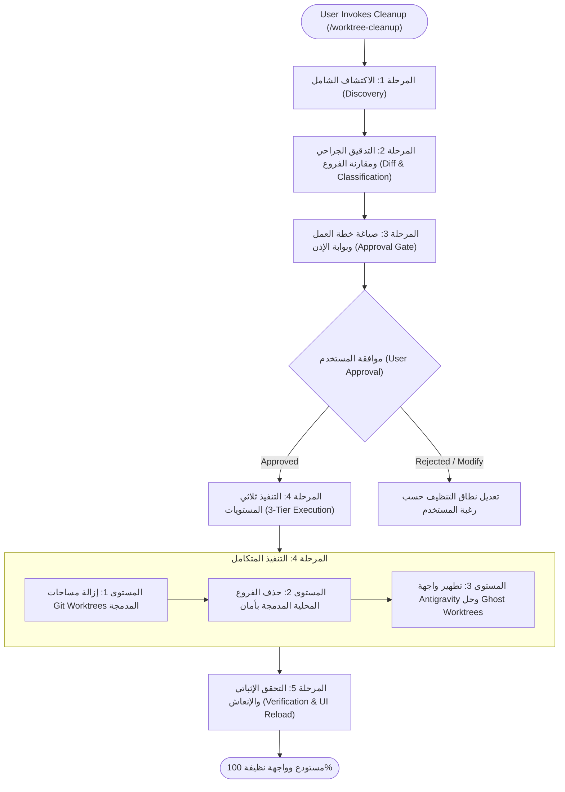

# 🧹 Git Worktree Janitor & Antigravity UI Sanitizer

> **Core Philosophy**: Maintain a pristine, clutter-free development environment with **Mathematical Zero Data Loss Protection**. Every branch and worktree must be audited before removal. Unmerged intellectual property is strictly protected, while merged, stale, and ghost entries are cleanly expunged across Git, the filesystem, and the Antigravity UI registry.

---

## 🚫 The Iron Rules (القوانين الحديدية)

1. **ZERO UNMERGED DATA LOSS**: Never delete any branch that contains unmerged commits (`Ahead of main > 0`) without explicit, unambiguous user confirmation detailing the exact commit list and diff.
2. **STRICT PRE-CLEANUP APPROVAL GATE**: Before executing any `git branch -d`, `git worktree remove`, or registry modification, produce a comprehensive cleanup plan artifact and wait for user approval.
3. **THREE-TIER SANITIZATION**: A complete cleanup must synchronize all three layers:
   - **Layer 1: Git Worktrees & Filesystem** (`git worktree remove` + `git worktree prune`).
   - **Layer 2: Local Git Branches** (`git branch -d`).
   - **Layer 3: Antigravity UI Registry** (`~/.gemini/config/projects/<id>.json` + `conversation_summaries.db` + proto cache).
4. **ALWAYS BACKUP REGISTRIES BEFORE WRITE**: Always create a `.bak` copy of `conversation_summaries.db` and the project configuration JSON before modifying them.

---

## 🧭 End-to-End Workflow Architecture



---

## 🔍 المرحلة 1: الاكتشاف الشامل (Discovery Phase)

1. **تحديد جذر المشروع والفرع الرئيسي المعتمد**:
   ```powershell
   git rev-parse --show-toplevel
   # تحديد الفرع الرئيسي (main أو master)
   $mainBranch = if (git rev-parse --verify refs/heads/main 2>$null) { "main" } else { "master" }
   ```

2. **فحص الفروع المحلية والبعيدة**:
   ```powershell
   git branch -a -vv
   ```

3. **فحص مساحات العمل الحالية في Git**:
   ```powershell
   git worktree list
   ```

4. **فحص سجل بيئات Antigravity الداخلية (Internal Project Registry)**:
   - البحث عن ملف إعدادات المشروع الحالي في مسار المستخدم:
     - **Windows**: `C:\Users\<Username>\.gemini\config\projects\`
     - **macOS / Linux**: `~/.gemini/config/projects/`
   - قراءة مصفوفة `"environments"` لمعرفة مساحات العمل الشبحية المسجلة في واجهة Antigravity.

---

## 🔬 المرحلة 2: التدقيق الجراحي ومقارنة الفروع (Surgical Diff & Classification)

لكل فرع محلي مفتوح (بخلاف الفرع الرئيسي `main`):

1. **حساب مسافة التباعد (`Ahead` / `Behind`)**:
   ```powershell
   $ahead = (git rev-list --count "$mainBranch..$branch")
   $behind = (git rev-list --count "$branch..$mainBranch")
   ```

2. **التدقيق مع عزل اختلافات نهايات الأسطر (CRLF vs LF)**:
   - في بيئات ويندوز، قد يظهر ملف معدلاً بسبب فواصل الأسطر فقط. قم دائماً بالتدقيق عبر:
     ```powershell
     git diff --ignore-space-at-eol --stat "$mainBranch...$branch"
     ```

3. **تصنيف الفروع بدقة رقمية**:
   - 🟢 **الفئة (أ) - آمنة للحذف الفوري (Fully Merged)**:
     - `Ahead = 0`: كل تجميعاتها مدمجة بالكامل في الفرع الرئيسي. حذفها آمن 100% وخالٍ من أي مخاطرة.
   - 🟡 **الفئة (ب) - فروع شكلية خالية من كود فعلي (Zero Logic / Stale)**:
     - `Ahead > 0` ولكن ناتج `git diff --ignore-space-at-eol` لا يحتوي على أي أسطر كود مفيدة (فقط اختلافات مسافات بيضاء أو تجميعات مكررة).
   - 🔴 **الفئة (ج) - تحتوي على كود غير مدمج (Unmerged Changes - RETAIN)**:
     - `Ahead > 0` مع وجود أسطر كود حقيقية لم تدخل الفرع الرئيسي.
     - **قاعدة حديدية**: يُحظر حذف هذه الفروع، ويجب عرض قائمة التجميعات الخاصة بها للمستخدم.

---

## 📋 المرحلة 3: خطة العمل وبوابة إذن المستخدم (Approval Gate)

1. إنشاء وثيقة تقرير وخطة العمل كـ **Artifact** تحت اسم `cleanup_plan.md` مع تعيين `RequestFeedback: true`.
2. تضمين:
   - جدول الفروع وتصنيفها (`Ahead`, `Behind`, الحالة).
   - قائمة مساحات العمل المنتهية المطلوب حذفها.
   - قائمة بيئات العمل الشبحية المراد مسحها من واجهة Antigravity.
   - التحذيرات إن وجدت فروع تحوي كوداً غير مدمج (الفئة ج).
3. **التوقف التام عن تنفيذ أي أوامر حذف** حتى يمنح المستخدم الموافقة الصريحة.

---

## ⚡ المرحلة 4: التنفيذ الجراحي ثلاثي المستويات (3-Tier Execution)

بمجرد اعتماد المستخدم للخطة، نفذ الخطوات التالية بالتسلسل:

### المستوى 1: إزالة مساحات عمل Git المنتهية (`Worktrees Pruning`)
1. إزالة كل مساحة عمل تابعة لفرع تم دمجه:
   ```powershell
   git worktree remove --force "<Path_To_Worktree>"
   ```
2. تنظيف مؤشرات Git الداخلية:
   ```powershell
   git worktree prune
   ```
3. التحقق من خلو مجلد مساحات العمل:
   ```powershell
   Get-ChildItem -Path "C:\Users\<Username>\.gemini\antigravity\worktrees\<project_name>"
   ```

### المستوى 2: حذف الفروع المحلية المدمجة بأمان (`Branch Deletion`)
1. حذف فروع الفئة (أ) باستخدام الحذف الآمن (`-d` فقط لضمان التحقق من الدمج):
   ```powershell
   git branch -d <branch_name_1> <branch_name_2>
   ```
2. في حال كان الفرع من الفئة (ب) ووافق المستخدم صراحة على إتلافه، يُستخدم `-D`.

### المستوى 3: تطهير واجهة Antigravity والتخلص من `Ghost Worktree Overflow`
هذا هو المستوى الحاسم لحل مشكلة استمرار ظهور الفروع في واجهة التطبيق والهاتف:

1. **تطهير ملف تسجيل المشروع الداخلي (`config/projects/*.json`)**:
   - أخذ نسخة احتياطية:
     ```powershell
     Copy-Item "C:\Users\<Username>\.gemini\config\projects\<project-id>.json" "C:\Users\<Username>\.gemini\config\projects\<project-id>.json.bak" -Force
     ```
   - تفريغ مصفوفة `"environments"` للبيئات المحذوفة:
     ```json
     "environments": {
       "environments": []
     }
     ```
   - حفظ الملف بترميز UTF-8 صالح.

2. **تطهير قاعدة بيانات الجلسات (`conversation_summaries.db`)**:
   - أخذ نسخة احتياطية:
     ```powershell
     Copy-Item "C:\Users\<Username>\.gemini\antigravity\conversation_summaries.db" "C:\Users\<Username>\.gemini\antigravity\conversation_summaries.db.bak" -Force
     ```
   - توجيه المحادثات السابقة لترتبط بالمسار الأصلي للمشروع بدلاً من مسارات مساحات العمل المحذوفة:
     ```powershell
     sqlite3 "C:\Users\<Username>\.gemini\antigravity\conversation_summaries.db" "UPDATE conversation_summaries SET workspace_uris = '[\""file:///<Root_Project_Uri>\""]' WHERE workspace_uris LIKE '%worktrees/<project_name>/%';"
     ```

3. **حذف كاش الـ Protobuf القديم**:
   - أخذ نسخة احتياطية ثم حذف ملف الكاش القديم لإجبار التطبيق على إعادة القراءة من السجل النظيف:
     ```powershell
     Copy-Item "C:\Users\<Username>\.gemini\antigravity\agyhub_summaries_proto.pb" "C:\Users\<Username>\.gemini\antigravity\agyhub_summaries_proto.pb.bak" -Force -ErrorAction SilentlyContinue
     Remove-Item "C:\Users\<Username>\.gemini\antigravity\agyhub_summaries_proto.pb" -Force -ErrorAction SilentlyContinue
     ```

---

## 🎯 المرحلة 5: التحقق الإثباتي وتوجيه الإنعاش (Verification)

1. **التحقق من Git**:
   - تشغيل `git branch -a -vv` للتأكد من عدم وجود سوى الفرع الرئيسي `main`.
   - تشغيل `git worktree list` للتأكد من وجود مسار العمل الأصلي فقط.
2. **التحقق من ملفات الإعدادات**:
   - التأكد من أن مصفوفة `"environments"` فارغة وخالية من البيئات الشبحية.
3. **توجيه المستخدم لتحديث الواجهة**:
   - شرح خطوة إنعاش الواجهة بوضوح:
     - **على الكمبيوتر**: إغلاق نافذة تطبيق Antigravity وفتحها مجدداً (Restart) أو الضغط على `Ctrl + R`.
     - **على الهاتف**: عمل Refresh لصفحة المتصفح أو تطبيق الهاتف بعد إعادة فتح تطبيق الكمبيوتر، لتحديث المزامنة السحابية فوراً.
