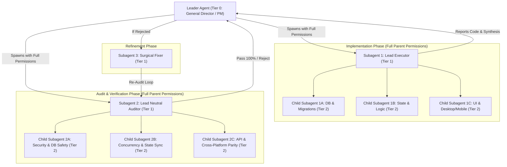

# Multi-Agent Orchestrator (المنسق متعدد الوكلاء الهرمي)

## Overview & Governance Rules

This skill transforms the primary agent into a **Leader Agent (PM/General Director)** managing a **Hierarchical Multi-Tier Tree of Subagents**. Every subagent is empowered with **full parent permissions** (`enable_write_tools: true`, `enable_subagent_tools: true`, `enable_mcp_tools: true`), enabling recursive task decomposition where any subagent can autonomously spawn specialized child subagents (Tier 2+) as needed for complex architectures.

The orchestrator coordinates a strict, multi-pass refinement loop integrating `/coderabbit-guard` with **Completely Neutral Auditing Subagents** to guarantee complete compliance with the project constitution (`.specify/memory/constitution.md`), clean architecture, zero false success declarations, and zero-error commit readiness.

---

## 🌳 Hierarchical Multi-Tier Subagent Architecture



---

## ⚙️ Mandatory Permission Configuration for All Subagents

Whenever defining or invoking ANY subagent in this workflow, the following configuration is **MANDATORY**:

```json
{
  "enable_write_tools": true,
  "enable_subagent_tools": true,
  "enable_mcp_tools": true
}
```
*(Or use `self` subagents when cloning full parent capabilities).*

---

## 📋 Strict Execution Workflow

### Phase 0: Environment & Constitution Discovery (Zero-Code Phase)
Before invoking any subagent, the Leader Agent MUST inspect:
1. Workspace constitution and rules (`.specify/memory/constitution.md`, `.agents/rules/GEMINI.md`).
2. Active MCP servers (`dart-mcp-server`, `code-index-mcp`, `graphify`, `duckduckgo`).
3. Installed skills and CLI tools (`flutter analyze`, `flutter test`, `coderabbit-guard`).
4. Construct role-tailored system prompts for Tier 1 Lead Subagents, explicitly authorizing them to spawn child subagents if the task touches multiple layers (DB, Riverpod, UI).

---

### Phase 1: Subagent 1 (Lead Executor) - Research, Tree Delegation & Implementation
- **Turn 1 (Zero-Code Rule)**: The Lead Executor is strictly forbidden from modifying files in its first turn. It MUST use `dart-mcp-server` (LSP / Find References), `graphify`, and `view_file` to map the codebase.
- **Autonomous Tree Decomposition (Tier 2 Subagents)**:
  - If the task is multi-faceted, the Lead Executor MUST use `define_subagent` / `invoke_subagent` (with `enable_write_tools: true` & `enable_mcp_tools: true`) to spawn specialized child subagents:
    - `Child 1A (DB Specialist)`: For Drift, SQLite migrations, and local tables.
    - `Child 1B (State/Logic Specialist)`: For Riverpod Notifiers, Outbox controllers, and repositories.
    - `Child 1C (UI Specialist)`: For responsive widgets, keyboard shortcuts, and screen layouts.
- **Integration & Review**: The Lead Executor aggregates the code written by child subagents, verifies cohesion, and reports completion to the Leader Agent.

---

### Phase 2: Subagent 2 (Lead Neutral CodeRabbit Guard Auditor)
The Lead Auditor MUST be spawned with a **strictly neutral, zero-author-bias prompt**. It treats all modified code as untrusted 3rd-party code.

- **Recursive Audit Delegation (Tier 2 Subagents)**:
  The Lead Auditor defines and invokes parallel specialized auditor subagents:
  1. **Auditor 2A (Security & DB Safety)**: Parameterized queries, schema alignment, data leaks, swallowed errors, SQLite runtime DDL safety.
  2. **Auditor 2B (Concurrency, State & Persistence Sync)**: Reactive stream invalidation (`markTablesUpdated` / provider refresh), async context safety (`if (!mounted)`), state vs DB desync, and **Mandatory Red-Teaming** (rapid double-taps, poison-pill queue clogging, unhandled I/O failures).
  3. **Auditor 2C (API Contracts & Cross-Platform Parity)**: Signature changes, caller breakage, Windows Desktop keyboard handling vs Android Touch parity.
- **Linter & Static Analysis**: Runs `flutter analyze` directly to capture all compiler & linter warnings.
- **Synthesis & Severity Rating**:
  - Aggregates findings from child auditors into `[CRITICAL]`, `[MAJOR]`, `[MINOR]`.
  - Provides exact line references `[file_basename](file:///path/to/file#L10-L25)` and concrete diff suggestions.
  - Declares whether the code is **"100% VERIFIED CLEAN & READY FOR COMMIT"** or **"REJECTED - REQUIRES FIXES"**.

---

### Phase 3: Subagent 3 (Surgical Fixer) & Iterative Refinement Loop
If the Lead Auditor reports ANY `[CRITICAL]` or `[MAJOR]` issues (or score < 100%):
1. **Subagent 3 (Surgical Fixer)** is launched with full write permissions and the exact Auditor diff report to apply surgical fixes.
2. **Mandatory Re-Audit Rule**: ANY modification made by the Fixer MUST trigger a fresh re-audit cycle by **Lead Neutral Auditor (Subagent 2)** and its specialized auditing tree.
3. The loop (`Fixer` ➔ `Lead Auditor`) MUST continue until the Lead Auditor explicitly declares **0 CRITICAL, 0 MAJOR issues, 0 analyze errors, and 100% READY FOR COMMIT**.

---

### Phase 4: Leader Verification Gate & Circuit Breaker
The Leader Agent continuously oversees the tree:
- **Mandatory Leader Checkpoint**: BEFORE presenting the final answer or updating the PM artifact, the Leader Agent MUST independently run `flutter analyze` directly in the terminal to empirically verify **0 syntax errors, 0 linter errors, and exit code 0**. NEVER rely solely on subagent claims without executing the verification command directly.
- **Loop End (Success)**: Leader Agent verifies 100% CodeRabbit pass, 0 `flutter analyze` errors, and clean commit status.
- **Circuit Breaker**: If oscillation or repetition occurs (> 3 iterations), Leader Agent halts child subagents and directly resolves the bottleneck.

---

## Deliverable: PM Executive Summary Artifact

Upon completion, the Leader Agent MUST create an **Executive Summary Artifact** for the non-programmer PM formatted as follows:

```markdown
# 📊 Executive Summary: [Feature / Task Name]

## 💡 Business Value & Key Updates
- [Clear non-technical description of what was built or fixed]
- [User experience impact]

## 🌳 Subagent Tree Execution
- **Lead Executor**: Decomposed into [X] child specialists.
- **Lead Neutral Auditor**: Multi-tier audit across Security, Concurrency, and Platform Parity.
- **Refinement Iterations**: [X] Rounds

## 🔍 Audit & Quality Assurance Loop
- **CodeRabbit Guard Pass Status**: 100% Verified Clean & Ready for Commit
- **Bugs Prevented**: [List of bugs/flaws caught during auditing and fixed]

## 🧾 Proof Matrix (Empirical Evidence)
```text
[Exact terminal output of flutter analyze - 0 errors, 0 warnings]
```

## 🎯 PM Verification Guide
1. Open the application.
2. [Step-by-step simple instructions for the PM to test the feature]
```
