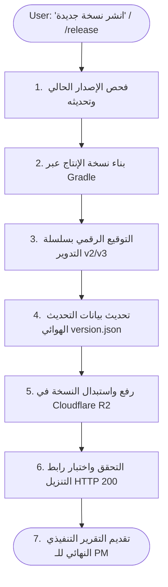

# 🚀 AntiPorn Autonomous Release & Distribution Publisher

> **Core Purpose**: Completely automates the production release lifecycle for AntiPorn: increments version numbers, compiles an ultra-compact production APK with R8 and 64-bit ABI pruning, signs with the official keystore via v2/v3 Lineage Rotation, deploys and overwrites the active release on Cloudflare R2, updates OTA metadata, validates the public download link, and ensures the permanent QR provisioning code remains 100% active.

---

## 🧭 The Autonomous Release Workflow



---

## 📋 Operational Instructions for the Agent

When this skill is activated, execute the following stages autonomously:

### المرحلة 1: تحديد بيانات الإصدار (Version Bump)
1. اقرأ ملف [`app/build.gradle.kts`](file:///D:/b/antiporn/app/build.gradle.kts) لاستخراج `versionCode` و `versionName` الحاليين.
2. إذا حدد المستخدم رقماً واسماً للإصدار في طلبه (مثلاً: "إصدار 1.2 برقم 3")، اعتمد ذلك مباشرة.
3. إذا لم يحدد، قم بزيادة `versionCode` تلقائياً بمقدار `+1` واقترح الترقية المنطقية لـ `versionName` (مثلاً من `1.0` إلى `1.1`).
4. حدّث القيم في `app/build.gradle.kts`.

---

### المرحلة 2: بناء حزمة الإنتاج المصغرة (Compile Release APK)
1. شغّل أمر البناء الرسمي في موجه الأوامر:
   ```powershell
   .\gradlew.bat assembleRelease
   ```
2. تأكد من خروج الملف بنجاح في المسار:
   `app\build\outputs\apk\release\app-release.apk`
3. تحقق من أن الحجم لا يتجاوز 28 ميجابايت (متضمناً نموذجي الذكاء الاصطناعي `halalify_v2.tflite` و `nudenet_320.onnx` وتقليص معمارية `arm64-v8a`).

---

### المرحلة 3: التوقيع الرقمي بنظام التدوير الرسمي (v2/v3 Lineage Signing)
1. اضبط متغير بيئة كلمة المرور الرسمية المعتمدة:
   ```powershell
   $env:RELEASE_KEYSTORE_PASSWORD = "REDACTED_KEYSTORE_PASSWORD"
   ```
2. شغّل سكريبت التوقيع بسلسلة التدوير:
   ```powershell
   powershell -ExecutionPolicy Bypass -File scripts\sign_rotated_release.ps1
   ```
3. تأكد من إنتاج الملف النهائي الموقّع:
   `app\build\outputs\apk\release\app-release-rotated.apk`
4. تحقق من أن التحقق يطبع:
   * `Verified using v2 scheme: true`
   * `Verified using v3 scheme: true`
   * بصمة الشهادة: `0b18bb0ca9f775d7095d822e0cd5dd94a37ce04b8abbc05fd0bd129123c238c9` (المقابلة للـ Checksum: `Cxi7DKn3ddcJXYIuDNXdlKN84EuKu8Bf0L0SkSPCOMk`).

---

### المرحلة 4: تحديث بيانات التحديث الهوائي (OTA Metadata)
1. قس حجم الملف الموقّع بالبايت.
2. حدّث ملف [`version.json`](file:///D:/b/antiporn/version.json) بالبيانات الجديدة:
   ```json
   {
     "versionCode": <NEW_CODE>,
     "versionName": "<NEW_NAME>",
     "minSupportedVersion": 1,
     "apkFileName": "antiporn-release.apk",
     "downloadUrl": "https://example-releases.r2.dev/antiporn-release.apk",
     "fileSizeBytes": <EXACT_BYTES>,
     "sha256CertificateChecksum": "Cxi7DKn3ddcJXYIuDNXdlKN84EuKu8Bf0L0SkSPCOMk",
     "releaseNotes": "<USER_OR_SUMMARY_NOTES>",
     "releaseDate": "<CURRENT_DATE_YYYY-MM-DD>"
   }
   ```

---

### المرحلة 5: الرفع والاستبدال على Cloudflare R2
1. شغّل سكريبت الرفع إلى الـ Bucket المخصص:
   ```powershell
   powershell -ExecutionPolicy Bypass -File scripts\deploy_r2_distribution.ps1
   ```
2. تأكد من رفع الملفات التالية واستبدال القديم في `antiporn-releases`:
   * `app-release-rotated.apk` باسم `antiporn-release.apk` ونوع `application/vnd.android.package-archive`.
   * `version.json` بنوع `application/json`.

---

### المرحلة 6: التحقق وضمان سلامة رابط التحميل والـ QR Code
1. تأكد من عمل فحص `HEAD` للرابط العام للتأكد من استجابته بـ `HTTP 200`:
   ```powershell
   Invoke-WebRequest -Uri "https://example-releases.r2.dev/antiporn-release.apk" -Method Head
   ```
2. تأكد من أن ملف [`provisioning_payload.json`](file:///D:/b/antiporn/provisioning_payload.json) وصورة [`provisioning_qr.png`](file:///D:/b/antiporn/provisioning_qr.png) محدثان.
3. ارفع صورة الـ QR إلى R2 إذا لزم الأمر:
   ```powershell
   wrangler r2 object put "antiporn-releases/provisioning_qr.png" --file="provisioning_qr.png" --content-type="image/png" --remote --force
   ```

---

### المرحلة 7: تقديم التقرير للـ PM (Executive Presentation)
أبلغ المستخدم بأسلوب مختصر، وواضح، وخالٍ من الأخطاء:
* تأكيد رقم الإصدار الجديد الذي تم نشره بنجاح.
* حجم الملف المرفوع.
* روابط التنزيل المباشرة للتطبيق ولبيانات الإصدار OTA.
* التأكيد التام للمستخدم أن رمز الـ QR السابق ما زال صالحاً ودائماً ولن يحتاج للتغيير.
