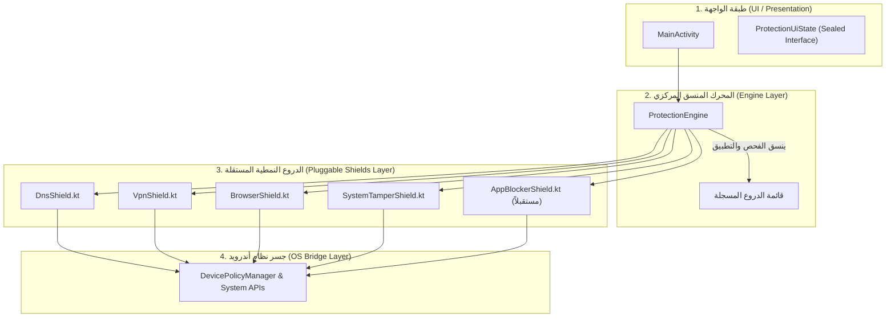

# 📜 دستور هندسة كوتلين وأندرويد لتطبيقات الحماية الذاتية
# Kotlin & Android Device Owner Engineering Constitution

> **الإصدار:** 1.2.0  
> **النطاق:** مشروع AntiPorn وكافة أنظمة الحماية الذاتية بصلاحية Device Owner على أندرويد.  
> **الفئة المستهدفة:** مطورو البرمجيات ونماذج الذكاء الاصطناعي (AI Coding Agents) العاملة على هذا المستودع.  
> **الإلزامية:** هذا الدستور ملزم تعاقدياً بنسبة 100%، ولا يجوز لأي وكيل ذكاء اصطناعي تجاوزه تحت أي ظرف.

---

## 🏛️ الباب الأول: المبادئ الحاكمة غير القابلة للتفاوض (Immutable Core Laws)

### 🔴 المادة 1: قدسية بيئة المطور وتصحيح أخطاء USB (Developer ADB Preservation)
> [!CAUTION]
> **قاعدة أمنية قطعية:**
> * صاحب الهاتف يعمل في **مجال تطوير وبرمجة تطبيقات الأجهزة الذكية**.
> * **يُمنع منعاً باتاً ومطلقاً** تحت أي مبرر تطبيق القيود التالية:
>   - `UserManager.DISALLOW_DEBUGGING_FEATURES`
>   - `UserManager.DISALLOW_CONFIG_DEVELOPER_OPTIONS`
> * أي نموذج ذكاء اصطناعي يقترح أو يكتب كوداً يفعّل هذين القيدين يُعتبر مرتكباً لخطأ أمني فادح يؤدي لعزل المطور وحبسه خارج هاتفه.
> * سطر أوامر **ADB عبر الحاسوب** هو المنفذ الوحيد المعتمد لإلغاء القفل، تصحيح الأخطاء، أو حذف التطبيق.

### 🔴 المادة 2: الحماية على مستوى نواة الشبكة (System & Network Stack Level)
* لا يجوز الاعتماد على حلول واجهات المستخدم السطحية (مثل مراقبة العناوين في المتصفحات عبر Accessibility Service) كبديل لدرع الشبكة.
* الحماية الأساسية تكون دائماً مشفرة وعميقة عبر:
  1. فرض **NextDNS over TLS** على مستوى النظام (`DevicePolicyManager.setGlobalPrivateDnsModeSpecifiedHost`).
  2. قفل واجهة الـ DNS في الإعدادات (`DISALLOW_CONFIG_PRIVATE_DNS`).
  3. حظر بروتوكولات الـ VPN بالكامل (`DISALLOW_CONFIG_VPN`).

### 🔴 المادة 3: منع الالتفاف السلوكي والنفسي الشامل (Zero-Bypass Architecture)
* لا تقتصر الحماية على الـ DNS؛ بل يجب إغلاق كافة المنافذ البديلة التي يلجأ إليها العقل في لحظات الضعف:
  * **الوضع الآمن (Safe Mode):** محظور إجبارياً عبر `DISALLOW_SAFE_BOOT`.
  * **المستخدمون المتعددون والضيوف:** محظور إجبارياً عبر `DISALLOW_ADD_USER` و `DISALLOW_USER_SWITCH`.
  * **مساحات استنساخ النظام (System Cloner / Work Profiles):** محظورة عبر `DISALLOW_ADD_MANAGED_PROFILE`.
  * **وضع التصفح المتخفي (Incognito Mode):** معطل إجبارياً على مستوى المتصفحات عبر `setApplicationRestrictions`.
  * **إلغاء التثبيت وفورمات الجهاز:** محظور عبر `setUninstallBlocked` و `DISALLOW_FACTORY_RESET`.

### 🔴 المادة 4: التجريب والإثبات الواقعي قبل إعلان النجاح (Empirical Proof Gate)
* يُحظر على أي نموذج ذكاء اصطناعي إعلان نجاح المهمة بناءً على الافتراض النظري.
* إعلان النجاح يتطلب حصراً:
  1. `.\gradlew.bat compileDebugSources` بدون أي خطأ.
  2. `.\gradlew.bat lintDebug` بصفر أخطاء (`0 errors`).
  3. اختبار مباشر على الجهاز المتصل والتحقق من سجلات `Logcat` الحية.

---

## ⚠️ الباب الثاني: كتالوج أخطاء نماذج الذكاء الاصطناعي في Kotlin & Android
**(AI Hallucination & Failure Catalog)**

هذا القسم يوثق أخطر الأخطاء الشائعة التي تقع فيها نماذج الذكاء الاصطناعي (مثل GPT و Claude و Gemini) عند كتابة كود Kotlin وأندرويد، مع بيان المعيار الإلزامي لتفاديها:

### 1. فخ الأنواع المنصية وانعدام التحقق من الفراغ (Platform Types & NPE Traps)
* **المشكلة:** دوال أندرويد SDK الأصلية مكتوبة بلغة Java. عندما تستدعيها بلغة Kotlin، يعامل المترجم النتيجة كـ `Platform Type` (تظهر كـ `Type!`). تفترض نماذج AI خطأً أن القيمة غير فارغة وتستدعي الدوال عليها مباشرة (مثل `restrictions.getInt(...)`)، وعندما ترجع الدالة `null` في بعض الأجهزة أو الإصدارات ينهار التطبيق فوراً بـ `NullPointerException`.
* **المعيار الإلزامي:**  
  يجب معاملة أي قيمة مرجعة من دوال نظام أندرويد (الـ Framework APIs) كقيمة اختيارية قابلة للفراغ (`Nullable - Type?`) واستخدام عوامل الأمان التلقائية في كوتلين (`?.` و `?:`) وتطويقها بـ `try-catch` مخصص.
  ```kotlin
  // ❌ خطأ شائع من نماذج الـ AI (يسبب NPE):
  val bundle = dpm.getApplicationRestrictions(admin, pkg)
  val mode = bundle.getInt("IncognitoModeAvailability")

  // ✅ المعيار الصارم المعتمد:
  val bundle: Bundle? = try { dpm.getApplicationRestrictions(admin, pkg) } catch (e: Exception) { null }
  val isLocked = bundle?.getInt("IncognitoModeAvailability", 0) == 1
  ```

---

### 2. تسريب الذاكرة وسياق التطبيق (Context Leaks)
* **المشكلة:** تقوم نماذج AI بتمرير سياق الشاشة (`Activity Context`) إلى كائنات وحيدة ممتدة الأجل (Singletons / `object`) مثل `DnsManager`، أو تخزين مراجع الـ Views في خيوط خلفية، مما يمنع Garbage Collector من تنظيف الشاشات عند تدوير الهاتف أو إغلاقه ويؤدي لنفاد ذاكرة الرام (`OutOfMemoryError`).
* **المعيار الإلزامي:**  
  أي كائن ممتد الأجل أو `object` أو دالة خلفية يجب أن تستخدم حصراً سياق التطبيق العام:
  ```kotlin
  // ❌ خطأ AI:
  fun applyPolicies(context: Context) { this.savedContext = context }

  // ✅ المعيار الصارم:
  fun applyPolicies(context: Context) {
      val appContext = context.applicationContext
      // استخدام appContext حصراً
  }
  ```

---

### 3. إسقاط الاستدعاءات المتزامنة وتجميد الأزرار (Callback Dropping & UI Freeze)
* **المشكلة:** لمنع التكرار، تضع نماذج الـ AI قفل فحص ساذج مثل `if (!isEnforcing.compareAndSet(false, true)) return`. وإذا ضغط المستخدم الزر أثناء تنفيذ خلفي سابق، يتم تجاهل طلبه وإسقاط دالة الرد (`onComplete`) دون استدعائها. ولأن الزر في الواجهة يتم تعطيله (`btn.isEnabled = false`) انتظاراً للرد؛ فإن إسقاط الـ Callback يجعل الزر معطلاً للأبد!
* **المعيار الإلزامي:**  
  يجب استخدام قائمة انتظار متزامنة آمنة للخيوط (`CopyOnWriteArrayList<(Result) -> Unit>`) تجمع كافة دوال الرد المعلقة، وتقوم بإخطارها جميعاً على خيط الواجهة الرئيسي (`Looper.getMainLooper()`) فور اكتمال التنفيذ لضمان إعادة تفعيل الأزرار دائماً.

---

### 4. حلقة الفحص والتنفيذ اللانهائية مع المراقبين (Observer Feedback Loops)
* **المشكلة:** تقوم نماذج AI بإنشاء مراقب للإعدادات (`ContentObserver`) لمراقبة `private_dns_mode`. وبمجرد حدوث أي تغيير، تقوم الدالة باستدعاء `dpm.setGlobalPrivateDnsModeSpecifiedHost`. ولكن كتابة الإعدادات تُطلق حدث تغيير جديد في الـ Observer، فيعيد المراقب طلب التطبيق، ليدخل التطبيق في حلقة تكرار لانهائية كل نصف ثانية تستنزف البطارية والمعالج!
* **المعيار الإلزامي (Check-Before-Write):**  
  يُحظر منعاً باتاً استدعاء دوال الكتابة المؤسسية إذا كانت القيمة الحالية مطابقة بالفعل للقيمة المستهدفة:
  ```kotlin
  // ✅ فحص الحالة الحالية قبل الكتابة لمنع الحلقة اللانهائية:
  val currentMode = dpm.getGlobalPrivateDnsMode(admin)
  val currentHost = dpm.getGlobalPrivateDnsHost(admin)
  if (currentMode != DevicePolicyManager.PRIVATE_DNS_MODE_PROVIDER_HOSTNAME || currentHost != NEXTDNS_HOST) {
      dpm.setGlobalPrivateDnsModeSpecifiedHost(admin, NEXTDNS_HOST)
  } else {
      // تخطي الكتابة لعدم إثارة الـ Observer
  }
  ```

---

### 5. قيود خدمات الخلفية الصارمة (Android 12 & 14+ FGS Restrictions)
* **المشكلة:** تفشل نماذج AI في مواكبة تطور قيود أندرويد الصارمة على الخدمات الخلفية:
  1. تشغيل `Foreground Service` من الخلفية يسبب انهيار `ForegroundServiceStartNotAllowedException` في أندرويد 12+.
  2. في أندرويد 14+ (API 34)، تشغيل خدمة بدون تصريح نوع الخدمة الصريح داخل المانيفست يسبب انهياراً فورياً.
* **المعيار الإلزامي:**
  1. الاستفادة من استثناءات صفة مسؤول الجهاز (`Device Owner`) المسموح لها بتشغيل الخدمات.
  2. تحديد نوع الخدمة الصريح: `foregroundServiceType="specialUse"` مع إضافة خاصية `PROPERTY_SPECIAL_USE_FGS_SUBTYPE`.
  3. استدعاء `startForeground()` خلال أقل من 5 ثوانٍ من إنشاء الخدمة.
  4. المنح التلقائي الصامت لإذن الإشعارات `POST_NOTIFICATIONS` بصلاحية Device Owner على أندرويد 13 فما فوق.

---

### 6. ثغرة الإقلاع بدون إنترنت (Boot-without-Network Loophole)
* **المشكلة:** عند استقبال بث إعادة تشغيل الهاتف (`ACTION_BOOT_COMPLETED`)، لا يكون الاتصال بالإنترنت (الواي فاي أو بيانات الهاتف) قد تم ربطه بعد. محاولة فحص خادم الـ DNS عبر TLS ترجع الخطأ `PRIVATE_DNS_SET_ERROR_HOST_NOT_SERVING` (1) ولا يتم حفظ الـ DNS. وإذا كان التطبيق يراقب فقط تغييرات الإعدادات، فإن عودة الإنترنت لاحقاً لا تُعيد تطبيق الـ DNS ويبقى الهاتف مكشوفاً!
* **المعيار الإلزامي:**  
  تسجيل مراقب لشبكة الاتصال (`ConnectivityManager.NetworkCallback`) داخل خدمة المراقبة للتحقق التلقائي وإعادة فرض الـ DNS فور توفر الإنترنت.

---

### 7. كتم الأخطاء بصمت (Silent Exception Swallowing)
* **المشكلة:** تلجأ نماذج AI الكسولة لكتابة:
  ```kotlin
  // ❌ كارثة برمجية:
  try { ... } catch (e: Exception) {}
  ```
* **المعيار الإلزامي:**  
  يُمنع منعاً باتاً ترك كتل `catch` فارغة أو إعادة قيم افتراضية زائفة. يجب دائماً تسجيل الخطأ بوضوح عبر `Log.e(TAG, "...", e)` أو إعادته في كائن النتيجة للمستخدم لعرضه في الواجهة.

---

### 8. النصوص المكتوبة يدوياً وتراكم تحذيرات الـ Lint
* **المشكلة:** كتابة النصوص العربية أو الإنجليزية مباشرة داخل ملفات Kotlin أو الـ XML (`HardcodedText`).
* **المعيار الإلزامي:**  
  كافة النصوص بلا استثناء يجب تعريفها داخل `res/values/strings.xml` واستدعاؤها عبر `getString(R.string...)` أو `@string/...` للحفاظ على نظافة المشروع وخلو تقرير الـ Lint من التحذيرات.

---

### 9. حظر استخدام الإيموجي في واجهات المستخدم (Strict No-Emoji UI Rule)
* **المشكلة:** تميل نماذج الذكاء الاصطناعي لوضع إيموجي ملونة (مثل 🛡️, 🔒, 🚫, 👑, ⏳, ⚠️) بكثافة داخل نصوص الأزرار، العناوين، مربعات الحوار، والإشعارات. هذا يجعل التطبيق يبدو غير احترافي كأنه تطبيق هواة، ويسبب تشوهاً بصرياً لعدم اتساق أشكال الإيموجي عبر أجهزة أندرويد المختلفة (Samsung vs Xiaomi vs Google Pixel)، كما يكسر محاذاة الخط العربي وتناسق المسافات (RTL Alignment).
* **المعيار الإلزامي:**  
  يُمنع منعاً باتاً ومطلقاً استخدام الإيموجي Unicode في واجهات المستخدم نهائياً (في ملفات `activity_*.xml` أو نصوص `strings.xml` أو عناوين الإشعارات والـ Toasts).  
  **البديل الاحترافي الإلزامي:** استخدام أيقونات Material المتجهة الرسمية (`VectorDrawable` / `MaterialIcons` / `@drawable/...`) بجانب النصوص لتوفير مظهر مؤسسي أنيق وموحد على كافة الشاشات.

---

### 10. صمام أمان إضافة الحسابات بعد التفعيل (Account Lockout Prevention)
* **المشكلة:** عند نجاح تفعيل صلاحية المالك (Device Owner)، يقوم الذكاء الاصطناعي أحياناً بفرض قيد `DISALLOW_MODIFY_ACCOUNTS` فورياً. وبما أن المستخدم أزال حساباته كشرط مسبق لأندرويد، فإن تفعيل هذا القيد يمنعه نهائياً من تسجيل الدخول لحساب Google مجدداً، ويحبسه خارج المتجر وخدمات الهاتف!
* **المعيار الإلزامي:**  
  يُحظر منعاً باتاً على أي نموذج AI كتابة كود يفعّل قيد منع تعديل الحسابات تلقائياً عند الإقلاع أو فور الترقية. يجب ترك إمكانية إضافة الحسابات متاحة دائماً، أو اشتراط تأكيد صريح ومستقل من المستخدم بعد إتمام تسجيل دخوله لحساب Google.

---

### 11. التوقيت التراكمي ومحرك الوقت الحقيقي الموثوق (Monotonic Trusted Time Enforcing)
* **المشكلة:** يعتمد الذكاء الاصطناعي بصورة تلقائية على توقيت الجدار وساعة الهاتف (`System.currentTimeMillis()`) لحساب المدد الزمنية ومواعيد انتهاء الحظر (مثل وضع القيلولة أو الحظر الليلي أو مهلة الفك الاضطراري). هذا يفتح ثغرة سلوكية قاتلة؛ حيث يقوم المستخدم بتقديم أو تأخير ساعة النظام للهروب من الحظر وفكه!
* **المعيار الإلزامي:**  
  كافة المؤقتات وحسابات مدد الحظر والجداول الزمنية يجب أن تعتمد حصراً على محرك الوقت الموثوق `TrustedTimeProvider` الذي يربط بين الوقت الذري من خوادم NTP العالمية (مع مسار احتياطي عبر ترويسة HTTP Date) والوقت التراكمي المنوتوني `SystemClock.elapsedRealtime()` الذي يحسب نبضات المعالج ويستمر بالعد حتى أثناء وضع السكون العميق (Deep Sleep) ولا يتأثر نهائياً بتغيير ساعة الجهاز اليدوية أو المنطقة الزمنية.  
  يُحظر منعاً باتاً استدعاء `System.currentTimeMillis()` المباشر في أي منطق أمني أو حسابات انتهاء حظر، كما يجب جدولة منبهات أندرويد حصرياً عبر `AlarmManager.ELAPSED_REALTIME_WAKEUP` باستخدام فارق المدة العتادية.

---

### 12. حظر استنزاف البطارية بالحلقات الدوارة (Zero Busy-Waiting Rule)
* **المشكلة:** عند طلب مراقبة الشاشة أو التطبيقات النشطة، تقوم نماذج AI بإنشاء حلقة `while (true) { Thread.sleep(1000) }` أو تكرار متقارب، مما يرفع استهلاك المعالج ويفرغ بطارية الهاتف في ساعات قليلة، ويدفع نظام أندرويد لقتل التطبيق لفرط استهلاك الطاقة (ANR / Battery Whitelist Kill).
* **المعيار الإلزامي:**  
  يُحظر استخدام أي حلقات انتظار نشطة أو `Thread.sleep` في مهام المراقبة. يجب الاعتماد حصراً على إشارات النظام الحقيقية غير المتزامنة (`UsageEvents`, `NetworkCallback`, `AccessibilityEvents`, `AlarmManager.setExactAndAllowWhileIdle`).

---

### 13. حماية عناصر الواجهة بعد إغلاق الشاشات (Lifecycle Safety Guard)
* **المشكلة:** في العمليات الخلفية والمؤقتات التكرارية والـ Coroutines، يقوم الذكاء الاصطناعي باستدعاء عناصر الشاشة (مثل `viewBinder.updateUi()`) بعد انتهاء المهمة الخلفية. إذا كان المستخدم قد غادر التطبيق أو قام بتدوير الشاشة، تكون الـ Activity قد دُمّرت، مما يؤدي لانهيار فوري للتطبيق بـ `IllegalStateException` أو تسريب للذاكرة.
* **المعيار الإلزامي:**  
  أي استدعاء أو تحديث للواجهة قادم من عملية غير متزامنة أو مستمع خلفي أو `Runnable` يجب أن يُسبق إلزامياً بحارس دورة الحياة:
  ```kotlin
  if (!isFinishing && !isDestroyed) {
      viewBinder.updateUi()
  }
  ```

---

### 14. استباقية تراخيص المكتبات وتوافق المترجم (Packaging & Metadata Pre-flight)
* **المشكلة:** عند إضافة مكتبات برمجية جديدة (مثل مكتبات التشفير BouncyCastle أو شبكات ADB)، يتفاجأ الذكاء الاصطناعي بفشل البناء بسبب تكرار ملفات التراخيص (`META-INF/LICENSE.md`) أو تعارض إصدارات Kotlin Metadata الثنائية، ويبدأ في تخمين الحلول بعد فشل البناء.
* **المعيار الإلزامي:**  
  عند إضافة أي مكتبة جديدة للمشروع في مرحلة التخطيط، يجب استباقياً تضمين استثناءات الموارد المكررة داخل كتلة `packaging.resources.excludes` في `build.gradle.kts`، وضبط خيارات توافق المترجم `-Xskip-metadata-version-check` مسبقاً قبل أول تجميع.

---

---

### 15. الإلزام المعماري بنظام Material 3 والرموز الدلالية المتكيفة (Mandatory Material 3 & Semantic Theming)
* **المشكلة:** تقوم نماذج AI بوضع ألوان صلبة ثابتة (Hardcoded Colors مثل خلفية داكنة مسائية ثابتة على البطاقات مع نصوص تعتمد على سمات الوضع الفاتح ?attr/colorOnSurface)، مما ينتج عنه كارثة بصرية في الوضع الفاتح (Light Mode) بظهور نصوص داكنة فوق خلفيات شبه سوداء بنسبة تباين غير مقروءة إطلاقاً (1.1:1)، أو العكس بظهور نصوص بيضاء على خلفيات بيضاء في الوضع الداكن، فضلاً عن كسر اتساق لغة التصميم عبر الشاشات.
* **المعيار الإلزامي:**
  1. **الالتزام الكامل بنظام Material 3 Day/Night:** ترث كافة الشاشات والأنشطة ومربعات الحوار حصراً من ثيم ماتيريال 3 (Theme.Material3.DayNight.NoActionBar).
  2. **حظر تشفير ألوان الأسطح والنصوص صلبة:** يُحظر منعاً باتاً تلوين خلفيات البطاقات أو الحاويات أو ألوان النصوص بقيم ألوان صلبة ثابتة (مثل @color/shield_hero_bg أو @color/black أو @color/white على الحاويات المتغيرة).
  3. **الاعتماد الحصري على الرموز الدلالية (Semantic Theme Attributes):** لضمان تباين فائق ومريح للعين يطابق معايير الوصول العالمية (WCAG 2.1 AAA) في الوضعين الفاتح والداكن تلقائياً:
     - خلفيات الشاشات الأساسية (Scaffold): ?attr/colorSurface
     - خلفيات البطاقات والحاويات المرتفعة: ?attr/colorSurfaceContainer أو ?attr/colorSurfaceContainerHigh
     - عناوين النصوص الرئيسية: ?attr/colorOnSurface
     - نصوص الشرح والأوصاف والبيانات الفرعية: ?attr/colorOnSurfaceVariant
     - الحواف والفواصل الهيكلية: ?attr/colorOutlineVariant
     - الألوان التفاعلية وحالات الإجراء: ?attr/colorPrimary و ?attr/colorSecondary، وحالات النظام المشتركة (@color/status_green, @color/status_orange).
  4. **مكونات Material الرسمية الحصرية:** استخدام مكونات com.google.android.material.* الرسمية فقط (مثل MaterialCardView, MaterialButton, TextInputLayout, MaterialAlertDialogBuilder) مع زوايا تدوير متناسقة (12dp للأزرار و 20dp للبطاقات).

---

## 🏛️ الباب الثالث: المعمارية الهندسية الإلزامية لمشاريع مكافحة الإدمان
**(Mandatory Pluggable Shield Architecture)**

> [!IMPORTANT]
> **قاعدة معمارية إلزامية لجميع نماذج الذكاء الاصطناعي:**  
> يُحظر منعاً باتاً تجميع الميزات الأمنية المختلفة في ملف واحد ضخم (God Class).  
> يجب أن يتبع المستودع حصراً **معمارية الدروع النمطية (Pluggable Shield Architecture)** القائمة على مبادئ Clean Architecture و UDF لضمان صغر حجم الملفات (< 200 سطر)، وحماية المشاريع من تخريب نماذج الذكاء الاصطناعي للميزات السابقة.



### 1. عقد الدرع المعياري الإلزامي (Standard ProtectionShield Contract)
كل ميزة حماية في التطبيق يجب أن تُبنى ككائن أو كلاس مستقل ينفذ العقد الموحد التالي:

```kotlin
interface ProtectionShield {
    val id: String
    val titleResId: Int
    val descriptionResId: Int
    
    /**
     * تطبيق سياسة الحماية الخاصة بهذا الدرع على خيط خلفي حصراً
     */
    fun apply(context: Context, dpm: DevicePolicyManager, admin: ComponentName): ShieldApplyResult
    
    /**
     * التحقق من الحالة الحالية للدرع وإرجاع تقرير فوري
     */
    fun checkStatus(context: Context, dpm: DevicePolicyManager, admin: ComponentName): ShieldStatusReport
}
```

### 2. قانون عدم التخريب العرضي (Zero Collateral Damage Rule)
* عند مطالبة أي نموذج ذكاء اصطناعي بإضافة ميزة حماية جديدة (مثل حظر تنزيل تطبيقات معينة، أو تجميد شبكات التواصل، أو حظر البحث الصوتي):
  * **يُمنع منعاً باتاً** التعديل المباشر داخل أكواد الدروع الحالية المستقرة (`DnsShield` أو `BrowserShield`).
  * **الإجراء الإلزامي:** إنشاء ملف درع جديد مستقل (مثال: `AppSuspensionShield.kt`) وتسجيله في قائمة المحرك المركزي `ProtectionEngine`.
  * هذا العزل يضمن عدم كسر أي ميزة مستقرة ويقلل استهلاك الـ Tokens وسياق الـ AI إلى أقل من 20%.

### 3. نمط تدفق البيانات أحادي الاتجاه (UDF & Sealed Interfaces)
تعتمد طبقة العرض والواجهة حصراً على كائنات الحالة المغلقة غير القابلة للتعديل (`Sealed Interfaces`)، مما يجبر نماذج الـ AI عبر مترجم كوتلين على معالجة كافة الحالات بصورة قطعية:

```kotlin
sealed interface ShieldStatus {
    data class Active(val detail: String) : ShieldStatus
    data class NeedsEnforcement(val reason: String) : ShieldStatus
    data class Disabled(val warning: String) : ShieldStatus
    data class Unsupported(val minSdkRequired: Int) : ShieldStatus
}
```

### 4. قانون سقف حجم الملفات والتفكيك المعياري (File Size Ceiling & Modular Decomposition)
> [!CAUTION]
> **السقف الحجمي المطلق للكود:**  
> يُمنع منعاً باتاً وصول أي ملف كود في هذا المشروع إلى **1000 سطر**.  
> السقف الموصى به والمستهدف لأي وحدة هو **300 إلى 500 سطر** (ولملفات الدروع أقل من 200 سطر).  
> بمجرد اقتراب أي ملف من هذا السقف، **يجب إلزامياً تفكيكه فوراً** إلى وحدات أصغر وفقاً لدليل التسميات المعياري المعتمد أدناه.

#### 🏷️ دليل التسميات المعيارية للوحدات المفككة (Canonical Unit Naming Conventions):
عند تجزئة الملفات الكبيرة، يجب على المطور ونماذج الذكاء الاصطناعي استخدام اللاحقات والأنماط المعيارية التالية بحسب المسؤولية:

| الطبقة / الدور | اللاحقة المعيارية (Suffix) | الوظيفة الدقيقة | أمثلة تطبيقية للمشروع |
| :--- | :--- | :--- | :--- |
| **دروع الحماية** | `...Shield` | تمثيل ميزة أمنية مستقلة ومنعزلة | `DnsShield.kt`, `BrowserShield.kt`, `VpnShield.kt` |
| **المحرك والمنسق** | `...Engine` أو `...Coordinator` | الربط بين عدة دروع وتنسيق التدفق العام | `ProtectionEngine.kt`, `ShieldCoordinator.kt` |
| **مراقبو الأحداث** | `...Watcher` أو `...Observer` | رصد تغيرات النظام والشبكة والإعدادات | `NetworkWatcher.kt`, `DnsSettingsObserver.kt` |
| **جسور النظام** | `...Bridge` أو `...Controller` | واجهة التعامل المباشر مع خدمات أندرويد و DPM | `DevicePolicyBridge.kt`, `UserManagerBridge.kt` |
| **معالجة العمليات** | `...Handler` | معالجة إجراء أو حدث محدد ومعزول | `PolicyApplyHandler.kt`, `ActionDispatcher.kt` |
| **ربط الواجهة (UI)** | `...ViewBinder` أو `...Delegate` | عزل منطق ربط عناصر الشاشة عن الـ Activity | `StatusCardViewBinder.kt`, `ShieldListViewBinder.kt` |
| **سجل المكونات** | `...Registry` | تسجيل وحفظ الدروع والسياسات المتاحة | `ShieldRegistry.kt` |
| **تحويل ونقل البيانات** | `...Mapper` | تحويل كائنات النظام المعقدة إلى نماذج واجهة | `ShieldStatusMapper.kt` |
| **الدوال المساعدة** | `...Ext` أو `...Extensions` | دوال كوتلين التوسيعية النقية المعزولة | `ContextExt.kt`, `DpmExt.kt`, `BundleExt.kt` |

---

## 📋 الباب الرابع: مصفوفة المتصفحات وقفل التصفح المتخفي (Browser Hardening Matrix)

لحظر التصفح المتخفي وفرض البحث الآمن، يجب تطبيق حزمة الإعدادات المؤسسية التالية على كافة المتصفحات المستهدفة:

```kotlin
val bundle = Bundle().apply {
    putInt("IncognitoModeAvailability", 1)       // 1 = إلغاء وحظر التصفح المتخفي تماماً
    putBoolean("ForceGoogleSafeSearch", true)     // فرض البحث الآمن في جوجل
    putBoolean("ForceYouTubeSafetyMode", true)   // وضع الأمان الكلاسيكي في يوتيوب
    putInt("ForceYouTubeRestrict", 2)            // وضع الأمان الصارم في يوتيوب (Modern Chromium)
    putInt("SafeSitesFilterBehavior", 1)         // حظر المواقع الإباحية الصريحة في المتصفح
}
```

### قائمة الحزم الإلزامية المستهدفة (Target Packages):
* **Google Chrome:** `com.android.chrome`, `com.chrome.beta`, `com.chrome.dev`, `com.chrome.canary`.
* **Brave Browser:** `com.brave.browser`, `com.brave.browser_beta`, `com.brave.browser_nightly`.
* **Microsoft Edge:** `com.microsoft.emmx`, `com.microsoft.emmx.canary`.
* **Samsung Internet:** `com.sec.android.app.sbrowser`.
* **Opera & Opera Mini:** `com.opera.browser`, `com.opera.mini.native`.
* **Vivaldi:** `com.vivaldi.browser`.

---

## 🛠️ الباب الخامس: بروتوكول إلغاء القفل وحالات الطوارئ (Emergency Protocol)

بما أن التطبيق يمنع إلغاء التثبيت ويمنع الفورمات من داخل الهاتف لمنع أي محاولة للالتفاف، فإن الطريقة الوحيدة والمصرح بها حصرياً لصاحب الجهاز هي عبر سطر أوامر ADB من الحاسوب الشخصي:

```bash
# خطوة 1: إلغاء صلاحية مسؤول الجهاز المالك (Device Owner)
adb shell dpm remove-active-admin --user 0 com.drmohammed.antiporn/.AdminReceiver

# خطوة 2: حذف التطبيق بالكامل
adb uninstall com.drmohammed.antiporn
```

---

## ✅ الباب السادس: قائمة التحقق الصارمة للـ AI قبل اعتماد أي كود (AI Pre-Commit Gate)

قبل أن يُعلن أي وكيل ذكاء اصطناعي اكتمال أي مهمة في هذا المشروع، يجب أن يجيب بـ "نعم" موثقة على الأسئلة التالية:

1. [ ] هل تأكدت من أن خيارات المطور وتصحيح أخطاء USB لم تُمس ولم تُعطل؟
2. [ ] هل تم تطبيق التعديلات باتباع معمارية الدروع النمطية (`ProtectionShield`) دون التعديل العرضي على الدروع الأخرى؟
3. [ ] هل استعلمت عن دوال الـ SDK بحذر مع التحقق من احتمالية رجوع `null`؟
4. [ ] هل تحققت من أن الـ Singletons لا تحتفظ بـ `Activity Context`؟
5. [ ] هل فحصت إعدادات النظام قبل الكتابة لتفادي حلقة الـ Observer اللانهائية؟
6. [ ] هل تم وضع كافة النصوص داخل strings.xml؟
7. [ ] هل تم تشغيل `.\gradlew.bat compileDebugSources` بنجاح؟
8. [ ] هل تم تشغيل `.\gradlew.bat lintDebug` وحقق صفر أخطاء؟
9. [ ] هل تم تثبيت التطبيق وتجريبه على الجهاز المتصل فعلياً؟
10. [ ] هل تأكدت من خلو نصوص الواجهة والأزرار والإشعارات من الإيموجي واستخدام أيقونات Material المتجهة بدلاً منها؟
11. [ ] هل تم الاعتماد على SystemClock.elapsedRealtime() في أي حسابات للمؤقتات والمدد الزمنية للحظر؟
12. [ ] هل تم تطويق استدعاءات الواجهة غير المتزامنة بحارس if (!isFinishing && !isDestroyed)؟
13. [ ] هل تم ضمان عدم تفعيل قيد حظر تعديل الحسابات تلقائياً لحماية حساب المستخدم؟
14. [ ] هل تم فحص تراخيص المكتبات الجديدة واستثناء الملفات المكررة في packaging مسبقاً؟
15. [ ] هل تأكدت من التزام شاشات وعناصر الواجهة بنظام Material 3 واستخدام الرموز الدلالية (?attr/colorSurfaceContainer إلخ) بدلاً من الألوان الصلبة لضمان التباين في الوضعين الفاتح والداكن؟
16. [ ] هل تأكدت من أن كافة الوظائف والمؤقتات المعتمدة على الوقت مرتبطة حصراً بـ `TrustedTimeProvider` وتمت جدولة منبهاتها عبر `ELAPSED_REALTIME_WAKEUP`؟
