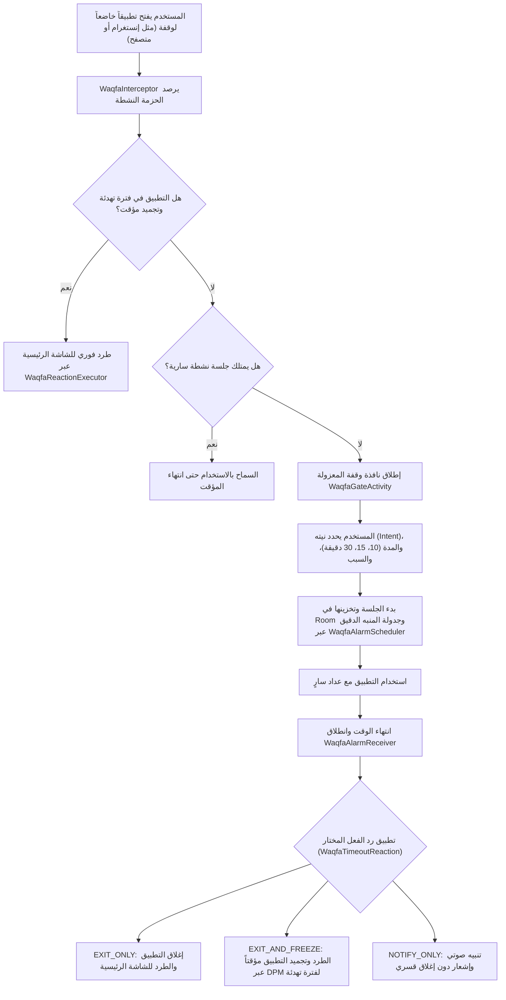
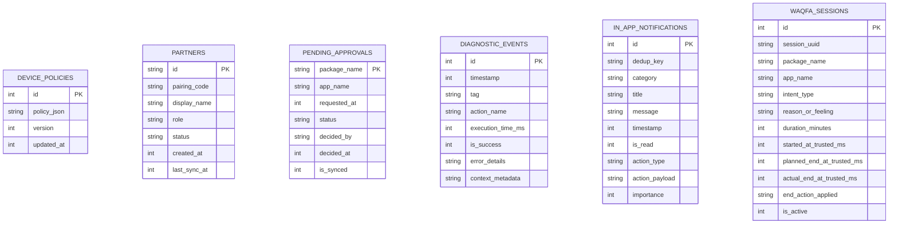

# 🛡️ التوثيق التقني والمعماري الشامل لمشروع «حِصْن» (Hisn / AntiPorn DO)
> **الإصدار الحالي المستقر:** 1.78 (Build Code: 16)  
> **الدور المعماري:** Senior Android Systems Architect  
> **الهدف من الوثيقة:** النقل الدقيق، الجراحي، والكامل بنسبة 100% للسياق الهندسي والعملي لكافة ملفات وأكواد وقواعد بيانات المشروع إلى نماذج الذكاء الاصطناعي والمطورين للتخطيط، والتطوير، والتدقيق الجنائي، والترقية المستقبلية دون أدنى التباس.

---

# 1. نظرة عامة والتقنيات المستخدمة (Tech Stack & Environment)

### 1.1 لغة البرمجة ونمط المعمارية
- **لغة البرمجة:** Kotlin بنسبة 100%، بالاعتماد الكامل على النمط الاصطلاحي (Idiomatic Kotlin). يُمنع منعاً باتاً استخدام الـ Force-Unwrap (`!!`) أو الاستدعاءات غير الآمنة.
- **التزامن والتوازي:** Kotlin Coroutines (`Dispatchers.IO`, `Dispatchers.Main`, `SupervisorJob()`, `Mutex`) مع استخدام تدفقات `StateFlow` و `SharedFlow` لإدارة الحالة التفاعلية غير المتزامنة ومزامنة الواجهات.
- **إطار العمل والواجهات:** واجهات أندرويد الأصلية Native Android UI مبنية باستخدام تقنية **ViewBinding** وملفات الـ XML المتجاوبة (مع استخدام Material Components 3 والتلوين التكيفي Dynamic Colors وشاشات البداية المتقدمة `SplashScreen`).
- **النمط المعماري العام:** Clean Architecture مقترنة بـ MVVM (Model-View-ViewModel)، مع عزل تام لطبقات الـ Domain والأمان (Shields Architecture) وطبقة الـ Repository المستندة لمبدأ المصدر الموحد للحقيقة (Single Source of Truth - SSOT).

### 1.2 إعدادات الـ SDK والبناء (Build & SDK Configuration)
مستخرجة مباشرة من ملف [`app/build.gradle.kts`](file:///d:/b/antiporn/app/build.gradle.kts):
- **`compileSdk`:** 36 (Android 15 / 16 - Vanilla Ice Cream / Baklava)
- **`targetSdk`:** 36
- **`minSdk`:** 24 (يدعم أندرويد 7.0 فما فوق)
- **`versionCode`:** 16
- **`versionName`:** "1.78"
- **أداة البناء:** Gradle Kotlin DSL (`build.gradle.kts`) مع Android Gradle Plugin (AGP) بالإصدار `9.0.1` و Kotlin 2.0+ و KSP للترميز والتوليد الفوري.
- **التوافقية ومكتبات Desugaring:** Java 11 (`JavaVersion.VERSION_11`) مع تفعيل `isCoreLibraryDesugaringEnabled = true` عبر `desugar_jdk_libs:2.1.4`.
- **معمارية المعالجات المدعومة حصراً في الإنتاج (NDK ABI Filters):** `arm64-v8a` (تم إسقاط 32-bit لتقليص الحجم وزيادة الأمان وكفاءة معالجات الـ NPU).
- **اللغات المدعومة (Resource Configurations):** العربية (`ar`) والإنجليزية (`en`).
- **تحسينات الإنتاج (Release Optimization):** `isMinifyEnabled = true` و `isShrinkResources = true` مع قواعد ProGuard صارمة للحفاظ على نماذج ONNX و TFLite وسجلات Room.

### 1.3 أهم المكتبات والتبعيات المضافة (Core Dependencies)
مستخرجة من [`gradle/libs.versions.toml`](file:///d:/b/antiporn/gradle/libs.versions.toml) و [`app/build.gradle.kts`](file:///d:/b/antiporn/app/build.gradle.kts):
1. **قاعدة البيانات والتخزين الدائم (Jetpack Room Persistence):**
   - `androidx.room:room-runtime:2.6.1` و `androidx.room:room-ktx:2.6.1` بمعالجة KSP.
   - قاعدة بيانات مدمجة حديثة `HisnRoomDatabase` (الإصدار 6) حلت بالكامل محل `SQLiteOpenHelper` القديمة مع الحفاظ المطلق على بيانات المستخدم عبر ترقيات هجرة بيانات تراكمية.
2. **الذكاء الاصطناعي والرؤية الحاسوبية على الجهاز (On-Device AI / ML):**
   - `org.tensorflow:tensorflow-lite:2.16.1`: تشغيل نموذج Halalify v2 لكشف وتصنيف صور النساء وغض البصر.
   - `com.microsoft.onnxruntime:onnxruntime-android:1.20.0`: تشغيل نموذج NudeNet v3 (شبكة YOLOv8 Nano) لاكتشاف وتحديد العورات بدقة عتادية فائقة.
3. **الخدمات السحابية ومزامنة السياسات (Firebase Cloud Infrastructure):**
   - Firebase BoM (`33.10.0`):
     - `com.google.firebase:firebase-firestore`: المزامنة اللحظية ثنائية الاتجاه للسياسات وطلبات الموافقة والحالة.
     - `com.google.firebase:firebase-auth`: المصادقة المجهولة (Anonymous Auth) مع دعم الربط التلقائي بحسابات Google.
     - `com.google.firebase:firebase-messaging`: استقبال رسائل الـ FCM الصامتة وفائقة الأولوية لتطبيق السياسات وفك الحزم فورياً.
   - `androidx.credentials:credentials:1.3.0` و `com.google.android.libraries.identity.googleid:googleid:1.1.1`: تسجيل الدخول السلس عبر Google Credential Manager الحديث.
4. **المهام المجدولة في الخلفية (AndroidX WorkManager):**
   - `androidx.work:work-runtime-ktx:2.10.0` مع `io.insert-koin:koin-androidx-workmanager:3.5.6`: إدارة مهام المزامنة السحابية الدورية (`CloudSyncWorker`) والتحقق من التحديثات الهوائية وتثبيتها صامتاً (`OtaUpdateWorker`).
5. **حقن التبعيات (Dependency Injection):**
   - `io.insert-koin:koin-android:3.5.6`: إدارة حقن الاعتماديات لكافة قواعد البيانات، والـ DAOs، والـ Repositories، والـ ViewModels، وخلفيات الـ Workers.
6. **الترقية لصلاحية مسؤول الجهاز ذاتياً (Wireless ADB Provisioning):**
   - `com.github.rhythmcache:adb-kt:v1.0.13`: عميل ADB مكتوب بلغة Kotlin لتنفيذ بروتوكول المصادقة عبر SPAKE2 TLS 1.3 والاقتران الذاتي المحلي عبر `127.0.0.1`.
7. **الباركود والمسح والطباعة (QR Code & Camera):**
   - `com.google.zxing:core:3.5.3`: توليد أكواد QR لمزامنة السياسات دون اتصال بالإنترنت وقفل التحكم الذاتي.
   - `com.google.mlkit:barcode-scanning:17.3.0` مع `androidx.camera:camera-camera2:1.4.1`: قراءة ومسح أكواد QR بالكاميرا.
   - `androidx.print:print:1.0.0`: طباعة وثيقة أو كود الاسترداد الاحتياطي على الورق.
8. **التسجيل الجنائي والتشخيص:**
   - `com.jakewharton.timber:timber:5.0.1`: تسجيل الأحداث البرمجية الجنائية محلياً.

---

# 2. هيكلة المشروع وشجرة الملفات الشاملة (Project Structure - 190 Files)

يضم المشروع 190 ملف Kotlin موزعة هندسياً على 15 حزمة متخصصة وفق أفضل معايير Clean Architecture:

```
com.drmohammed.antiporn
│
├── AdminReceiver.kt                       # مستقبل صلاحيات إدارة ومسؤول الجهاز (DeviceAdminReceiver)
├── AntiPornApplication.kt                 # نقطة انطلاق التطبيق، تهيئة Koin، CrashHandler، ومزامنة الوقت الموثوق
├── DnsWatchdogService.kt                  # خدمة الحراسة الأمامية (FGS specialUse) لمراقبة إعدادات الـ DNS وشبكة الجهاز
├── MainActivity.kt                        # شاشة التحكم الرئيسية (ViewPager2 مع 4 تبويبات) وتنسيق الخدمات
├── PackageChangeReceiver.kt               # استقبال أحداث تثبيت وإلغاء تثبيت التطبيقات فور وقوعها (Zero-Trust)
│
├── ai/                                    # منظومة الذكاء الاصطناعي والتعتيم الموضعي اللحظي
│   ├── core/
│   │   ├── inference/                     # محركات الاستدلال لنماذج TFLite و ONNX
│   │   │   ├── AiInputConfig.kt           # إعدادات أبعاد ومعايير تطبيع مصفوفات الدخل للنماذج
│   │   │   ├── HalalifyGenderDetector.kt  # فاحص تصنيف وكشف النساء عبر TFLite
│   │   │   ├── IModestyDetector.kt        # واجهة تجريد محرك الاستدلال
│   │   │   ├── MobileNetOutputDecoder.kt  # فك شفرة مصفوفات خرج MobileNet
│   │   │   ├── MobileNetV4ModestyDetector.kt # كاشف العورات المبني على MobileNetV4
│   │   │   ├── ModestyPostProcessor.kt    # معالجة مصفوفات الإحداثيات وتطبيق خوارزمية NMS
│   │   │   ├── NudeNetDetector.kt         # كاشف NudeNet v3 عبر ONNX Runtime (18 فئة)
│   │   │   └── TfLiteModestyDetector.kt   # مشغل TFLite العام
│   │   ├── model/                         # نماذج البيانات الخاصة باكتشافات الذكاء الاصطناعي
│   │   │   ├── HalalifyDetection.kt
│   │   │   ├── ModestyClass.kt
│   │   │   ├── ModestyDetection.kt
│   │   │   ├── ModestyInferenceResult.kt
│   │   │   └── NudeNetDetection.kt
│   │   ├── pipeline/                      # خط معالجة الإطارات الموفر للطاقة والحرارة
│   │   │   ├── ContextualGatingWatcher.kt # استثناء التطبيقات الآمنة وتوجيه الفحص للأهداف المشبوهة
│   │   │   ├── FrameDifferencer.kt        # مقارنة الفروق بين الإطارات لتخطي المعالجة المتطابقة (Level-0 Diff)
│   │   │   └── RowStrideExtractor.kt      # فك قيود الـ Stride لمصفوفات البكسل بكفاءة عالية
│   │   ├── policy/
│   │   │   └── AiExemptionRegistry.kt     # السجل المعياري لاستثناءات فحص الذكاء الاصطناعي
│   │   └── tracking/                      # التتبع البصري فائق السرعة لصناديق التعتيم
│   │       ├── KltMathHelper.kt
│   │       ├── KltOpticalFlowTracker.kt   # خوارزمية Kanade-Lucas-Tomasi (KLT) للتتبع البصري
│   │       ├── KltPyramidHelper.kt
│   │       ├── KltSolver.kt
│   │       └── TrackedModestyBox.kt
│   ├── diagnostic/
│   │   └── TelegramAlertDispatcher.kt     # إرسال تنبيهات الاختراق وتشخيص الذكاء الاصطناعي
│   ├── overlay/
│   │   └── ScreenBlurOverlayManager.kt    # رسم نوافذ التعتيم الداكنة فوق العورات بنمط TYPE_APPLICATION_OVERLAY
│   └── service/
│       ├── AiInferenceCoordinator.kt      # منسق تشغيل نماذج الذكاء الاصطناعي وتتبع KLT ورسم التعتيم
│       ├── ScreenAiProjectionService.kt   # خدمة التقاط الشاشة وتحليلها (MediaProjection FGS) بعد تجزئتها لـ 314 سطر
│       └── ScreenFrameStreamManager.kt    # إدارة مسار التقاط الإطارات (ImageReader + VirtualDisplay) وحساب الـ FPS
│
├── cloud/                                 # التكامل مع الخدمات السحابية ومصادقة المستخدم
│   ├── auth/
│   │   └── GoogleAuthManager.kt           # ترقية الحساب المجهول إلى حساب Google دائم عبر Credential Manager
│   └── fcm/
│       └── AntiPornFirebaseMessagingService.kt # استقبال أوامر الحماية وتحديث السياسات عبر FCM الصامت فائق الأولوية
│
├── core/                                  # النواة المركزية وقواعد الأمان المشتركة
│   ├── contract/
│   │   └── ProtectionShield.kt            # العقد المعياري لكافة دروع الحماية البرمجية (apply, checkStatus)
│   ├── engine/
│   │   ├── DeviceOwnerTeardownManager.kt  # محرك التفكيك الآمن لمسؤول الجهاز وإلغاء القيود لتفادي القيود العالقة
│   │   └── ProtectionEngine.kt            # المنسق العام لتطبيق وفحص حالة الدروع الستة بالتوازي
│   ├── model/
│   │   ├── DevicePolicyBundle.kt          # حزمة إعدادات وسياسات الحماية الشاملة للجهاز (SSOT)
│   │   ├── IslamicTimeZoneRegistry.kt     # سجل المناطق الزمنية الإسلامية المعتمدة
│   │   ├── ShieldResult.kt                # نتيجة تطبيق الدرع بالمللي ثانية
│   │   └── ShieldStatus.kt                # الحالة الحالية للدرع (نشط، يحتاج إنفاذ، غير مدعوم)
│   ├── network/
│   │   ├── DnsFilteringValidator.kt       # فاحص DoT الاستباقي (RFC 7858 عبر Port 853) للتحقق من حجب الإباحية
│   │   └── dns/                           # منظومة فحص وتحليل حزم الـ DNS المتقدمة
│   │       ├── BinaryDomainFilter.kt      # محرك الفلترة الثنائي المدمج بالذاكرة (Zero-Allocation، بحث في 9 خطوات)
│   │       ├── DnsLruCache.kt             # ذاكرة كاش محلية فائقة السرعة لاستجابات الـ DNS
│   │       ├── DnsPacketParser.kt         # محلل حزم الـ DNS (Port 53 UDP) وقراءة أسماء النطاقات والرد بـ NXDOMAIN
│   │       ├── DnsPolicyEvaluator.kt      # المقيّم السداسي لسياسات النطاقات (Tiers 0-6: حظر، استثناء، يوتيوب، إلخ)
│   │       ├── DnsTunnelWorker.kt         # معالج قراءة الحزم وتمريرها في خيط مخصص عبر نفق الـ TUN
│   │       ├── DnsUpstreamForwarder.kt    # موجه الاستعلامات النظيفة للخوادم الآمنة (Cloudflare Family 1.1.1.3 افتراضياً)
│   │       └── PornKeywordMatcher.kt      # مطابق الكلمات الإباحية الذكي المانع لخطأ Scunthorpe
│   ├── policy/
│   │   ├── AppClassification.kt           # تصنيفات الحزم البرمجية (IMMUNE, BLACKLIST, BROWSER, CURFEW, إلخ)
│   │   ├── AppPolicyRegistry.kt           # السجل المركزي للقوائم السوداء والبيضاء والمتصفحات وقواعد التطبيقات
│   │   └── AppRule.kt                     # نموذج قاعدة التطبيق والتصنيف والسبب
│   ├── time/
│   │   ├── SntpClient.kt                  # عميل SNTP للتواصل مع خوادم الوقت الذرية
│   │   └── TrustedTimeProvider.kt         # مزود الوقت الموثوق الأحادي (Monotonic) المانع للتراجع والمحصن ضد تغيير الساعة
│   └── util/
│       └── BrowserUrlSanitizer.kt         # تنظيف ومطابقة عناوين الروابط وقوائم السماح والحجب
│
├── curfew/                                # منظومة حظر التجوال الليلي ووضع القيلولة
│   ├── CurfewAlarmReceiver.kt             # استقبال منبهات بدء وانتهاء حظر التجوال والقيلولة
│   ├── CurfewAppResolver.kt               # تمييز تطبيقات الترفيه المحظورة ليلاً عن التطبيقات الأساسية المستثناة
│   ├── CurfewBlackholeVpnService.kt       # خدمة VPN ثنائية: فلترة DNS نهاراً وثقب أسود عازل للإنترنت ليلاً
│   ├── CurfewBootReceiver.kt              # إعادة جدولة حظر التجوال فور إقلاع الهاتف أو تعديل الساعة أو استبدال الحزمة
│   ├── CurfewConfig.kt                    # ثوابت وإعدادات حظر التجوال والمناطق الزمنية
│   ├── CurfewEnforcer.kt                  # المنفذ الفعلي لتعليق التطبيقات وإخفائها وتفعيل العزل الشبكي
│   ├── CurfewForegroundWatcher.kt         # مراقبة التطبيقات في الواجهة كخط دفاع إضافي
│   ├── CurfewScheduler.kt                 # جدولة تنبيهات الحظر باستخدام Exact Alarm
│   ├── NapConfig.kt                       # إعدادات وضع القيلولة (60 دقيقة حظر تام)
│   ├── NapController.kt                   # إدارة حالة ومؤقت القيلولة المعتمد على ساعتين متزامنتين
│   ├── ZeroTrustForegroundWatcher.kt      # مراقبة فورية لإنفاذ حظر التطبيقات غير المعتمدة
│   └── notification/
│       ├── NapNotificationReceiver.kt     # استقبال طلب تمديد القيلولة (+60 دقيقة)
│       └── ProtectionNotificationCoordinator.kt # تنسيق إشعارات الحظر والقيلولة
│
├── data/                                  # طبقة البيانات والتخزين المحلي والسحابي
│   ├── local/db/
│   │   ├── HisnRoomDatabase.kt            # قاعدة بيانات Room المركزية (الإصدار 6) بنمط WAL وترقيات صارمة
│   │   ├── dao/                           # كلاسات الوصول للبيانات (Data Access Objects)
│   │   │   ├── DevicePolicyDao.kt         # استعلامات وتحديث سياسات الجهاز الموحدة
│   │   │   ├── DiagnosticEventDao.kt      # استعلامات وحذف أحداث الصندوق الأسود الجنائية
│   │   │   ├── InAppNotificationDao.kt    # إدارة الإشعارات الداخلية وتحديث حالة القراءة
│   │   │   ├── PartnerDao.kt              # إدارة رفقاء الدرب ورموز الاقتران
│   │   │   └── PendingApprovalDao.kt      # إدارة التطبيقات المعلقة بانتظار الاعتماد
│   │   └── entity/                        # كيانات الجداول الممثلة في SQLite
│   │       ├── DevicePolicyEntity.kt      # جدول السياسات (device_policies)
│   │       ├── DiagnosticEventEntity.kt   # جدول السجلات الجنائية (diagnostic_events)
│   │       ├── InAppNotificationEntity.kt # جدول الإشعارات الداخلية (in_app_notifications)
│   │       ├── PartnerEntity.kt           # جدول رفقاء الدرب (partners)
│   │       └── PendingApprovalEntity.kt   # جدول طلبات التطبيقات (pending_approvals)
│   ├── model/
│   │   └── InstalledAppDto.kt             # كائن نقل بيانات التطبيقات المثبتة
│   └── repository/
│       ├── AccountabilityIdentityMigrator.kt # ترحيل هويات المستخدمين بين الحساب المجهول وجوجل
│       ├── AccountabilityRepository.kt    # إدارة الشراكة والاقتران ورموز الربط (Pairing Codes)
│       ├── AppInventoryManager.kt         # إدارة جرد تطبيقات الجهاز ومزامنتها سحابياً
│       ├── ApprovalRepository.kt          # إدارة تجميد التطبيقات الجديدة في 0ms ونظام الاعتماد
│       └── PolicyRepository.kt            # المصدر الموحد للسياسات والمزامنة اللحظية مع Firestore
│
├── di/
│   └── AppModule.kt                       # موديول Koin لحقن الاعتماديات لـ Room, Repositories, ViewModels, Workers
│
├── notification/                          # منظومة الإشعارات المركزية داخل وخارج التطبيق
│   ├── manager/AppNotificationManager.kt  # إدارة قنوات وإشعارات أندرويد
│   ├── model/InAppNotification.kt         # نموذج الإشعار الداخلي المحفوظ في قاعدة البيانات
│   ├── registry/NotificationRegistry.kt   # سجل قنوات ومعرفات الإشعارات الثابتة
│   ├── repository/NotificationRepository.kt # حفظ واسترجاع الإشعارات من Room
│   └── router/NotificationActionRouter.kt # توجيه أحداث النقر على الإشعارات للشاشات المناسبة
│
├── ota/                                   # التحديث الهوائي الصامت المستقل (Over-The-Air Updates)
│   ├── installer/OtaPackageInstaller.kt   # تثبيت التحديثات صامتاً عبر جلسات PackageInstaller بدون تدخل المستخدم
│   ├── model/
│   │   ├── OtaUpdateState.kt              # حالات التحديث (فحص، تنزيل، تحقق، تثبيت، اكتمال، خطأ)
│   │   └── OtaVersionInfo.kt              # بيانات إصدار التحديث القادم من Cloudflare R2
│   ├── notification/OtaNotificationManager.kt
│   ├── receiver/OtaInstallReceiver.kt     # استقبال نتيجة تثبيت التحديث وتأكيد النجاح
│   ├── remote/OtaRemoteSource.kt          # جلب معلومات التحديث وملفات الـ APK من سحابة Cloudflare R2
│   ├── repository/OtaRepository.kt        # إدارة عملية التنزيل والتحقق والتثبيت الصامت
│   └── security/OtaIntegrityVerifier.kt   # التحقق الصارم من توقيع الـ APK وبصمة SHA-256 قبل التثبيت
│
├── provisioning/                          # تهيئة وترقية مسؤول الجهاز (Device Owner Setup)
│   ├── engine/
│   │   ├── AccountAuditor.kt              # فحص الحسابات المسجلة على الهاتف لتفادي فشل الترقية
│   │   ├── AdbMdnsDiscovery.kt            # اكتشاف منافذ تصحيح الأخطاء اللاسلكية عبر mDNS
│   │   ├── DeviceOwnerPromoter.kt         # تنفيذ اقتران SPAKE2 TLS وأمر dpm set-device-owner محلياً
│   │   ├── OemProvisioningHelper.kt       # كشف واجهات الأجهزة (Xiaomi, Samsung, Realme) وتوجيه المستخدم
│   │   └── ProvisioningWifiWatcher.kt     # مراقبة الاتصال بشبكة الـ Wi-Fi أثناء الاقتران اللاسلكي
│   ├── receiver/PairingCodeReceiver.kt    # التقاط رمز الاقتران تلقائياً من إشعار النظام
│   ├── service/AdbPairingNotificationService.kt # خدمة الاستماع لرموز اقتران الـ ADB
│   └── ui/
│       ├── EnterpriseProvisioningActivity.kt # معالج إعداد Android Enterprise عبر مسح كود QR
│       └── ProvisioningWizardActivity.kt  # معالج الترقية اللاسلكية خطوة بخطوة داخل التطبيق
│
├── services/
│   └── NetworkWatchdog.kt                 # مراقب التغيرات في شبكة الاتصال والـ Wi-Fi
│
├── shields/                               # دروع الحماية المعزولة الستة (Pluggable Security Shields)
│   ├── AppSuspensionShield.kt             # تجميد وإخفاء تطبيقات القائمة السوداء (تيليجرام، تيك توك، المتصفحات)
│   ├── BrowserShield.kt                   # تعطيل التصفح الخفي وفرض البحث الآمن وحجب الروابط في كروم
│   ├── CurfewShield.kt                    # إنفاذ حظر التجوال الليلي وإغلاق المتاجر والشبكة
│   ├── DnsShield.kt                       # فرض DNS المشفر (DoT) وإغلاق إعدادات النطاقات الخاصة
│   ├── SystemTamperShield.kt              # منع ضبط المصنع، والوضع الآمن، وتعدد المستخدمين، وتغيير الوقت
│   └── VpnShield.kt                       # إغلاق ثغرة الـ VPN ومنع تجاوز الحماية
│
├── telemetry/                             # المراقبة الجنائية وتسجيل الأخطاء والصندوق الأسود
│   ├── AiTelemetryReporter.kt             # إرسال تقارير أداء ومكتشفات الذكاء الاصطناعي
│   ├── BlackBoxRecorder.kt                # تسجيل محاولات التلاعب والأحداث الأمنية في Room
│   ├── DiagnosticEventDto.kt              # كائن نقل بيانات الأحداث التشخيصية
│   ├── GlobalCrashHandler.kt              # لاقط الانهيارات الشامل ومنع التدمير الذاتي
│   └── SafeDpmGateway.kt                  # بوابة استدعاء DPM الآمنة وقياس زمن التنفيذ بالمللي ثانية
│
├── ui/                                    # شاشات وواجهات المستخدم وتجربة الاستخدام
│   ├── ProtectionUiState.kt               # حالة واجهة المستخدم الموحدة
│   ├── accountability/                    # شاشات إدارة المشرفين ورفقاء الدرب والتحكم عن بعد
│   │   ├── AccountabilityFragment.kt      # تبويب رفيق الدرب ورموز الاقتران
│   │   ├── AccountabilityUiState.kt
│   │   ├── AccountabilityViewModel.kt
│   │   ├── AppIconResolver.kt             # جلب أيقونات التطبيقات بكفاءة لعرضها في القوائم
│   │   ├── GuardianAlertsViewBinder.kt    # ربط وعرض تنبيهات محاولات التلاعب للمشرف
│   │   ├── GuardianApprovalsAdapter.kt    # محول عرض طلبات التطبيقات المعلقة
│   │   ├── GuardianApprovalsHubActivity.kt # مركز مراجعة واعتماد طلبات تثبيت التطبيقات للمشرف
│   │   ├── GuardianApprovalsViewBinder.kt # ربط تفاعلات الموافقة والرفض
│   │   ├── GuardianControlActivity.kt     # لوحة تحكم المشرف بجهاز المكفول عن بعد
│   │   ├── GuardianControlUiState.kt
│   │   ├── GuardianControlViewModel.kt
│   │   ├── GuardianLiveSyncViewBinder.kt  # مؤشر المزامنة الحية مع السحابة
│   │   ├── RemoteAppManagerActivity.kt    # إدارة تطبيقات المكفول وحظرها/السماح بها عن بعد
│   │   ├── RemoteAppManagerUiState.kt
│   │   └── RemoteAppManagerViewModel.kt
│   ├── control/                           # تبويب مراكز التحكم والأنشطة اللامركزية وبوابة الـ QR
│   │   ├── SelfControlApprovalsViewBinder.kt # عرض قائمة التطبيقات المعلقة مباشرة في شاشة التحكم
│   │   ├── SelfControlFragment.kt         # تبويب التحكم الذاتي ومنطلق الشاشات الفرعية المتخصصة
│   │   ├── SelfControlUiState.kt
│   │   ├── SelfControlViewModel.kt
│   │   ├── curfew/
│   │   │   └── CurfewSettingsActivity.kt  # شاشة مخصصة لإعدادات حظر التجوال، نهاية الأسبوع، والعزل
│   │   ├── gate/
│   │   │   └── SelfControlAccessGate.kt   # بوابة حماية قسم الإعدادات برمز المرور أو باركود الـ QR
│   │   ├── other/
│   │   │   └── OtherSettingsActivity.kt   # شاشة مخصصة للإعدادات المتقدمة وتفكيك مسؤول الجهاز
│   │   ├── qr/                            # توليد ومسح وطباعة باركود التحكم الذاتي
│   │   │   ├── QrExportDialog.kt          # نافذة تصدير وطباعة كود الـ QR
│   │   │   ├── QrScannerBottomSheet.kt    # نافذة مسح كود الـ QR بالكاميرا
│   │   │   └── SelfControlQrManager.kt    # إدارة تشفير وفك تشفير كود التحكم الذاتي
│   │   └── web/
│   │       └── WebFilterSettingsActivity.kt # شاشة مخصصة لفلترة الويب، DoT، والبحث الآمن، ويوتيوب
│   ├── home/                              # شاشة الحصن الرئيسية وزر القيلولة ودرع الأمان
│   │   ├── HomeFragment.kt
│   │   ├── HomeUiState.kt
│   │   └── HomeViewModel.kt
│   ├── main/
│   │   └── MainViewModel.kt
│   ├── notification/                      # مركز الإشعارات والتنبيهات الداخلي
│   │   ├── NotificationAdapter.kt
│   │   ├── NotificationCenterActivity.kt  # شاشة عرض وفلترة سجل الإشعارات الداخلي
│   │   └── NotificationCenterViewModel.kt
│   ├── settings/                          # شاشة الإعدادات العامة والذكاء الاصطناعي
│   │   ├── DiagnosticLogViewerActivity.kt # شاشة فحص وتصدير سجلات الصندوق الأسود الجنائية
│   │   ├── SettingsFragment.kt
│   │   ├── SettingsUiState.kt
│   │   └── SettingsViewModel.kt
│   ├── shields/                           # القائمة السفلية لعرض تفاصيل الدروع النشطة
│   │   ├── ActiveShieldInfo.kt
│   │   ├── ActiveShieldsBottomSheet.kt
│   │   └── ActiveShieldsEvaluator.kt
│   └── splash/
│       └── SplashAnimationController.kt   # إدارة مؤثرات ورسوم شاشة البداية الاحترافية
│
├── waqfa/                                 # منظومة «وَقْفَة» للتدخل الواعي وإدارة الوقت والحد من التشتت
│   ├── data/
│   │   ├── WaqfaDao.kt                    # عمليات الـ CRUD لجلسات وقفة في Room
│   │   ├── WaqfaRepository.kt             # مستودع إدارة الجلسات في الذاكرة وقاعدة البيانات
│   │   └── WaqfaSessionEntity.kt          # جدول جلسات وقفة (waqfa_sessions)
│   ├── engine/
│   │   ├── WaqfaAlarmReceiver.kt          # استقبال منبهات انتهاء وقت الجلسة وانتهاء فترة التهدئة
│   │   ├── WaqfaAlarmScheduler.kt         # جدولة منبهات دقيقة بالثانية عبر Exact Alarm
│   │   ├── WaqfaBootHandler.kt            # استعادة جلسات وقفة النشطة وتصفيتها فور إقلاع الهاتف
│   │   ├── WaqfaCooldownStore.kt          # تخزين وفحص أوقات التهدئة والتجميد المؤقت للتطبيقات
│   │   ├── WaqfaForegroundWatcher.kt      # مراقبة التطبيقات في الواجهة لاعتراض التطبيقات المستهدفة
│   │   ├── WaqfaInterceptor.kt            # منسق اعتراض تشغيل التطبيق وتوجيهه لنافذة وقفة
│   │   ├── WaqfaNotificationHelper.kt     # إرسال إشعارات التنبيه والانتهاء الخاصة بوقفة
│   │   ├── WaqfaReactionExecutor.kt       # تنفيذ رد الفعل (طرد للشاشة الرئيسية أو تجميد عبر DPM)
│   │   └── WaqfaSessionManager.kt         # مدير دورة حياة الجلسات في الذاكرة ومزامنتها عبر Mutex
│   ├── model/
│   │   ├── WaqfaConfig.kt                 # إعدادات سياسة وقفة (مدمجة ضمن DevicePolicyBundle)
│   │   ├── WaqfaIntentType.kt             # تصنيف نوايا الدخول (هدف محدد، ملل، عادة، إلخ)
│   │   ├── WaqfaSession.kt                # كائن جلسة وقفة النشطة وحساب وقت الانتهاء
│   │   └── WaqfaTimeoutReaction.kt        # نمط الاستراتيجية لردود الفعل عند انتهاء الوقت
│   └── ui/
│       ├── gate/
│       │   ├── WaqfaGateActivity.kt       # نافذة الاعتراض المعزولة (singleInstance) المانعة للتجاوز
│       │   └── WaqfaGateViewModel.kt
│       └── settings/
│           ├── WaqfaAppPickerBottomSheet.kt # منتقي التطبيقات الخاضعة لنظام وقفة
│           ├── WaqfaSettingsActivity.kt   # شاشة ضبط وتخصيص إعدادات وقفة
│           └── WaqfaSettingsViewModel.kt
│
└── work/                                  # مهام الخلفية المجدولة عبر AndroidX WorkManager
    ├── CloudSyncWorker.kt                 # عامل المزامنة السحابية الدورية والنبضات كل 12 ساعة
    └── OtaUpdateWorker.kt                 # عامل التحقق والتثبيت الصامت للتحديثات كل 24 ساعة
```

---

# 3. هندسة صلاحيات الـ Device Owner والحماية (DO & Security Architecture)

يعمل تطبيق «حِصْن» كمنظومة دفاعية غير قابلة للتحايل (Fail-Secure & Tamper-Proof) عبر استثمار أقصى صلاحيات نظام أندرويد المؤسسية (Device Owner - DO).

### 3.1 تفعيل وإدارة الـ Device Owner
يوفر التطبيق 3 مسارات هندسية للترقية:
1. **الترقية اللاسلكية الذاتية من داخل الهاتف (On-Device Wireless ADB):**
   - يديرها الكلاس [`DeviceOwnerPromoter.kt`](file:///d:/b/antiporn/app/src/main/java/com/drmohammed/antiporn/provisioning/engine/DeviceOwnerPromoter.kt) بالتعاون مع مكتبة `adb-kt`.
   - يقوم التطبيق بالاقتران المحلي مع خدمة تصحيح الأخطاء اللاسلكية على العنوان `127.0.0.1` عبر بروتوكول SPAKE2 TLS 1.3.
   - يكتشف المنافذ عبر `AdbMdnsDiscovery.kt`، ويستقبل رمز الاقتران تلقائياً عبر `AdbPairingNotificationService.kt` ومستقبل `PairingCodeReceiver.kt`.
   - بمجرد اكتمال المصافحة، ينفذ الأمر التالي محلياً:  
     `dpm set-device-owner com.drmohammed.antiporn/.AdminReceiver`
2. **تهيئة الجهاز المؤسسي عند ضبط المصنع (Android Enterprise QR Provisioning):**
   - يستقبل المعالج كود الـ QR الخاص بشركة أندرويد عبر [`EnterpriseProvisioningActivity.kt`](file:///d:/b/antiporn/app/src/main/java/com/drmohammed/antiporn/provisioning/ui/EnterpriseProvisioningActivity.kt).
   - يتعامل مع نوايا النظام: `android.app.action.GET_PROVISIONING_MODE` و `android.app.action.ADMIN_POLICY_COMPLIANCE`.
3. **أمر سطر الأوامر الخارجي (Computer ADB):**
   - `adb shell dpm set-device-owner com.drmohammed.antiporn/.AdminReceiver`

### 3.2 بوابة الـ DPM المركزية الآمنة (`SafeDpmGateway.kt`)
وفقاً لدستور المشروع الهندسي، يُحظر استدعاء `DevicePolicyManager` مباشرة من طبقات الـ UI والـ Repositories. كل التفاعلات تمر عبر [`SafeDpmGateway.kt`](file:///d:/b/antiporn/app/src/main/java/com/drmohammed/antiporn/telemetry/SafeDpmGateway.kt):
- التحقق المسبق من تفعيل الصلاحية (`isAdminActive` و `isDeviceOwnerApp`).
- الإلزام الصارم بالتنفيذ في مسار الخلفية (`Dispatchers.IO`).
- التقاط الاستثناءات الجنائية وقياس زمن التنفيذ بالمللي ثانية، وتسجيل النتيجة في جدول `diagnostic_events` داخل قاعدة بيانات Room فوراً.

### 3.3 السياسات والقيود المؤسسية المطبقة حالياً (Policies & Restrictions)
تدار السياسات وتنفذ عبر كلاسات الدروع المعزولة الستة المنبثقة من عقد [`ProtectionShield.kt`](file:///d:/b/antiporn/app/src/main/java/com/drmohammed/antiporn/core/contract/ProtectionShield.kt):

| السياسة / القيد | الكلاس المسؤول | الآلية والكود المطبق | الغرض الأمني |
|---|---|---|---|
| **منع إلغاء التثبيت** | `SystemTamperShield.kt` | `dpm.setUninstallBlocked(admin, packageName, true)` | منع المستخدم من حذف تطبيق الحصن نهائياً من إعدادات النظام. |
| **منع مسح البيانات والتوقف الإجباري** | `SystemTamperShield.kt` | `setClearApplicationUserDataBlocked(admin, pkg, true)` (عبر Reflection) + `UserManager.DISALLOW_APPS_CONTROL` | منع الضغط على "Clear Data" أو "Force Stop" لتعطيل خدمات الحماية. |
| **منع ضبط المصنع** | `SystemTamperShield.kt` | `dpm.addUserRestriction(admin, UserManager.DISALLOW_FACTORY_RESET)` | سد ثغرة إعادة ضبط الهاتف لمسح الحصن وصلاحيات الـ Device Owner. |
| **منع الوضع الآمن (Safe Mode)** | `SystemTamperShield.kt` | `dpm.addUserRestriction(admin, UserManager.DISALLOW_SAFE_BOOT)` | منع إعادة تشغيل الهاتف في الوضع الآمن لتجاوز تشغيل خدمات الحصن. |
| **منع تعدد المستخدمين وحسابات الضيف** | `SystemTamperShield.kt` | `UserManager.DISALLOW_ADD_USER` و `UserManager.DISALLOW_USER_SWITCH` مع ضبط `user_switcher_enabled=0` | منع فتح مساحة ثانية (Second Space) أو مستخدم ضيف لتصفح الإباحية. |
| **قفل التاريخ والوقت والمنطقة الزمنية** | `SystemTamperShield.kt` & `TrustedTimeProvider.kt` | `UserManager.DISALLOW_CONFIG_DATE_TIME` و `dpm.setTimeZone(admin, targetTz)` و `setAutoTimeEnabled(admin, true)` | منع التلاعب بالساعة لتخطي أوقات حظر التجوال أو وضع القيلولة أو وقفة. |
| **إغلاق ثغرة الـ VPN الخارجي** | `VpnShield.kt` | `dpm.addUserRestriction(admin, UserManager.DISALLOW_CONFIG_VPN)` | منع إنشاء أو تفعيل أي تطبيق VPN خارجي لتجاوز خوادم الـ DNS النظيفة. |
| **قفل إعدادات الـ Private DNS** | `DnsShield.kt` | `dpm.addUserRestriction(admin, UserManager.DISALLOW_CONFIG_PRIVATE_DNS)` و `UserManager.DISALLOW_NETWORK_RESET` | منع العبث بإعدادات خادم الـ DNS الخاص بالهاتف أو تصفير إعدادات الشبكة. |
| **تجميد المتصفحات الخبيثة وتطبيقات الشات** | `AppSuspensionShield.kt` | `dpm.setPackagesSuspended(admin, pkgs, true)` و `dpm.setApplicationHidden(admin, pkg, true)` | تجميد فوري وإخفاء تام لتيليجرام وفروعه، تيك توك، المتصفحات البديلة (Tor/Firefox)، وشات الروليت. |
| **حظر التصفح الخفي وفرض البحث الآمن** | `BrowserShield.kt` | `dpm.setApplicationRestrictions(admin, pkg, bundle)` | تعطيل التصفح الخفي (Incognito) وفرض Google SafeSearch و YouTube Restricted Mode في متصفحات كروم. |
| **العزل الشبكي التام أثناء حظر التجوال** | `CurfewShield.kt` & `CurfewBlackholeVpnService.kt` | `dpm.setAlwaysOnVpnPackage(admin, packageName, true, bypassedPackages)` مع استدعاء `builder.addDisallowedApplication(packageName)` | قفل حركة المرور بالكامل (Always-on Lockdown) وتوجيه البيانات إلى ثقب أسود، مع **استثناء إلزامي ومطلق لتطبيق الحصن نفسه** وتطبيقات الطوارئ المعتمدة. |

> [!IMPORTANT]
> **قدسية تصحيح أخطاء USB وشريان الحياة السحابي للتطبيق (Lifeline Sanctuaries):**  
> 1. **قدسية تصحيح أخطاء USB (Developer ADB Sanctuary - المادة 2):**  
>    وفقاً لدستور المشروع الهندسي، **يُمنع منعاً باتاً ومطلقاً** تطبيق `UserManager.DISALLOW_DEBUGGING_FEATURES` أو `UserManager.DISALLOW_CONFIG_DEVELOPER_OPTIONS`، لضمان بقاء شريان الحياة الوحيد للمطور مفتوحاً دائماً عبر الحاسوب للإصلاح والبرمجة والتطوير.  
> 2. **شريان الحياة السحابي وإعفاء الحصن التام من حظر الإنترنت (Self-Network Lifeline):**  
>    **تطبيق الحصن نفسه (`com.drmohammed.antiporn`) معفي بنسبة 100% وبشكل إلزامي دائم من أي حظر للإنترنت أو عزل شبكي.** يتم استثناؤه تلقائياً عبر `builder.addDisallowedApplication(packageName)` وعبر `CurfewConfig.getVpnBypassedPackages()` لضمان بقاء اتصاله بـ Firebase Firestore و رسائل FCM واستعلامات الوقت الذري SNTP وتحديثات الـ OTA الهوائية حتى أثناء ذروة حظر التجوال والعزل التام.

### 3.4 محرك التفكيك الآمن لمسؤول الجهاز (`DeviceOwnerTeardownManager.kt`)
لحماية هواتف المستخدمين من الوقوع في فخ "القيود العالقة" (Orphaned Restrictions) عند الرغبة المشروعة في إلغاء تفعيل التطبيق، تم بناء كلاس مخصص [`DeviceOwnerTeardownManager.kt`](file:///d:/b/antiporn/app/src/main/java/com/drmohammed/antiporn/core/engine/DeviceOwnerTeardownManager.kt):
1. **التحقق الأمني:** التحقق من انقضاء فترة التهدئة (`deactivationUnlockAt`) وموافقة المشرف إن وجد.
2. **التفكيك المتسلسل:**
   - فك تجميد كافة التطبيقات المعلقة والمجمدة (`dpm.setPackagesSuspended(..., false)`).
   - إظهار كافة التطبيقات المخفية (`dpm.setApplicationHidden(..., false)`).
   - إزالة كافة القيود المؤسسية (`dpm.clearUserRestriction(...)`).
   - تصفير خادم الـ Private DNS المشفر وإعادة الوضع التلقائي.
   - إلغاء قفل نفق الـ Always-On VPN.
   - إلغاء قفل حذف التطبيق (`dpm.setUninstallBlocked(..., false)`).
   - إسقاط صلاحية مالك الجهاز نهائياً بسلام (`dpm.clearDeviceOwnerApp(...)`).

---

# 4. منظومة الحجب والفلترة خماسية الطبقات (Multi-Layer Protection Engine)

لا يعتمد «حِصْن» على وسيلة واحدة قابلة للكسر، بل يطبق 5 طبقات حماية متكاملة ومتزامنة:

### 4.1 الطبقة الأولى - DNS المشفر المعتمد على مستوى النظام (DoT Enforced)
- يديرها [`DnsShield.kt`](file:///d:/b/antiporn/app/src/main/java/com/drmohammed/antiporn/shields/DnsShield.kt).
- يفرض تشفير Private DNS (DNS-over-TLS) باستخدام خادم **Cloudflare Family الافتراضي** (`family.cloudflare-dns.com` - الأسرع استجابة والأكثر استقراراً عالمياً) مع دعم خيارات موثقة:
  - Control D Family (`no-ads-drugs-malware-porn-gambling-dating-typo.freedns.controld.com`)
  - AdGuard Family (`family.adguard-dns.com`)
  - NextDNS (`family.cloudflare-dns.com`)
- **الفحص الاستباقي للـ DoT (`DnsFilteringValidator.kt`):** فحص الخادم المخصص عبر المنفذ 853 قبل تطبيقه بإرسال استعلامات تجريبية (`google.com` للمرور و `pornhub.com` للتأكد من الحجب والـ Sinkhole) لتفادي قطع الإنترنت عن هاتف المستخدم.
- **Fallback ذكي:** في حال فشل استدعاء DPM في بعض واجهات الشركات (مثل واجهة Realme/ColorOS)، يتم تفعيله فورياً عبر صلاحية كتابة إعدادات النظام `Settings.Global.putString(..., "private_dns_specifier", host)`.

### 4.2 الطبقة الثانية - بالوعة الـ DNS ومحرك الفلترة الثنائي المدمج (Memory-Mapped Binary Filter)
- يديرها الكلاس [`CurfewBlackholeVpnService.kt`](file:///d:/b/antiporn/app/src/main/java/com/drmohammed/antiporn/curfew/CurfewBlackholeVpnService.kt) في وضع `DNS_FILTERING_ONLY`.
- يتم إنشاء نفق VPN محلي يلتقط فقط مسار الـ DNS (حزم UDP على المنفذ 53 الموجهة إلى عنوان النفق `10.255.255.2/32`) دون أي إبطاء لسرعة الإنترنت وسرعة تحميل البيانات.
- **محرك الفلترة الثنائي فائق السرعة (`BinaryDomainFilter.kt`):**
  - ملف ثنائي مدمج بالذاكرة (Memory-Mapped File) يبدأ بـ Magic Bytes `"HISN"`.
  - تخزين مصفوفات هاش FNV-1a مجزأة 64-bit مرتبة تصاعدياً.
  - **Zero-Allocation:** صفر بايت استهلاك للذاكرة في Heap أثناء الاستعلام.
  - **بحث ثنائي فائق السرعة:** بحد أقصى 9 خطوات بحث ثنائي لحسم أي نطاق مع تفادي الـ False Positives بنسبة 0.000%.
- **المقيّم السداسي لسياسات النطاقات (`DnsPolicyEvaluator.kt`):**
  - **Tier 0:** بوابات شبكات الواي فاي (Captive Portals) وخدمات جوجل الحيوية (تمرير فوري).
  - **Tier 1:** المواقع الإباحية المطلقة عبر `PornKeywordMatcher` و `BinaryDomainFilter` (حجب غير قابل للاستثناء في 0ms).
  - **Tier 2:** درع تيليجرام ويب (`t.me`, `web.telegram.org`) لمنع الالتفاف عبر المتصفح.
  - **Tier 3:** القواعد المخصصة للمشرف (قوائم الحجب والقوائم البيضاء).
  - **Tier 4:** حظر الإعلانات والتعقب الخبيث (`BinaryDomainFilter ADS`).
  - **Tier 5:** حظر نطاقات الالتفاف عبر DoH وخوادم Apple Private Relay لمنع اختراق الـ DNS.
  - **Tier 6:** توجيه يوتيوب لوضع التقييد الصارم (YouTube Restricted Mode VIP).
- **موجه المنبع النظيف (`DnsUpstreamForwarder.kt`):**
  - توجيه الاستعلامات النظيفة إلى Cloudflare Family (`1.1.1.3` / `1.0.0.3`) كخط أول، وخوادم OpenDNS / AdGuard كخط ثانٍ.
  - تحليل عناوين الـ IP بدون استدعاءات شبكية `parseIpv4ToInetAddress` لمنع حلقات الـ DNS التكرارية (Looping).
  - ذاكرة كاش داخلية `DnsLruCache(512)` للاستجابات السريعة.

### 4.3 الطبقة الثالثة - سياسات كروم المؤسسية وتصفية الروابط (Chromium Managed Policies)
- يديرها [`BrowserShield.kt`](file:///d:/b/antiporn/app/src/main/java/com/drmohammed/antiporn/shields/BrowserShield.kt) عبر `dpm.setApplicationRestrictions`.
- ترسل حزم السياسات لكافة المتصفحات المبنية على Chromium (Chrome, Brave, Edge, Samsung Browser):
  - `IncognitoModeAvailability = 1` (تعطيل الوضع الخفي نهائياً).
  - `ForceGoogleSafeSearch = true`.
  - `ForceYouTubeSafetyMode = true` و `ForceYouTubeRestrict = 2`.
  - `SafeSitesFilterBehavior = 1` (منع المواقع غير الآمنة داخلياً).
  - `URLBlocklist` و `URLAllowlist` لفرض القوائم المخصصة أو وضع "القائمة البيضاء فقط".

### 4.4 الطبقة الرابعة - الرؤية الحاسوبية والذكاء الاصطناعي اللحظي (On-Device Computer Vision)
- تعمل عبر خدمة [`ScreenAiProjectionService.kt`](file:///d:/b/antiporn/app/src/main/java/com/drmohammed/antiporn/ai/service/ScreenAiProjectionService.kt) بالتكامل مع:
  - [`ScreenFrameStreamManager.kt`](file:///d:/b/antiporn/app/src/main/java/com/drmohammed/antiporn/ai/service/ScreenFrameStreamManager.kt): إدارة تدفق الإطارات عبر `ImageReader` ومقارنة الفروق `FrameDifferencer` لإسقاط الإطارات الثابتة دون استهلاك المعالج.
  - [`AiInferenceCoordinator.kt`](file:///d:/b/antiporn/app/src/main/java/com/drmohammed/antiporn/ai/service/AiInferenceCoordinator.kt): منسق تشغيل النماذج والتتبع البصري.
- **النماذج العاملة على الجهاز دون خروج أي صورة خارجه:**
  - **نموذج NudeNet v3:** شبكة YOLOv8 عبر ONNX Runtime لكشف وتحديد إحداثيات 18 فئة من العورات.
  - **نموذج Halalify v2:** شبكة TFLite لكشف وتصنيف صور النساء وغض البصر.
- **التتبع البصري فائق السرعة:** خوارزمية KLT Optical Flow (`KltOpticalFlowTracker.kt`) لتتبع حركة العورة بسلاسة عبر الشاشة دون إعادة استدعاء النماذج الثقيلة في كل إطار.
- **التعتيم الذكي:** استدعاء [`ScreenBlurOverlayManager.kt`](file:///d:/b/antiporn/app/src/main/java/com/drmohammed/antiporn/ai/overlay/ScreenBlurOverlayManager.kt) لرسم مستطيل تظليمي داكن فوري غير قابل للنقر (`FLAG_NOT_TOUCHABLE`) فوق العورة فقط دون إيقاف التطبيق.

### 4.5 الطبقة الخامسة - الاستئصال الفوري لتطبيقات الالتفاف ومعمارية الثقة الصفرية (Zero-Trust)
- يديرها درع [`AppSuspensionShield.kt`](file:///d:/b/antiporn/app/src/main/java/com/drmohammed/antiporn/shields/AppSuspensionShield.kt) ومستودع [`ApprovalRepository.kt`](file:///d:/b/antiporn/app/src/main/java/com/drmohammed/antiporn/data/repository/ApprovalRepository.kt) ومستقبل الأحداث [`PackageChangeReceiver.kt`](file:///d:/b/antiporn/app/src/main/java/com/drmohammed/antiporn/PackageChangeReceiver.kt).
- **التجميد التلقائي الفوري في 0ms:** بمجرد تثبيت أي تطبيق جديد على الهاتف، يُلتقط الحدث في أجزاء من الثانية ويُجمّد التطبيق تلقائياً عبر `dpm.setPackagesSuspended` حتى يوافق المشرف أو يتم اعتماده من بوابة التحكم الذاتي.
- **القائمة السوداء الدائمة (Permanent Blacklist):** تيليجرام وفروعه، تيك توك، المتصفحات التي لا تدعم سياسات الحماية (مثل Firefox ومحرك Gecko ومتصفح Tor)، وشات التعارف يتم تجميدها وإخفاؤها وحذفها صامتاً ولا يمكن استثناؤها مطلقاً.

---

# 5. منظومة التدخل الواعي وإدارة الوقت «وَقْفَة» (Waqfa System)

تمثل منظومة «وَقْفَة» بعداً سلوكياً وتربوياً رائداً في تطبيق «حِصْن»، يهدف إلى كسر فخ التشتت والاستخدام التلقائي اللاواعي للهاتف وتطبيقات التواصل.



### 5.1 مكونات منظومة «وَقْفَة»:
1. **`WaqfaConfig`:** كائن الإعدادات المدمج ضمن `DevicePolicyBundle`، يحدد التطبيقات المستهدفة (`targetPackages`)، المدد المتاحة، اشتراط كتابة السبب، رد الفعل المختار، ومدة التهدئة (`cooldownMinutes`).
2. **`WaqfaSessionManager`:** مدير الجلسات في الذاكرة المحصن بـ `Mutex`، يراقب انتقال المستخدم بين التطبيقات، وينهي الجلسة عند الخروج للتطبيقات الأخرى بعد مهلة تسامح وجيزة (Grace Period).
3. **`WaqfaGateActivity`:** نافذة حوارية معزولة (`launchMode="singleInstance"`, `excludeFromRecents="true"`) تظهر فوق التطبيق المستهدف وتمنع التجاوز.
4. **`WaqfaAlarmScheduler`:** جدولة منبهات دقيقة بالثانية عبر `AlarmManager.setExactAndAllowWhileIdle`.
5. **`WaqfaCooldownStore`:** تسجيل أوقات التهدئة؛ وفي حال اختيار `EXIT_AND_FREEZE`، يتم تجميد التطبيق عبر DPM لمنع فتحه مجدداً حتى انقضاء مدة التهدئة (افتراضياً 3 دقائق).

---

# 6. منظومة حظر التجوال الليلي ووضع القيلولة (Curfew & Nap Engine)

### 6.1 حظر التجوال الليلي المجدول (Scheduled Night Curfew)
- يديره الكلاسات [`CurfewScheduler.kt`](file:///d:/b/antiporn/app/src/main/java/com/drmohammed/antiporn/curfew/CurfewScheduler.kt) و [`CurfewEnforcer.kt`](file:///d:/b/antiporn/app/src/main/java/com/drmohammed/antiporn/curfew/CurfewEnforcer.kt).
- **المواعيد الافتراضية:** يبدأ الحظر يومياً من الساعة 8:00 مساءً وحتى 7:00 صباحاً (مع دعم مواعيد منفصلة لعطلة نهاية الأسبوع).
- **الإجراءات المطبقة أثناء الحظر:**
  1. تجميد وإخفاء كافة التطبيقات الترفيهية والمشتتة ومتاجر التطبيقات (OEM App Stores).
  2. استثناء التطبيقات الأساسية فقط: الاتصال، والرسائل، وتطبيقات العمل والإنتاجية الطبية المعتمدة، والمصاحف والأذكار عبر [`CurfewAppResolver.kt`](file:///d:/b/antiporn/app/src/main/java/com/drmohammed/antiporn/curfew/CurfewAppResolver.kt).
  3. تفعيل العزل الشبكي التام (الثقب الأسود للـ VPN) وقطع الإنترنت عن الهاتف مع **استثناء إلزامي ومطلق لتطبيق الحصن نفسه (`com.drmohammed.antiporn`)** عبر `builder.addDisallowedApplication(packageName)` وعبر `CurfewConfig.getVpnBypassedPackages()` لضمان استمرار المزامنة السحابية واستقبال رسائل FCM، واستثناء الحزم المعتمدة للمشرف عبر `curfewVpnBypassPackages`.
  4. زر قطع الإنترنت الفوري الطارئ (`isInstantInternetKillEnabled`) لإغلاق الشبكة بلمسة واحدة.

### 6.2 وضع القيلولة والتعافي الطارئ (1-Hour Nap Mode)
- يديره [`NapController.kt`](file:///d:/b/antiporn/app/src/main/java/com/drmohammed/antiporn/curfew/NapController.kt).
- زر طوارئ متاح على الشاشة الرئيسية يغلق المشتتات والإنترنت لمدة **60 دقيقة** غير قابلة للإلغاء للراحة والصلاة والتعافي.
- يستند إلى ساعتين متزامنتين (ساعة موثوقة وساعة عتادية) لمنع التراجع، مع إمكانية التمديد لـ 60 دقيقة إضافية عبر إشعار النظام المدار بواسطة `NapNotificationReceiver.kt`.

### 6.3 مزود الوقت الموثوق المضاد للتلاعب (`TrustedTimeProvider.kt`)
- **ساعة أحادية الاتجاه (Monotonic Clock):** تستند إلى `SystemClock.elapsedRealtime()` مقترنة بأختام زمنية ذرية عبر بروتوكول SNTP.
- **خوارزمية مكافحة التراجع (Anti-Rollback):** تقديم أو تأخير ساعة الهاتف من إعدادات أندرويد لا يؤثر إطلاقاً على سير الحظر.
- **حسابات الاستيقاظ الصباحي دون اتصال (Offline Morning Wakeup Heuristic):** خوارزمية ذكية تمنع قفل الهاتف عند تشغيله صباحاً بعد إغلاقه ليلاً في وضع عدم الاتصال عبر مقارنة فروق الساعة وضبط الانحراف بأمان.

---

# 7. معمارية البيانات والتخزين المدمج والسحابي (Data Flow & Storage)

### 7.1 قاعدة البيانات المحلية المدمجة (`HisnRoomDatabase.kt` - الإصدار 6)
تمت الترقية بنجاح إلى مكتبة Jetpack Room الرسمية بنمط WAL (Write-Ahead Logging) مع أمان كامل من الـ SQL Injection:



- **كلاسات الوصول للبيانات (DAOs):**
  - `DevicePolicyDao`: عمليات قراءة وتحديث مستند السياسات الموحد.
  - `PartnerDao`: إدارة رفقاء الدرب وطلبات الشراكة.
  - `PendingApprovalDao`: جداول متابعة التطبيقات المعلقة وتحديث حالة الموافقة والرفض.
  - `DiagnosticEventDao`: إدارة أحداث الصندوق الأسود الجنائية (مع تنظيف تلقائي للأقدم من 30 يوماً وسقف 5000 حدث).
  - `InAppNotificationDao`: حفظ وتصفية الإشعارات وتحديث حالة القراءة.
  - `WaqfaDao`: تخزين جلسات وقفة وحساب مدد الاستخدام.
- **ترقيات هجرة البيانات المتسلسلة (Room Migrations):**
  - `MIGRATION_3_4`: هجرة الجداول من SQLite الخام للإصدار 4 مع ضبط قيود NOT NULL.
  - `MIGRATION_4_5` & `MIGRATION_3_5`: إضافة جدول الإشعارات الداخلية `in_app_notifications` مع فهارس منع التكرار.
  - `MIGRATION_5_6`: إضافة جدول جلسات وقفة `waqfa_sessions` دون فقدان أي بيانات للمستخدمين.

### 7.2 التكامل السحابي والمزامنة (Firebase Cloud Architecture)
- **المصادقة:** تسجيل دخول مجهول تلقائي عبر Firebase Anonymous Auth، مع إمكانية الترقية التلقائية لحساب Google دائم عبر `GoogleAuthManager` باستخدام Google Credential Manager الحديث.
- **مجموعات Firestore المستخدمة:**
  - `/pairings/{pairingCode}`: مستند نشر رمز الاقتران المكون من 6 خانات لربط الأجهزة.
  - `/policies/{uid}`: مستند السياسات الموحد المربوط بمعرف الجهاز، مع مراقبة حية عبر `addSnapshotListener`.
  - `/approvals/{uid}/requests/{packageName}`: مسار رفع طلبات موافقة التطبيقات للمشرف.
  - `/heartbeats/{uid}`: إرسال نبضة حياة سحابية دورية للمشرف.
  - `/inventory/{uid}`: مزامنة قائمة التطبيقات المثبتة لتمكين المشرف من التحكم بها عن بعد.
- **رسائل الـ FCM الصامتة وفائقة الأولوية:** إيقاظ الجهاز فورياً لتطبيق قرارات الموافقة وتحديث السياسات لحظياً.

### 7.3 مهام الخلفية المجدولة عبر AndroidX WorkManager
- `CloudSyncWorker`: تشغيل دوري كل 12 ساعة تحت قيود توفر الشبكة لتحديث نبضات الحياة والمزامنة السحابية ومعالجة أي انقطاع في المزامنة الحية.
- `OtaUpdateWorker`: تشغيل دوري كل 24 ساعة تحت قيود الشبكة غير المحدودة والبطارية للتحقق من وجود إصدار جديد وتنزيله وتثبيته صامتاً.

---

# 8. واجهات المستخدم وتجربة الاستخدام (UI Architecture & Navigation)

تعتمد الواجهة على نظام Material 3 وتلوين تكيفي ودعم كامل للغتين العربية والإنجليزية:

### 8.1 الشاشة الرئيسية والتبويبات الأربعة (`MainActivity.kt`)
تستضيف `MainActivity` شريط تنقل سفلي (BottomNavigationView) مع `ViewPager2`:
1. **تبويب الحصن (`HomeFragment`):** الدرع البصري المركزي الكبير الموضح لحالة الحماية، وزر القيلولة الطارئة (1-Hour Nap)، ومفتاح فحص حالة الدروع النشطة.
2. **تبويب التحكم الذاتي (`SelfControlFragment`):** المركز الموحد لإدارة السياسات، مفكك إلى شاشات متخصصة مستقلة:
   - `CurfewSettingsActivity`: ضبط أوقات حظر التجوال، نهاية الأسبوع، والعزل الشبكي.
   - `WebFilterSettingsActivity`: إدارة خوادم DoT، وفحص الاستجابة، والبحث الآمن، ويوتيوب المقيد، وتيليجرام ويب.
   - `WaqfaSettingsActivity`: ضبط وتفعيل نظام وقفة، واختيار التطبيقات المستهدفة، وردود الفعل والتهدئة.
   - `OtherSettingsActivity`: الإعدادات المتقدمة، قفل الوقت، ومسار التفكيك الآمن لمسؤول الجهاز.
   - `RemoteAppManagerActivity` و `SelfControlApprovalsViewBinder`: مراجعة واعتماد التطبيقات المعلقة.
   - بوابة الـ QR الورقية المطبوعة (`SelfControlAccessGate`, `QrExportDialog`, `QrScannerBottomSheet`) لقفل قسم الإعدادات لمنع التراجع لحظات الضعف.
3. **تبويب رفيق الدرب (`AccountabilityFragment`):**
   - إدارة رموز الربط والاقتران السحابي المكون من 6 أحرف.
   - شاشات المشرف: `GuardianControlActivity` (التحكم بجهاز المكفول عن بعد)، و `GuardianApprovalsHubActivity` (مركز مراجعة وفك تجميد التطبيقات المعلقة).
4. **تبويب الإعدادات العامة (`SettingsFragment`):**
   - إدارة فحص الشاشة بالذكاء الاصطناعي (AI Screen Blur).
   - عرض وتصدير سجلات الصندوق الأسود الجنائية (`DiagnosticLogViewerActivity`).
   - ربط الحساب بـ Google والتحديثات الهوائية.

### 8.2 مركز الإشعارات الداخلي (`NotificationCenterActivity.kt`)
واجهة أرشيفية متقدمة لعرض تاريخ أحداث الحماية، ومحاولات التلاعب المرصودة، وتغييرات السياسة، مع دعم الفلترة حسب الأهمية، والتوجيه التلقائي للشاشات المعنية (Deep Linking).

---

# 9. الجرد الجنائي الشامل لملف AndroidManifest.xml

تمت مراجعة ملف [`AndroidManifest.xml`](file:///d:/b/antiporn/app/src/main/AndroidManifest.xml) بدقة وتوثيق كافة عناصره:

### 9.1 الصلاحيات المستخدمة (20 Permissions)
1. `INTERNET` & `ACCESS_NETWORK_STATE` & `ACCESS_WIFI_STATE`: المزامنة السحابية ومراقبة الشبكات.
2. `RECEIVE_BOOT_COMPLETED`: إعادة تشغيل الحراسة فور إقلاع الجهاز.
3. `PACKAGE_USAGE_STATS`: مراقبة نشاط التطبيقات في الواجهة (محمية).
4. `SYSTEM_ALERT_WINDOW`: رسم مستطيلات التعتيم الموضعي للذكاء الاصطناعي فوق الشاشة.
5. `WRITE_SECURE_SETTINGS`: كتابة إعدادات النظام وتثبيت DoT والتوقيت (تمنح تلقائياً لمسؤول الجهاز).
6. `FOREGROUND_SERVICE` & `FOREGROUND_SERVICE_SPECIAL_USE`: لخدمات الحراسة الدائمة والـ VPN.
7. `FOREGROUND_SERVICE_MEDIA_PROJECTION`: لخدمة فحص الشاشة بالذكاء الاصطناعي.
8. `POST_NOTIFICATIONS`: لإظهار إشعارات الخدمات والتنبيهات الأمنية في أندرويد 13+.
9. `REQUEST_IGNORE_BATTERY_OPTIMIZATIONS`: منع النظام من قتل خدمات الحماية في الخلفية.
10. `REQUEST_DELETE_PACKAGES` & `REQUEST_INSTALL_PACKAGES` & `UPDATE_PACKAGES_WITHOUT_USER_ACTION`: تنفيذ التحديثات الهوائية الصامتة عبر PackageInstaller.
11. `SCHEDULE_EXACT_ALARM` & `USE_EXACT_ALARM`: ضبط منبهات حظر التجوال والقيلولة ووقفة بدقة الثانية.
12. `QUERY_ALL_PACKAGES`: فحص وتصنيف كافة التطبيقات المثبتة وتجميد التطبيقات المحظورة فورياً.
13. `CAMERA`: مسح أكواد QR الخاصة بربط المشرفين وقفل التحكم الذاتي.
14. `VIBRATE`: اهتزاز تنبيهي لحظي عند رصد عورة على الشاشة.

### 9.2 المكونات المسجلة (14 Activities, 8 Receivers, 5 Services, 2 Providers)
- **الأنشطة (13):** `MainActivity`, `EnterpriseProvisioningActivity`, `WaqfaGateActivity`, `WaqfaSettingsActivity`, `GuardianControlActivity`, `GuardianApprovalsHubActivity`, `RemoteAppManagerActivity`, `CurfewSettingsActivity`, `WebFilterSettingsActivity`, `OtherSettingsActivity`, `DiagnosticLogViewerActivity`, `ProvisioningWizardActivity`, `NotificationCenterActivity`.
- **المستقبلات (8):** `AdminReceiver`, `PackageChangeReceiver`, `CurfewAlarmReceiver`, `WaqfaAlarmReceiver`, `CurfewBootReceiver`, `NapNotificationReceiver`, `PairingCodeReceiver`, `OtaInstallReceiver`.
- **الخدمات (5):** `DnsWatchdogService` (specialUse), `CurfewBlackholeVpnService` (specialUse VPN), `ScreenAiProjectionService` (mediaProjection), `AntiPornFirebaseMessagingService`, `AdbPairingNotificationService` (specialUse).
- **المزودات (2):** `FileProvider` (مشاركة التقارير والملفات داخلياً بأمان)، و `InitializationProvider` (معدل بتعطيل WorkManager الافتراضي لتهيئته عند الطلب عبر Koin).

---

# 10. الدستور البرمجي، القوانين الصارمة، وحالة الديون التقنية

### 10.1 القوانين المعمارية الصارمة (Immutable Architecture Laws)
1. **قانون انعدام الاستطلاع الدوري (Zero-Polling Law - المادة 8):**  
   يُحظر منعاً باتاً إنشاء حلقات استطلاع دورية مستمرة تستهلك البطارية (مثل استعلام `UsageStatsManager` كل 200ms). يعتمد النظام كلياً على الأحداث الحقيقية:
   - `dnsObserver` (ContentObserver لإعدادات الـ Private DNS).
   - `NetworkWatchdog` (مراقبة تبديل الشبكات والـ Wi-Fi).
   - `packageReceiver` (`ACTION_PACKAGE_ADDED` لتجميد التطبيقات الجديدة فوراً).
   - `screenReceiver` (رصد فتح الشاشة).
   - نبضة أمان دورية هادئة كل **15 دقيقة** للمحافظة القصوى على البطارية.
2. **قدسية تصحيح أخطاء المطور (Developer ADB Sanctuary - المادة 2):**  
   يُحظر حظراً مطلقاً فرض قيود على منافذ تصحيح الأخطاء USB أو إعدادات المطور، لضمان بقاء شريان الإصلاح مفتوحاً دائماً عبر الحاسوب.
3. **أمان العمليات الحسابية وتفادي الـ Null-Safety:**  
   منع استخدام `!!` نهائياً، والاعتماد على الكائنات غير القابلة للتعديل (Immutable Data Classes).
4. **شريان الحياة السحابي واستثناء التطبيق التام من حظر الإنترنت (Self-Network Lifeline):**  
   يُحظر منعاً باتاً تحت أي ظرف إدراج حزمة تطبيق الحصن `com.drmohammed.antiporn` ضمن أي حظر إنترنت أو عزل شبكي؛ إذ يلزم بقاء الحزمة مستثناة دائماً عبر `builder.addDisallowedApplication(packageName)` وعبر `CurfewConfig.getVpnBypassedPackages()` لضمان استمرار عمل المزامنة السحابية مع Firestore، واستقبال رسائل الـ FCM الصامتة، وأختام الوقت الذري SNTP، والتحديثات الهوائية الصامتة (OTA) حتى في ذروة حظر التجوال.

### 10.2 حالة الديون التقنية وإعادة الهيكلة
- **نجاح تجزئة خدمة الذكاء الاصطناعي:** تم بنجاح تفكيك الكلاس الضخم `ScreenAiProjectionService` من 953 سطراً إلى **314 سطراً** واستخراج `AiInferenceCoordinator` و `ScreenFrameStreamManager` ليتوافق تماماً مع سقف الـ 400 سطر.
- **الملفات المتبقية المخطط لتجزئتها مستقبلاً:**
  - `AccountabilityRepository.kt` (1085 سطر): يجمع إدارة الاقتران والحسابات؛ يُوصى مستقبلاً باستخراج `PairingCodeManager`.
  - `ApprovalRepository.kt` (999 سطر): يُوصى باستخراج معالج مزامنة الاعتمادات.
  - `PolicyRepository.kt` (894 سطر): يُوصى باستخراج مراقب التغييرات السحابية.
  - `ScreenBlurOverlayManager.kt` (697 سطر).
- **ميزانية الحرارة والبطارية للذكاء الاصطناعي:** تم تحسينها عبر خوارزمية `FrameDifferencer` واستثناء التطبيقات الموثوقة عبر `AiExemptionRegistry`.
- **قيد الـ VPN الفردي:** يمنع التطبيق الـ VPN الخارجي؛ والاعتماد نهاراً يكون على DoT لترك القناة خفيفة، ولا يُلجأ للعزل الكلي إلا ليلاً.

---

# 11. خريطة منظومة الاختبارات المؤتمتة (Unit Test Suite Map - 39 Suites)

يحتوي المشروع على تغطية اختبارية شاملة تضمن استقرار كافة الطبقات الحيوية:

| جناح الاختبار (Test Suite) | الملف المفحوص ومجال الاختبار |
|---|---|
| `HalalifyGenderDetectorTest` & `NudeNetDetectorTest` | محركات استدلال نماذج الذكاء الاصطناعي TFLite و ONNX |
| `MobileNetOutputDecoderTest` & `ModestyPostProcessorTest` | فك شفرة المصفوفات ومعالجة صناديق الاكتشاف و NMS |
| `RowStrideExtractorTest` & `AiExemptionRegistryTest` | فك قيود الـ Stride للبكسل وسجل استثناء التطبيقات النظيفة |
| `KltOpticalFlowTrackerTest` & `ScreenBlurOverlayManagerTest` | خوارزمية تتبع KLT البصري ونوافذ التعتيم الموضعي |
| `BinaryDomainFilterTest` & `DnsPacketParserTest` | محرك الفلترة الثنائي عالي السرعة ومحلل حزم الـ UDP |
| `DnsPolicyEvaluatorTest` & `PornKeywordMatcherTest` | التقييم السداسي للنطاقات وتفادي خطأ Scunthorpe في الكلمات |
| `DnsFilteringValidatorTest` & `DnsLruCacheTest` | فحص DoT عبر المنفذ 853 وذاكرة الكاش المحلية |
| `AppPolicyRegistryTest` & `AppSuspensionShieldTest` | السجل المركزي لتصنيف التطبيقات وتجميد تطبيقات القائمة السوداء |
| `IslamicTimeZoneRegistryTest` & `BrowserUrlSanitizerTest` | المناطق الزمنية المعتمدة وتنظيف وتطبيع عناوين الروابط |
| `CurfewTest` & `NapTest` & `NapIntegrationTest` | إنفاذ حظر التجوال، مؤقتات القيلولة، وعزل الإنترنت |
| `ProtectionNotificationCoordinatorTest` | تنسيق إشعارات الحماية والقيلولة والتحذيرات |
| `AppInventoryAndZeroTrustTest` & `DevicePolicyBundleTest` | جرد التطبيقات، التجميد الفوري في 0ms، ومطابقة JSON للسياسات |
| `RoomMigrationTest` | التحقق من صحة هجرة جداول Room (`3->4`, `4->5`, `3->5`, `5->6`) |
| `AppModuleTest` & `WorkManagerSchedulingTest` | حقن اعتماديات Koin وجدولة عمال WorkManager |
| `InAppNotificationTest` | حفظ واسترجاع وفلترة الإشعارات الداخلية وتحديث القراءة |
| `OtaInstallerTest`, `OtaModelsAndVerifierTest`, `OtaRepositoryTest` | سلامة التحديثات الهوائية، فحص التوقيع وبصمة SHA-256 |
| `TrustedTimeTest` & `TelemetryAndGatewayTest` | ساعة الوقت الموثوق ومكافحة التراجع وبوابة SafeDpmGateway |
| `AppIconResolverTest` & `SelfControlQrManagerTest` | تحليل أيقونات التطبيقات وتشفير وفك تشفير باركود التحكم الذاتي |
| `MainViewModelTest` & `ActiveShieldsEvaluatorTest` | تفاعلات الشاشة الرئيسية وتقييم حالات الدروع النشطة |
| `WaqfaConfigTest` & `WaqfaSessionTest` | إعدادات وقفة، دورة حياة الجلسات، وردود الفعل والتهدئة |

---

> 📝 **خلاصة الوثيقة:**  
> يعد ملف `HISN_CONTEXT.md` المحدث هذا بمثابة المرآة الهندسية الكاملة والصادقة لكود تطبيق «حِصْن» بنسبة 100%. عند تزويد أي نموذج ذكاء اصطناعي أو مهندس برمجيات بهذا الملف، فإنه يمتلك المعرفة البنيوية التامة بكافة فئات الكود، وهندسة الأمان المؤسسية، وتدفق البيانات، وقواعد الحماية، لضمان استمرارية التطوير بدقة متناهية ودون أي انحراف عن المعايير المعمارية المقررة.
