# «حِصْن» (Hisn) - Enterprise Zero-Trust AntiPorn Device Owner 🛡️

<p align="center">
  <a href="README.md"><strong>🇬🇧 Read the Full Technical Documentation in English</strong></a>
</p>

<p align="center">
  
</p>

<p align="center">
  <strong>نظام حماية ذاتية متقدم وسياسات أمان رقمية صارمة بصلاحية مسؤول الجهاز المالك (Device Owner) ونماذج الذكاء الاصطناعي على الجهاز لنظام أندرويد</strong>
  <br />
  <em>Advanced Self-Control & Zero-Trust Digital Defense Stack for Android (On-Device Edge AI + Kernel-Level Policy Enforcement)</em>
</p>

<p align="center">
  <a href="LICENSE"></a>
  <a href="https://developer.android.com/about/versions/16"></a>
  <a href="https://kotlinlang.org"></a>
  <a href="app/src/test/java"></a>
  <a href="docs/APP_POLICY_REGISTRY.md"></a>
  <a href="docs/GENERATIONAL_ANTIPORN_ROADMAP.md"></a>
  <a href="docs/OTA_DISTRIBUTION.md"></a>
</p>

---

## 📑 فهرس المحتويات (Table of Contents)

1. [نظرة عامة والرؤية الطبية والهندسية (Executive Vision)](#-نظرة-عامة-والرؤية-الطبية-والهندسية-executive-vision)
2. [معرض الواجهات والتجربة الحية (Visual Product Showcase)](#-معرض-الواجهات-والتجربة-الحية-visual-product-showcase)
3. [المحدد الهندسي الصارم لحماية بيئة المطور (Core Developer Invariant)](#-المحدد-الهندسي-الصارم-لحماية-بيئة-المطور-core-developer-invariant)
4. [المعمارية الهندسية الشاملة للنظام (High-Level System Topology)](#-المعمارية-الهندسية-الشاملة-للنظام-high-level-system-topology)
5. [مصفوفة دروع الحماية السبعة (The 7 Modular Zero-Trust Shields)](#-مصفوفة-دروع-الحماية-السبعة-the-7-modular-zero-trust-shields)
6. [خط أنابيب الرؤية العصبية المحلية (On-Device Edge AI Pipeline)](#-خط-أنابيب-الرؤية-العصبية-المحلية-on-device-edge-ai-pipeline)
7. [محرك «وقفة» السلوكي لكسر تدفق الدوبامين (The Waqfa Behavioral Circuit Breaker)](#-محرك-وقفة-السلوكي-لكسر-تدفق-الدوبامين-the-waqfa-behavioral-circuit-breaker)
8. [دليل التثبيت وتفعيل الصلاحية دون حذف الحسابات (Zero-Account-Loss Activation Guide)](#-دليل-التثبيت-وتفعيل-الصلاحية-دون-حذف-الحسابات-zero-account-loss-activation-guide)
9. [المقاييس الهندسية وأجنحة الاختبار المؤتمتة (Verified Engineering Metrics)](#-المقاييس-الهندسية-وأجنحة-الاختبار-المؤتمتة-verified-engineering-metrics)
10. [بوابة التوثيق المعماري الموسع (Documentation Portal)](#-بوابة-التوثيق-المعماري-الموسع-documentation-portal)
11. [البناء والتطوير المحلي وبوابة الأمان (Local Build, CI/CD & Security)](#-البناء-والتطوير-المحلي-وبوابة-الأمان-local-build-cicd--security)
12. [الترخيص والملكية الفكرية (License & Attribution)](#-الترخيص-والملكية-الفكرية-license--attribution)

---

## 📖 نظرة عامة والرؤية الطبية والهندسية (Executive Vision)

تم تصميم وهندسة مشروع **«حِصْن» (AntiPorn Device Owner)** كمنظومة دفاعية وسيادية متكاملة على مستوى نواة نظام أندرويد (AOSP)، تجمع بين **الرؤية الطبية والفسيولوجية للإدمان الرقمي** و**الهندسة البرمجية فائقة الأمان (Defense-in-Depth & Zero-Trust)**.

### الركائز الفلسفية والتقنية:
* **كسر النشوة الدوبامينية (Dopamine Circuit Breaker):** بدلاً من الاعتماد الهش على "الإرادة اللحظية" التي تنهار أمام الاندفاع، يفرض النظام احتكاكاً إجبارياً وتأخيراً زمنياً مدروساً (Frictional Barriers) لتمكين العقل الواعي من استعادة السيطرة (Urge Surfing).
* **معمارية انعدام الثقة بنظام التشغيل (Zero-Trust Enforcement):** استغلال صلاحيات **مسؤول الجهاز المالك (Device Owner)** لتطبيق سياسات غير قابلة للالتفاف، أو الإيقاف الإجباري، أو الحذف، مع إغلاق الوضع الآمن وحسابات الضيوف.
* **الخصوصية المطلقة وحماية البيانات (100% Zero-Cloud AI):** كافة عمليات معالجة وتحليل إطارات الشاشة تتم محلياً بالكامل عبر معالجات الجهاز العصبية (NPU/CPU) دون إرسال أي بايت أو لقطة شاشة خارج الهاتف.
* **استدامة التطوير لمهندسي النظم:** صُمم النظام ليوفر أقصى درجات الحماية السلوكية دون إعاقة عمل المهندسين والمطورين عبر ضمان بقاء أدوات ADB وتصحيح الأخطاء نشطة دائماً.

---

## 📸 معرض الواجهات والتجربة الحية (Visual Product Showcase)

<div align="center">

### 1. منظومة الحماية والدروع الأساسية
| الشاشة الرئيسية ومستوى الالتزام | دروع الحماية السبعة النشطة | بوابة التحكم الذاتي وأقفال الإرادة |
|:---:|:---:|:---:|
| 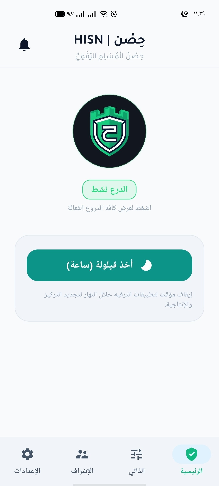 | 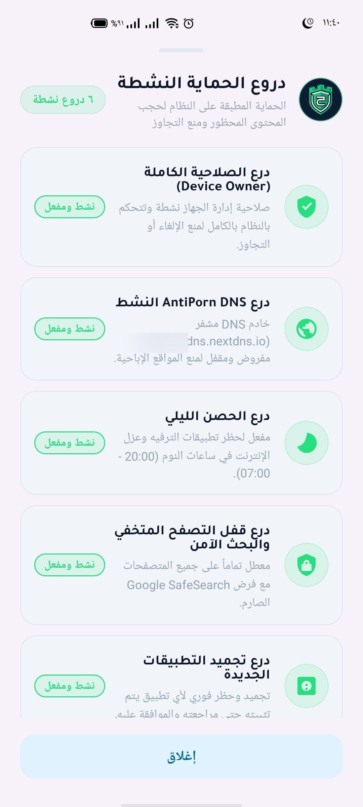 | 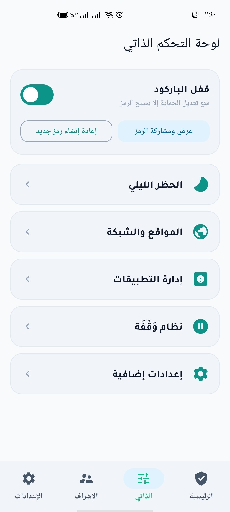 |
| **لوحة قياس الثبات والدرع الفعال** | **مراقبة وحالة الدروع اللحظية** | **مهلات التأخير وأقفال الطوارئ** |

### 2. الانضباط الزمني وشبكة الـ DNS المشفرة
| فك القفل بالـ QR المؤقت | حظر التجوال الليلي والنوم والقيلولة | إعدادات الـ DNS المشفر (DoT) |
|:---:|:---:|:---:|
| 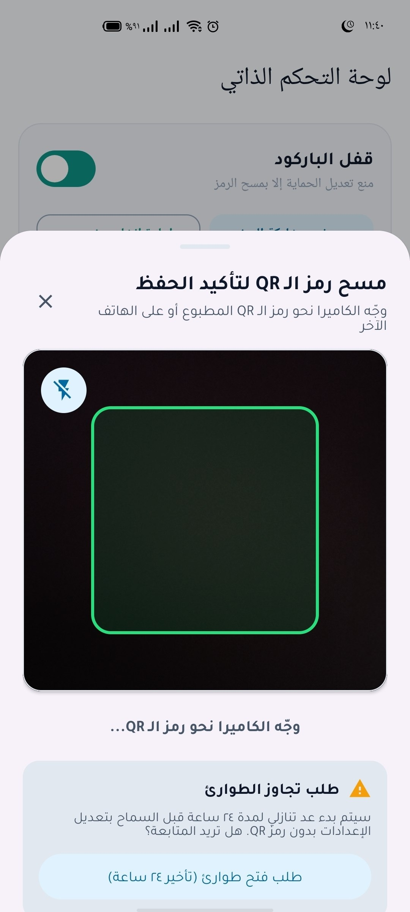 | 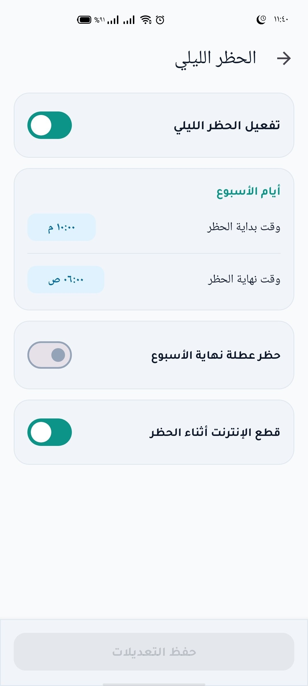 | 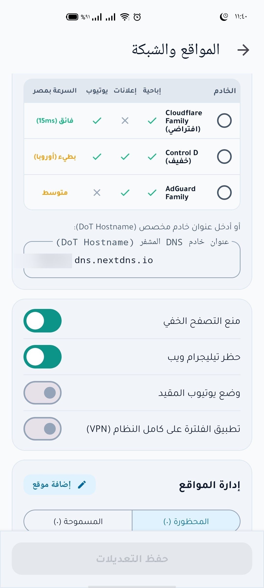 |
| **مسح رمز فعلي مع تأخير مدروس** | **جدولة ساعات النوم وعزل التطبيقات** | **فرض خوادم DoT العائلية المشفرة** |

### 3. إدارة التطبيقات وبوابة التدبر والمساءلة
| إدارة سياسات التطبيقات (SSOT) | بوابة «وقفة» للتدبر النفسي | لوحة متابعة المكفول عن بُعد |
|:---:|:---:|:---:|
| 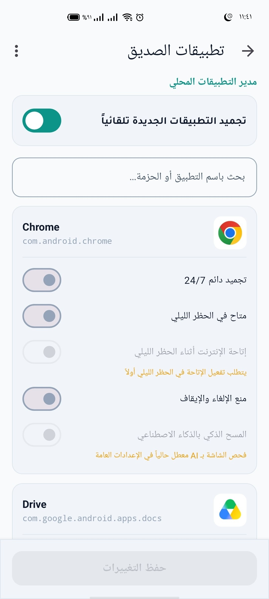 | 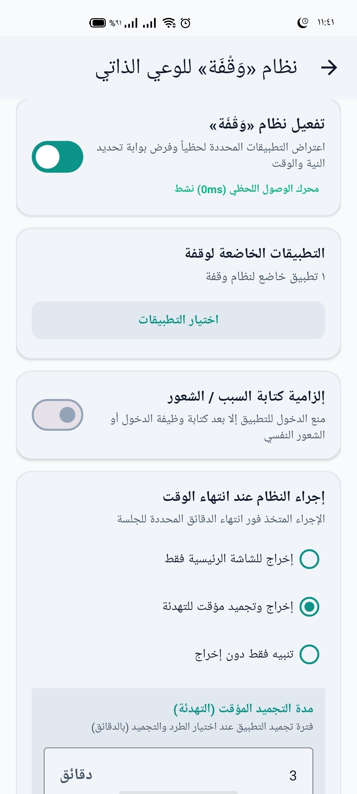 | 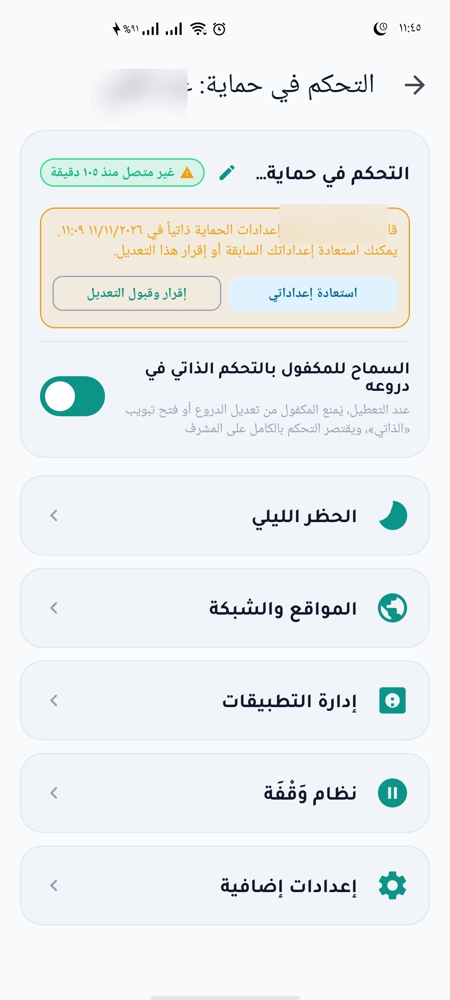 |
| **تجميد وحظر التطبيقات ديناميكياً** | **تمارين تنفس وتريث قبل الفتح** | **مراقبة التزام المكفول وتحديث السياسات** |

### 4. مركز رفيق المساءلة والتحكم المشترك
| مركز رفيق المساءلة والتحقق المشترك المشفر |
|:---:|
| 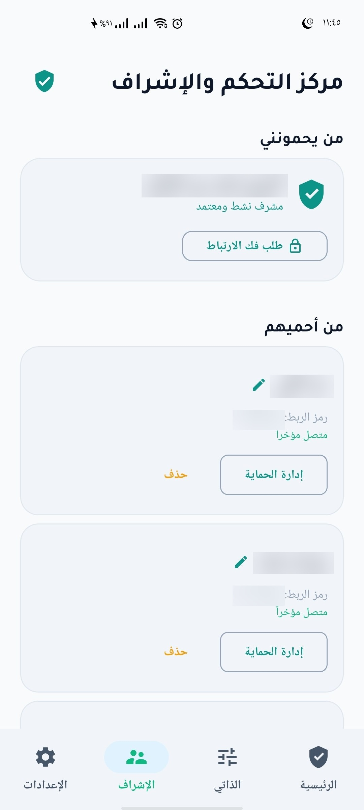 |
| **المشرفون المعتمدون، وقوائم المكفولين، ومزامنة السحابة المشفرة** |

</div>

---

## 📌 المحدد الهندسي الصارم لحماية بيئة المطور (Core Developer Invariant)

> [!IMPORTANT]
> ### 🛡️ إبقاء تصحيح أخطاء USB (USB Debugging / ADB) متاحاً بشكل دائم للمطور:
> * صاحب ومطور هذا المشروع وجمهور مستهدف واسع منه يعملون في **مجال هندسة وتطوير برمجيات الهواتف الذكية (Mobile Software Engineering)**.
> * ولذلك، فإن المعمارية تفرض **قيداً صارماً وغير قابل للتفاوض (Strict Invariant)** يمنع منعاً باتاً استدعاء أو فرض أي من القيود التالية برمجياً:
>   - ❌ `UserManager.DISALLOW_DEBUGGING_FEATURES`
>   - ❌ `UserManager.DISALLOW_CONFIG_DEVELOPER_OPTIONS`
> * **الهدف المعماري:** إحكام غلق كافة الثغرات السلوكية والمباشرة أثناء الاستخدام الفردي للجهاز (الـ DNS، قفل الـ VPN، حظر متصفحات التصفح الخفي، التعتيم البصري الفوري للشاشة، وتجميد التطبيقات المشتتة) مع الاحتفاظ بالهاتف كبيئة عمل واختبار وتطوير برمجية متكاملة عبر الحاسوب دون أي تعارض.

---

## 🏗️ المعمارية الهندسية الشاملة للنظام (High-Level System Topology)

يعتمد «حِصْن» على تصميم معماري متعدد الطبقات (Clean Architecture) يفصل بصرامة بين العرض، المنطق، الدروع الدفاعية، وواجهات النظام الخام:

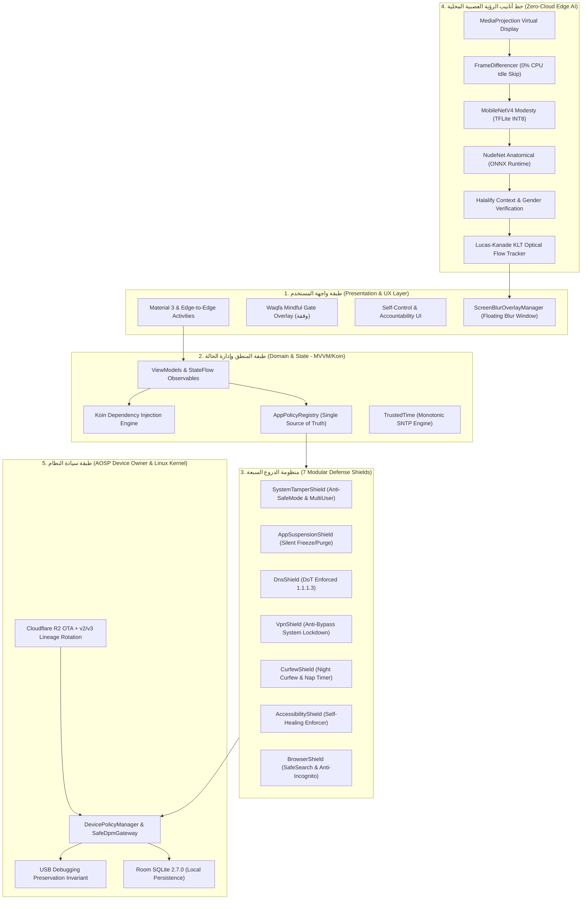

---

## 🛡️ مصفوفة دروع الحماية السبعة (The 7 Modular Zero-Trust Shields)

تتكامل منظومة الحماية عبر 7 دروع معيارية مستقلة يتم حقنها وإدارتها عبر [`AppPolicyRegistry`](docs/APP_POLICY_REGISTRY.md) وفق مبدأ المصدر الموحد للحقيقة:

| الدرع الدفاعي | ناقل الحماية (Target Vector) | واجهات النظام الخام (AOSP Enforcement APIs) | آلية الصمود والتعافي (Resilience & Fail-safe) |
| :--- | :--- | :--- | :--- |
| **1. `SystemTamperShield`** | منع الالتفاف وتعطيل الحماية | `setSafeBootBlocked`, `DISALLOW_SAFE_BOOT`, `DISALLOW_ADD_USER`, `DISALLOW_FACTORY_RESET` | رصد محاولات العبث بالساعة والنظام وإعادة قفل الإعدادات فوراً. |
| **2. `AppSuspensionShield`** | عزل وتجميد التطبيقات المحظورة | `setPackagesSuspended`, `PackageManager.setApplicationEnabledSetting` | مسح فوري وصامت للتطبيقات المحظورة قطعياً (تيك توك، برامج التعارف، متصفحات التصفح الخفي). |
| **3. `DnsShield`** | تشفير وحجب النطاقات والمواقع | `setGlobalPrivateDnsModeSpecifiedHost`, `DISALLOW_CONFIG_PRIVATE_DNS` | فرض DoT بخوادم Cloudflare Family (`family.cloudflare-dns.com`) ومراقبة خلفية عبر `DnsWatchdogService`. |
| **4. `VpnShield`** | منع كسر التصفية عبر تطبيقات VPN | `UserManager.DISALLOW_CONFIG_VPN` | إبطال عمل بروتوكولات وتطبيقات الـ VPN الخارجية على مستوى نواة أندرويد. |
| **5. `CurfewShield`** | حظر التجوال الليلي وإدارة النوم | `CurfewBlackholeVpnService`, `CurfewEnforcer`, `NapController` | توجيه حركة المرور إلى ثقب أسود محلي مجدول من 20:30 إلى 07:00 (توقيت مكة) مع مؤقت قيلولة صارم. |
| **6. `AccessibilityShield`** | استدامة صلاحيات إمكانية الوصول | `AccessibilitySelfActivator`, `TransientWindowEventFilter` | إعادة تفعيل خدمة إمكانية الوصول ذاتياً ومنع المستخدم من إيقافها برمجياً. |
| **7. `BrowserShield`** | إلغاء التصفح الخفي وإجبار البحث الآمن | `AppPolicyRegistry`, `BrowserUrlSanitizer`, Chromium Managed Policies | فرض قيود المتصفحات عبر ملفات السياسات المؤسسية وحجب الروابط المشبوهة لحظياً. |

---

## 🧠 خط أنابيب الرؤية العصبية المحلية (On-Device Edge AI Pipeline)

يعتمد «حِصْن» على خط استدلال بصري متسلسل فائق الخفة والسرعة (Cascaded Inference Pipeline)، يعمل محلياً 100% لحماية خصوصية المستخدم المطلقة وتوفير طاقة البطارية:

```
[MediaProjection Stream]
         ↓
[FrameDifferencer] ──(لا يوجد تغيير في الشاشة)──> تخطي المعالجة تماماً (0% CPU)
         ↓ (رصد حركة جديدة)
[Tier 1: MobileNetV4 Modesty (TFLite)] ──(محتوى آمن)──> الاستمرار الطبيعي
         ↓ (رصد احتمال عدم احتشام > 0.40)
[Tier 2: NudeNet Anatomical (ONNX Runtime)] ──(تحديد دقيق للأعضاء والأجزاء المكشوفة)
         ↓
[Tier 3: Halalify Context & Gender Verification]
         ↓
[Lucas-Kanade KLT Optical Flow Tracker] ──> تتبع مسار العناصر بمعدل 60fps واستهلاك < 2ms
         ↓
[ScreenBlurOverlayManager] ──> طبقة تعتيم فورية عائمة تغطي الشاشة بالكامل
```

* **التتبع البصري فائق الخفة (`KltOpticalFlowTracker`):** بدلاً من استدعاء نماذج الذكاء الاصطناعي الثقيلة في كل إطار، يتم تشغيل النموذج مرة واحدة ثم تسليم الإحداثيات لخوارزمية الهرم البصري (Pyramidal Lucas-Kanade) لتتبع الحركة باستهلاك شبه معدوم للطاقة.
* **سجل الاستثناءات الذكي (`AiExemptionRegistry`):** استثناء محمي للتطبيقات الموثوقة وبيئات التطوير البرمجي لتفادي الإنذارات الكاذبة أثناء العمل اليومي.

---

## ⏳ محرك «وقفة» السلوكي لكسر تدفق الدوبامين (The Waqfa Behavioral Circuit Breaker)

استناداً إلى الأبحاث الطبية في علم الأعصاب وعلاج الإدمان السلوكي، فإن الرغبة الملحة تتبع منحنى موجي (Urge Curve) يبلغ ذروته في أول 90 ثانية.  
صُممت **بوابة «وقفة» (Waqfa Gate)** كقاطع دائرة سلوكي (Behavioral Circuit Breaker):

* **الاحتكاك الإيجابي الموجه:** عند محاولة فتح تطبيق خاضع للتدبر (مثل منصات التسوق أو المحتوى المشتت)، تُفتح واجهة ملء الشاشة تجبر المستخدم على التوقف والتريث.
* **تمارين التنفس والتدبر:** عد تنازلي غير قابل للتخطي مصحوب بتمارين تنفس منظمة وإرشادات نفسية لكسر دائرة الاندفاع واستعادة السيطرة الواعية.
* **منع التكرار الاندفاعي:** تتبع الجلسات عبر `WaqfaSessionManager` لفرض قيود متزايدة في حال تكرار الفتح خلال فترات زمنية قصيرة.

---

## ⚡ دليل التثبيت وتفعيل الصلاحية دون حذف الحسابات (Zero-Account-Loss Activation Guide)

> [!TIP]
> ### 🔓 تجاوز حاجز الحسابات في أندرويد (The Zero-Account Bypass Breakthrough)
> في نظام أندرويد الخام (AOSP)، تمنع دالة `enforceCanSetDeviceOwnerLocked` تفعيل مسؤول الجهاز المالك إذا كانت هناك حسابات مسجلة (جوجل، واتساب، بنوك...).  
> ومع ذلك، توجد **نقطة تخطي ذهبية معمارية داخل كود أندرويد**: إذا كانت قيمة `user_setup_complete = 0`، يتخطى النظام كافة فحوصات الحسابات فوراً!  
> يدعم «حِصْن» تطبيق هذه الخوارزمية تلقائياً دون الحاجة لمسح الهاتف أو حذف أي حساب، كما هو مشروح بالتفصيل في **[المرجع الهندسي لتفعيل Device Owner دون حذف الحسابات](docs/device-owner-guide.md)**.

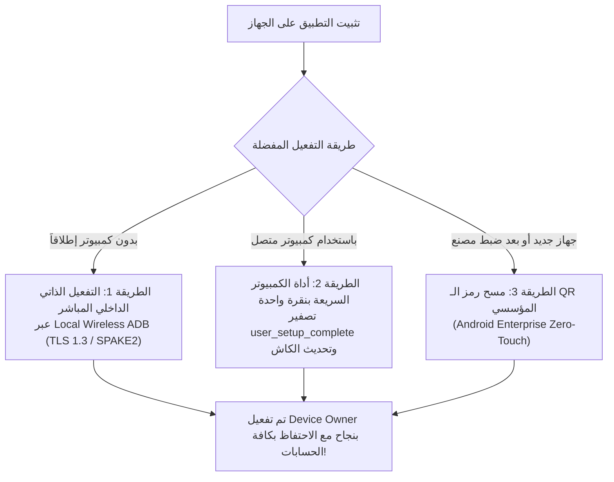

### الطريقة 1: التفعيل الذاتي من داخل التطبيق (دون كمبيوتر إطلاقاً ودون حذف حسابات)
1. قم بتثبيت ملف الـ APK: `adb install -r app-release.apk` (أو حمّله وثبّته مباشرة على الهاتف).
2. فعّل **تصحيح الأخطاء اللاسلكي (Wireless Debugging)** من خيارات المطورين.
3. افتح تطبيق «حِصْن» وتوجّه إلى **معالج التهيئة (Provisioning Wizard)**:
   - يدعم التطبيق داخلياً الاقتران اللاسلكي المباشر عبر بروتوكول TLS 1.3 / SPAKE2 (`DeviceOwnerPromoter.kt`) من شاشة الهاتف مباشرة دون الحاجة لأي تطبيقات وسيطة.
4. اضغط على زر **"تأكيد وتفعيل أقصى درجات الحماية"**؛ سيقوم التطبيق بتصفير مؤشر الإعداد وتحديث كاش النظام وتعيين الصلاحية لنفسه في ثوانٍ معدودة دون مسح أي حساب.

---

### الطريقة 2: التفعيل السريع عبر موجه أوامر الحاسوب (ADB دون حذف حسابات)
إذا كان هاتفك متصلاً بالكمبيوتر عبر كابل USB:

#### لأجهزة أندرويد 12 فما فوق (Android 12 to 16):
```cmd
:: 1. تصفير مؤشر اكتمال إعداد الهاتف مؤقتاً لتخطي فحص الحسابات
adb shell settings put secure user_setup_complete 0

:: 2. تعيين التطبيق كمسؤول الجهاز المالك فوراً
adb shell dpm set-device-owner com.drmohammed.antiporn/.AdminReceiver

:: 3. استعادة مؤشر الإعداد فوراً لحالته الطبيعية
adb shell settings put secure user_setup_complete 1
```

> [!NOTE]
> إذا ظهرت رسالة خطأ الحسابات على بعض واجهات أندرويد 12+ بسبب الكاش، يتم تحديث كاش النظام عبر تشغيل أداة المشروع المرفقة:
> ```cmd
> adb push scripts/setup-state-helper.jar /data/local/tmp/
> adb shell CLASSPATH=/data/local/tmp/setup-state-helper.jar app_process /system/bin SetupStateHelper 0
> adb shell dpm set-device-owner com.drmohammed.antiporn/.AdminReceiver
> adb shell settings put secure user_setup_complete 1
> adb shell rm /data/local/tmp/setup-state-helper.jar
> ```

#### لأجهزة أندرويد القديمة (Android 7 إلى 11):
يتم تجميد خدمات الحسابات مؤقتاً لمدة ثانيتين ثم تعيين الصلاحية وإعادة تفعيلها:
```cmd
adb shell pm disable-user com.google.android.gms
adb shell dpm set-device-owner com.drmohammed.antiporn/.AdminReceiver
adb shell pm enable com.google.android.gms
```

---

### الطريقة 3: التهيئة المؤسسية للأجهزة الجديدة أو بعد الفورمات (Android Enterprise QR)
1. عند تشغيل هاتف جديد أو بعد ضبط المصنع، انقر 6 مرات متتالية على شاشة الترحيب لتفعيل كاميرا مسح الـ QR.
2. امسح رمز الاستجابة السريعة المولد عبر سكربت المشروع:
   ```powershell
   .\scripts\generate_qr_payload.ps1
   ```
3. سيتولى نظام أندرويد تنزيل التطبيق وتفعيله كمالك حصري للجهاز بصورة مؤسسية كاملة.

---

### 🛡️ معمارية مقاومة التلاعب والإلغاء الآمن (Tamper Resistance & Safe Deactivation)
لحماية المتعافي من القرارات الاندفاعية في لحظات الضعف النفسي، لا يتيح تطبيق "حصن" أزرار إلغاء فورية. تتم إدارة إلغاء التفعيل وسحب صلاحية مسؤول الجهاز بأمان كامل من داخل التطبيق عبر محرك `DeviceOwnerTeardownManager`:
* **في الوضع الفردي المستقل (Standalone):** يلزم انقضاء مهلة تهدئة زمنية صارمة مدتها 48 ساعة (Cooling-off Period) قبل إتاحة سحب الصلاحية.
* **في الوضع الخاضع للإشراف (Supervised):** يتطلب الإلغاء موافقة الشريك أو تفعيل عداد الطوارئ المشروط بمرور 24 ساعة ومحكوم بتوقيت خوادم المزامنة.

> 🛠️ **مرجع المطورين للاختبار البرمجي:**  
> للمطورين والباحثين الأمنيين الذين يجرون تجاربهم على أجهزة الاختبار، يمكن الاطلاع على [دليل إلغاء الصلاحية للمطورين في docs/device-owner-guide.md](docs/device-owner-guide.md#developer-de-provisioning) لمعرفة أوامر سطر أوامر ADB.

---

## 📊 المقاييس الهندسية وأجنحة الاختبار المؤتمتة (Verified Engineering Metrics)

تم إخضاع المشروع لفحص دقيق وشامل لكافة أجنحة الاختبار ومكونات البناء عبر Gradle:

| المقياس الهندسي (Engineering Metric) | القيمة الحالية المؤكدة | التفاصيل البرمجية والملاحظات |
| :--- | :---: | :--- |
| **إجمالي أجنحة الاختبار (Test Suites)** | **42 حزمة اختبار مستقلة** | تغطي كافة الطبقات: الدروع، الذكاء الاصطناعي، الشبكة، الترحيل، والـ UI. |
| **إجمالي الاختبارات المؤتمتة (Unit Tests)** | **321 اختباراً فردياً** | **نجاح بنسبة 100% (0 failures, 0 errors, 0 skipped)**. |
| **أسطر كود Kotlin الفعلي (Main)** | **38,281 سطر برمجي** | كود إنتاجي نقي موزع على 196 ملفاً برمجياً. |
| **أسطر كود أجنحة الاختبار (Tests)** | **5,929 سطر برمجي** | اختبارات سلوكية وحسابية جدارية لضمان ثبات النظام وعدم الانهيار. |
| **إجمالي أسطر كوتلن في المشروع** | **44,210 سطر برمجي** | تلتزم بقواعد Clean Code ومبادئ SOLID و DRY. |
| **إصدار بيئة أندرويد المستهدفة** | **Android 16 (API 36)** | متوافق تراجعياً حتى Android 7.0 (API 24 - Nougat). |
| **محرك قاعدة البيانات المحلية** | **Jetpack Room 2.7.0** | مع 11 اختبار ترحيل آلي للمخططات (`RoomMigrationTest`). |
| **محقن التبعيات (Dependency Injection)** | **Koin 3.5.6** | هيكلية معيارية تفصل مجالات النظام بالكامل. |

---

## 📚 بوابة التوثيق المعماري الموسع (Documentation Portal)

يحتوي مجلد [`docs/`](docs/README.md) و [`scripts/`](scripts/README.md) على أدلة فنية تفصيلية متخصصة:

* 📱 **[المرجع الهندسي لتفعيل Device Owner دون حذف الحسابات (device-owner-guide.md)](docs/device-owner-guide.md):**  
  تشريح عميق في كود أندرويد الخام (AOSP) لطرق التجاوز الخمس وتفعيل الصلاحية دون مسح بيانات الجهاز.
* 📘 **[دليل المعمارية الموحدة لسياسات التطبيقات (APP_POLICY_REGISTRY.md)](docs/APP_POLICY_REGISTRY.md):**  
  شرح معمارية المصدر الموحد للحقيقة (SSOT)، ودليل إضافة أو استثناء التطبيقات بسطر برمجي واحد.
* 🛡️ **[خارطة الطريق الجيلية ورؤية المشروع (GENERATIONAL_ANTIPORN_ROADMAP.md)](docs/GENERATIONAL_ANTIPORN_ROADMAP.md):**  
  الوثيقة الفلسفية والاستراتيجية الكبرى: فسيولوجيا الإدمان، نمط قاطع الدائرة، والذكاء الاصطناعي على الجهاز.
* 📡 **[دليل التحديثات الهوائية وتدوير المفاتيح (OTA_DISTRIBUTION.md)](docs/OTA_DISTRIBUTION.md):**  
  شرح منظومة التوزيع المستقلة عبر Cloudflare R2 وتدوير مفاتيح APK Signature Scheme v2/v3 Lineage Rotation.
* 🛠️ **[أدوات وأدلة الأتمتة المساعدة والنشر (scripts/README.md)](scripts/README.md):**  
  دليل سكربتات PowerShell للبناء التلقائي، النسخ الاحتياطي، توليد حمولات الـ QR، والنشر الفوري.
* 📸 **[معرض لقطات الشاشة وفهرس الواجهات (art/screenshots/README.md)](art/screenshots/README.md):**  
  الفهرس الكامل لكافة الواجهات والشاشات وتجربة المستخدم.

---

## 💻 البناء والتطوير المحلي وبوابة الأمان (Local Build, CI/CD & Security)

### استنساخ المستودع والبناء الفوري (Zero-Setup Clone)
1. استنسخ المستودع:
   ```bash
   git clone https://github.com/dr-mohammed-hamed/antiporn.git
   cd antiporn
   ```
2. **ملف Firebase التجريبي التلقائي:**  
   تم تجهيز بيئة البناء بحيث تقوم تلقائياً بإنشاء ملف `app/google-services.json` تجريبي وهمي صالح فور تشغيل مهام Gradle إذا لم يكن الملف موجوداً، مما يتيح تجميع وبناء المشروع وتشغيل كافة الاختبارات بنقرة واحدة دون الحاجة لأي إعدادات يدوية مسبقة.
3. **تشغيل الاختبارات الأحادية:**
   ```bash
   # Windows (PowerShell)
   .\gradlew.bat testDebugUnitTest

   # Linux / macOS
   ./gradlew testDebugUnitTest
   ```

### بوابة التحقق من الأمان في الـ CI (Zero Leaks Gate)
يتضمن مسار التكامل المستمر ([`.github/workflows/ci.yml`](.github/workflows/ci.yml)) فحصاً دستورياً صارماً يمنع دمج أي كود يحتوي على ملفات المفاتيح الإنتاجية (`antiporn-release.jks`) أو ملفات التكوين الحساسة (`local.properties`).

---

## 🤝 المساهمة والمسؤولية الأمنية (Contributing & Security)

نرحب بكافة المساهمات والمقترحات البرمجية لتعزيز قوة وثبات المنظومة:
* 🔒 **الإبلاغ عن الثغرات الأمنية:** يرجى مراجعة [سياسة الأمان (SECURITY.md)](SECURITY.md) للإبلاغ المسؤول والسري.
* 🛠️ **إرشادات التطوير والكود النظيف:** يرجى قراءة [دليل المساهمة (CONTRIBUTING.md)](CONTRIBUTING.md) وقواعد الفحص الصارم.
* 📜 **الملكية الفكرية والتبعيات:** تفاصيل التبعيات والمشاريع الحرة الشقيقة مسجلة في ملف [NOTICE](NOTICE).

---

## 📜 الترخيص والملكية الفكرية (License & Attribution)

مشروع **«حِصْن» (AntiPorn DO)** برمجية حرة ومفتوحة المصدر مرخصة بموجب **[رخصة جنو العمومية الإصدار 3.0 (GNU General Public License v3.0 - GPL-3.0)](LICENSE)**.  
هذا المشروع وقف لله تعالى لحماية عقول وأعراض وأوقات الأمة والشباب من الإدمان الرقمي والمحتوى المشتت.

---

<p align="center">
  صُنع بفضل الله بعناية طبية وهندسية فائقة لحماية الأمة 🛡️
</p>
