# «Hisn» (حِصْن) - Enterprise Zero-Trust AntiPorn Device Owner 🛡️

<p align="center">
  <a href="README.ar.md"><strong>🇸🇦 اقرأ التوثيق الكامل باللغة العربية (Read in Arabic)</strong></a>
</p>

<p align="center">
  
</p>

<p align="center">
  <strong>Advanced Self-Control & Zero-Trust Digital Defense Stack for Android</strong>
  <br />
  <em>On-Device Edge AI Vision + Kernel-Level Device Owner Enforcement + Zero-Account-Loss Provisioning</em>
</p>

<p align="center">
  <a href="LICENSE"></a>
  <a href="https://developer.android.com/about/versions/16"></a>
  <a href="https://kotlinlang.org"></a>
  <a href="app/src/test/java"></a>
  <a href="docs/APP_POLICY_REGISTRY.md"></a>
  <a href="docs/GENERATIONAL_ANTIPORN_ROADMAP.md"></a>
  <a href="docs/OTA_DISTRIBUTION.md"></a>
</p>

---

## 📑 Table of Contents

1. [Executive Vision & Medical-Engineering Paradigm](#-executive-vision--medical-engineering-paradigm)
2. [Visual Product Showcase](#-visual-product-showcase)
3. [Core Developer Invariant: Permanent ADB Preservation](#-core-developer-invariant-permanent-adb-preservation)
4. [High-Level System Topology & Architecture](#-high-level-system-topology--architecture)
5. [The 7 Modular Zero-Trust Shields Matrix](#-the-7-modular-zero-trust-shields-matrix)
6. [On-Device Cascaded Edge AI & Neural Vision Pipeline](#-on-device-cascaded-edge-ai--neural-vision-pipeline)
7. [The "Waqfa" Behavioral Circuit Breaker](#-the-waqfa-behavioral-circuit-breaker)
8. [Zero-Account-Loss Activation & Provisioning Guide](#-zero-account-loss-activation--provisioning-guide)
9. [Verified Engineering Metrics & Test Suites](#-verified-engineering-metrics--test-suites)
10. [Architectural Documentation Portal](#-architectural-documentation-portal)
11. [Local Build, CI/CD Pipeline & Zero-Leak Gate](#-local-build-cicd-pipeline--zero-leak-gate)
12. [Contributing, Responsible Disclosure & License](#-contributing-responsible-disclosure--license)

---

## 📖 Executive Vision & Medical-Engineering Paradigm

**«Hisn» (AntiPorn DO)** is an enterprise-grade digital defense system engineered at the intersection of **clinical neurobiology** and **AOSP kernel-level zero-trust systems engineering**.

Developed by **Dr. Mohammed Hamed** (physician and systems engineer), this project dismantles the traditional, flawed paradigm of relying on ephemeral human willpower during impulsive dopamine rushes. Instead, it deploys **friction-enforced behavioral circuit breakers** and **immutable OS-level barriers**.

### Core Architectural Pillars:
* **The Dopamine Circuit Breaker:** Neuroscience proves that impulsive cravings follow a temporal wave (*Urge Surfing*) peaking within the first 90 seconds. Hisn enforces intentional physiological friction (mindful breathing gates, delayed QR unlocks, non-skippable reflection prompts) allowing the prefrontal cortex to regain control.
* **Kernel & OS-Level Zero-Trust Enforcement:** Leveraging Android Enterprise **Device Owner (DPM)** privileges, the system applies tamper-proof restrictions immune to bypass, force-stops, safe-mode reboots, guest user creation, or impulsive uninstallation.
* **100% On-Device Neural Vision (Zero-Cloud Privacy):** All visual stream inferences run entirely locally on the phone's NPU/CPU. Zero frames, zero telemetry, and zero screenshots ever leave the hardware boundary.
* **Mobile Engineer Invariant:** Full digital discipline is maintained without compromising software engineering workflows. USB debugging and ADB connectivity are permanently preserved by design.

---

## 📸 Visual Product Showcase

<div align="center">

### 1. Core Protection Ecosystem & Active Shields
| Home Dashboard & Commitment Status | 7 Active Protection Shields | Self-Control & Willpower Portal |
|:---:|:---:|:---:|
| 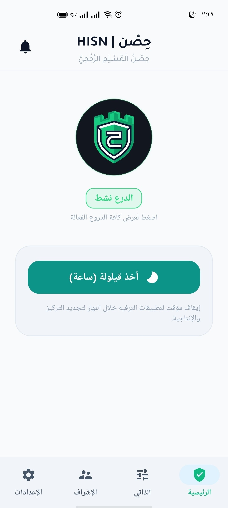 | 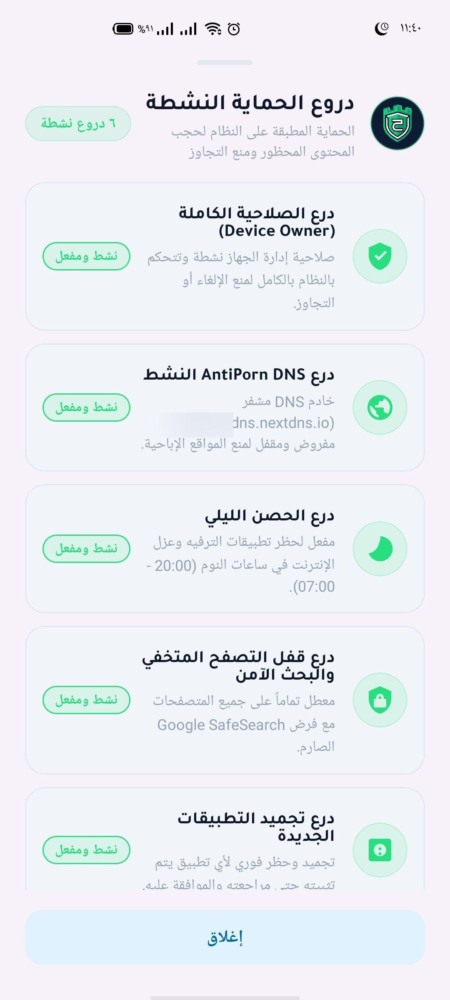 | 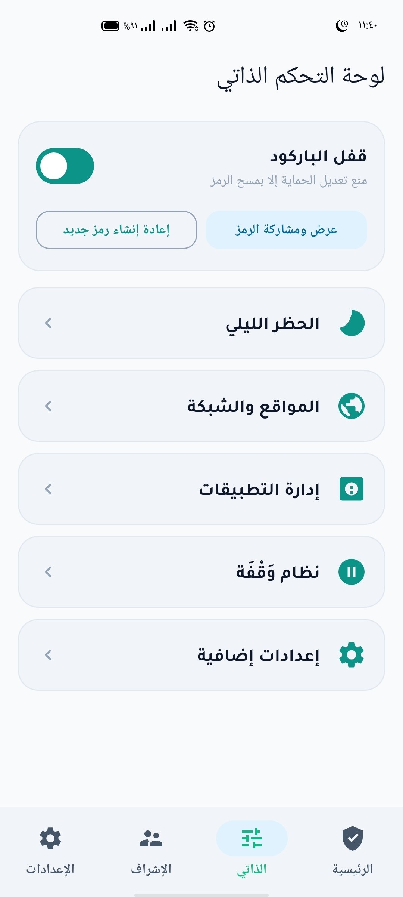 |
| **Real-time defense state & score** | **Granular OS-level shield status** | **Friction delays & emergency locks** |

### 2. Temporal Discipline & Encrypted Network Infrastructure
| Time-Locked QR Unlock Delay | Night Curfew & Smart Nap Control | Encrypted DNS over TLS (DoT) |
|:---:|:---:|:---:|
| 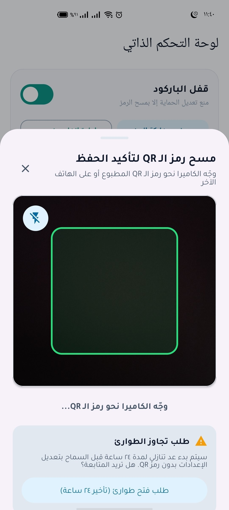 | 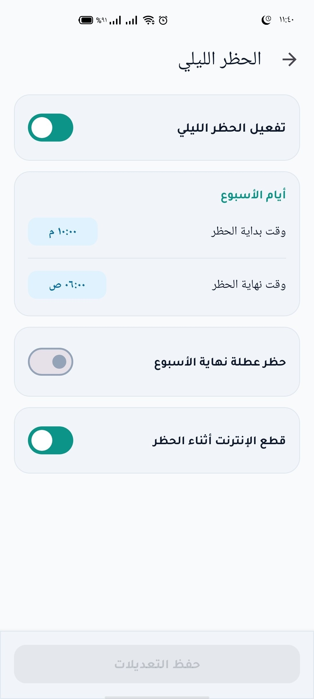 | 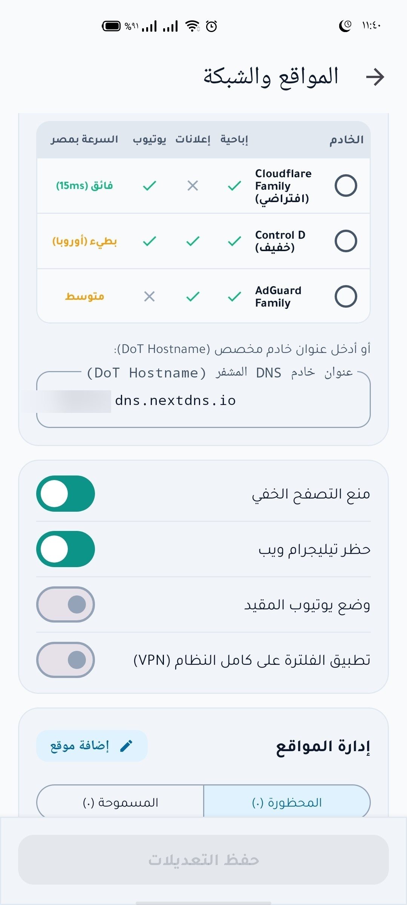 |
| **Physical paper QR + intentional timer** | **Scheduled app suspension & curfew** | **Enforced Cloudflare Family DoT** |

### 3. Application Governance & Mindful Reflection Gate
| App Policy Manager (SSOT) | «Waqfa» Mindful Gate | Remote Ward Supervision Portal |
|:---:|:---:|:---:|
| 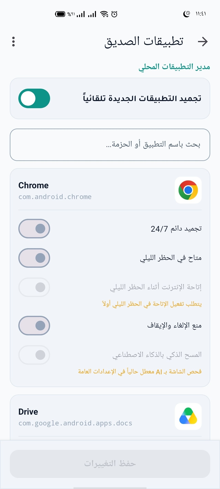 | 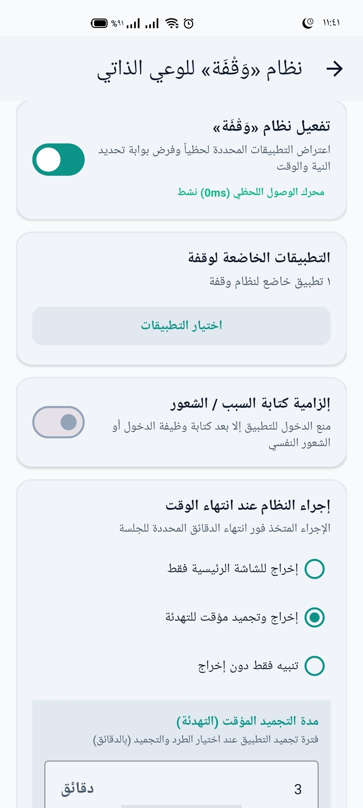 | 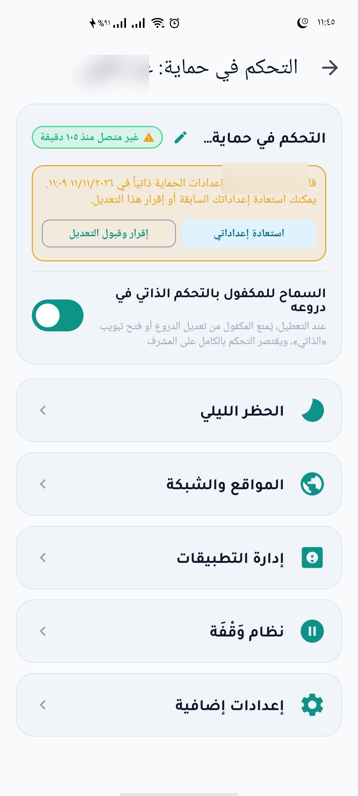 |
| **Dynamic app suspension & policy rules** | **Paced breathing & cognitive friction** | **Encrypted guardian policy monitoring** |

### 4. Accountability Center & Mutual Verification
| Cryptographically Paired Accountability Center |
|:---:|
| 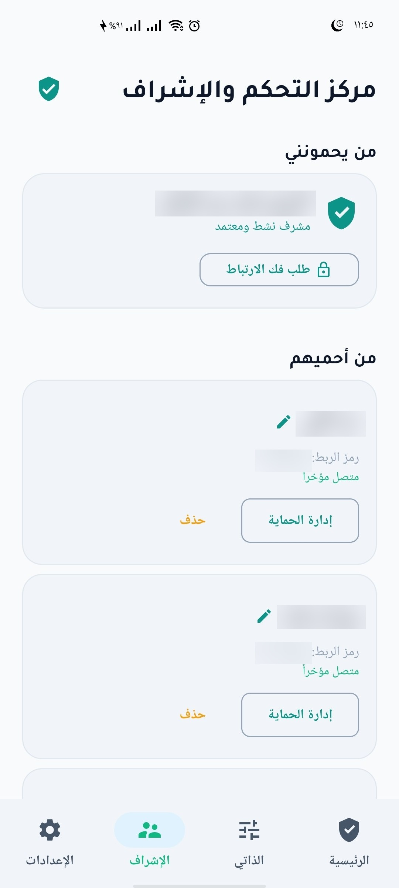 |
| **Trusted guardians, supervised wards, and end-to-end synced policies** |

</div>

---

## 📌 Core Developer Invariant: Permanent ADB Preservation

> [!IMPORTANT]
> ### 🛡️ Permanent USB Debugging & ADB Guarantee:
> * The author of this project and a substantial segment of its target developer community work professionally in **Mobile Software Engineering**.
> * Therefore, the architecture enforces an immutable, non-negotiable **Contractual Invariant**:
>   - ❌ `UserManager.DISALLOW_DEBUGGING_FEATURES` is **NEVER** applied.
>   - ❌ `UserManager.DISALLOW_CONFIG_DEVELOPER_OPTIONS` is **NEVER** applied.
> * **Design Objective:** Close all impulsive on-screen bypass vectors during individual phone usage (enforcing Private DNS, locking down third-party VPNs, disabling incognito browsers, instant AI screen blurring, and freezing distracting apps) while preserving the device as a complete, fully operable development and test workstation via computer-tethered ADB.

---

## 🏗️ High-Level System Topology & Architecture

Hisn follows Clean Architecture with strict modular boundaries between Presentation, Domain/State, Defense Shields, Local AI, and Android OS Kernel APIs:

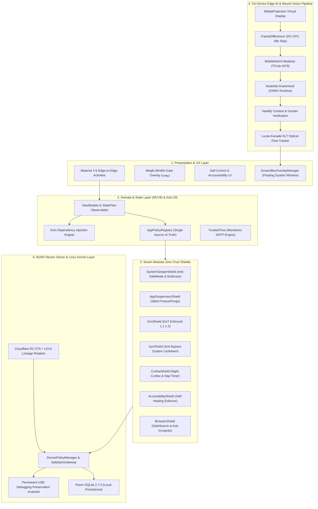

---

## 🛡️ The 7 Modular Zero-Trust Shields Matrix

System policies are governed centrally by [`AppPolicyRegistry`](docs/APP_POLICY_REGISTRY.md) (Single Source of Truth - SSOT) and executed across 7 modular shields:

| Defense Shield | Target Vector | AOSP Enforcement APIs | Resilience & Recovery Mechanism |
| :--- | :--- | :--- | :--- |
| **1. `SystemTamperShield`** | OS tampering, settings manipulation | `setSafeBootBlocked`, `DISALLOW_SAFE_BOOT`, `DISALLOW_ADD_USER`, `DISALLOW_FACTORY_RESET` | Detects attempts to alter system clock or users and immediately reapplies restrictions. |
| **2. `AppSuspensionShield`** | Impulsive distraction & forbidden apps | `setPackagesSuspended`, `PackageManager.setApplicationEnabledSetting` | Immediate, silent suspension and removal of blacklisted packages (TikTok, dating apps, incognito browsers). |
| **3. `DnsShield`** | Unfiltered DNS and malicious domains | `setGlobalPrivateDnsModeSpecifiedHost`, `DISALLOW_CONFIG_PRIVATE_DNS` | Enforces DoT with Cloudflare Family (`family.cloudflare-dns.com` 1.1.1.3), continuously audited by `DnsWatchdogService`. |
| **4. `VpnShield`** | Filter evasion via third-party VPNs | `UserManager.DISALLOW_CONFIG_VPN` | System-wide kernel restriction preventing third-party VPN tunnels from establishing. |
| **5. `CurfewShield`** | Late-night usage & sleep disruption | `CurfewBlackholeVpnService`, `CurfewEnforcer`, `NapController` | Routes unauthorized traffic into a local scheduled blackhole between 20:30 and 07:00 (Makkah time) with nap timer support. |
| **6. `AccessibilityShield`** | Service termination by user | `AccessibilitySelfActivator`, `TransientWindowEventFilter` | Automatically reactivates accessibility services via Device Owner privileges upon disconnection. |
| **7. `BrowserShield`** | Incognito browsing & NSFW search | `AppPolicyRegistry`, `BrowserUrlSanitizer`, Chromium Managed Policies | Enforces managed policies across Chromium browsers (disables incognito, enforces SafeSearch, sanitizes URLs). |

---

## 🧠 On-Device Cascaded Edge AI & Neural Vision Pipeline

To protect user privacy with **zero cloud dependencies** and prevent battery drain, Hisn uses a multi-tier cascaded inference pipeline:

```
[MediaProjection Virtual Frame Stream]
                 ↓
[FrameDifferencer] ──(Screen is Static)──> Skip Processing (0% CPU / Zero Battery Waste)
                 ↓ (Motion or Content Change Detected)
[Tier 1: MobileNetV4 Modesty (TFLite INT8)] ──(Safe Content)──> Continue Normal Rendering
                 ↓ (Immodesty Probability > 0.40)
[Tier 2: NudeNet Anatomical (ONNX Runtime)] ──(Granular Anatomical Bounding Boxes)
                 ↓
[Tier 3: Halalify Context & Gender Verification]
                 ↓
[Lucas-Kanade KLT Optical Flow Tracker] ──> Sub-millisecond tracking at 60fps (< 2ms CPU)
                 ↓
[ScreenBlurOverlayManager] ──> Instant system-level floating blur overlay
```

* **Lucas-Kanade Optical Flow (`KltOpticalFlowTracker`):** Instead of executing heavy neural network inference on every frame (which would overheat the device), the deep model runs once upon detection, and coordinates are handed to pyramidal Lucas-Kanade optical flow tracking.
* **Exemption Engine (`AiExemptionRegistry`):** Trusted developer tools, IDEs, and secure productivity apps are exempt to prevent false positives during technical work.

---

## ⏳ The "Waqfa" Behavioral Circuit Breaker

Impulsive urges follow a neurobiological surge curve. The **«Waqfa» (وقفة) Gate** acts as an intentional circuit breaker:

* **Paced Breathing & Reflection:** Opening borderline or shopping applications triggers a full-screen mindful overlay requiring controlled breathing and reflection before access is granted.
* **Non-Skippable Delay Countdown:** A timed cooling-off window interrupts autonomic dopamine spikes, returning executive control to the user's prefrontal cortex.
* **Session Rate Limiting:** Managed by `WaqfaSessionManager`, successive attempts to reopen restricted apps incur progressively longer cooling periods.

---

## ⚡ Zero-Account-Loss Activation & Provisioning Guide

> [!TIP]
> ### 🔓 The AOSP Zero-Account Bypass Breakthrough:
> In pure Android (AOSP), `DevicePolicyManagerService.enforceCanSetDeviceOwnerLocked()` rejects Device Owner setup if any user accounts (Google, WhatsApp, banking) exist.  
> However, an architectural exception exists: **when `user_setup_complete = 0`, AOSP skips all account and multi-user checks entirely!**  
> Hisn leverages this mechanism natively, allowing users to activate full Device Owner rights **WITHOUT wiping their phone or removing a single account**. Read the complete deep-dive in **[The Complete Device Owner Guide](docs/device-owner-guide.md)**.

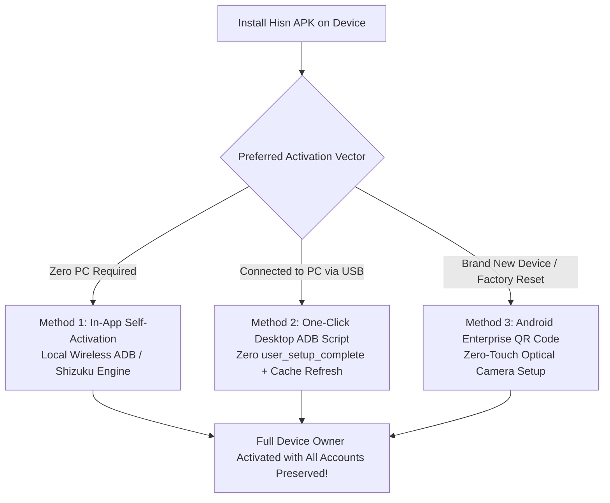

### Method 1: On-Device Self-Activation (Zero PC, Zero Account Deletion)
1. Install the APK: `adb install -r app-release.apk` (or download and install directly on device).
2. Enable **Wireless Debugging** in Android Developer Options.
3. Open Hisn and navigate to the **Provisioning Wizard**:
   - The app natively supports pairing over local loopback TLS/SPAKE2 (`DeviceOwnerPromoter.kt`) or via **[Shizuku](https://shizuku.rikka.app/)**.
4. Tap **"Self-Promote to Device Owner"**; the app automatically zeroes `user_setup_complete`, flushes the DPM cache, and promotes itself in seconds without touching your accounts.

---

### Method 2: Fast PC Command-Line Activation (ADB Without Account Loss)
With the phone connected to your PC via USB:

#### For Android 12 to 16 (API 31 to 36):
```cmd
:: 1. Temporarily toggle user_setup_complete to bypass account checks
adb shell settings put secure user_setup_complete 0

:: 2. Grant Device Owner privileges
adb shell dpm set-device-owner com.drmohammed.antiporn/.AdminReceiver

:: 3. Restore setup state immediately
adb shell settings put secure user_setup_complete 1
```

> [!NOTE]
> On certain OEM skins (OneUI, HyperOS) where DPM caches state in memory, update the cache using the project helper payload:
> ```cmd
> adb push scripts/setup-state-helper.jar /data/local/tmp/
> adb shell CLASSPATH=/data/local/tmp/setup-state-helper.jar app_process /system/bin SetupStateHelper 0
> adb shell dpm set-device-owner com.drmohammed.antiporn/.AdminReceiver
> adb shell settings put secure user_setup_complete 1
> adb shell rm /data/local/tmp/setup-state-helper.jar
> ```

#### For Legacy Devices (Android 7 to 11):
Temporarily disable Google account services, assign owner, and re-enable:
```cmd
adb shell pm disable-user com.google.android.gms
adb shell dpm set-device-owner com.drmohammed.antiporn/.AdminReceiver
adb shell pm enable com.google.android.gms
```

---

### Method 3: Android Enterprise QR Code Provisioning (Fresh Setup)
1. On a new or factory-reset device, tap the welcome screen 6 times to open the QR camera.
2. Scan the enterprise payload generated by:
   ```powershell
   .\scripts\generate_qr_payload.ps1
   ```
3. Android OS automatically downloads, installs, and provisions Hisn as the immutable Device Owner.

---

### 🛠️ Developer De-provisioning & Uninstallation
Because USB debugging remains permanently active, you can remove Device Owner and uninstall at any time via ADB:
```bash
# 1. Remove Device Owner privileges
adb shell dpm remove-active-admin --user 0 com.drmohammed.antiporn/.AdminReceiver

# 2. Uninstall the package
adb uninstall com.drmohammed.antiporn
```

---

## 📊 Verified Engineering Metrics & Test Suites

The codebase is continuously audited and verified against rigorous static and dynamic analysis gates:

| Engineering Metric | Current Verified Value | Architecture Notes |
| :--- | :---: | :--- |
| **Automated Test Suites** | **42 Independent Suites** | Covering shields, AI inference, networking, DB migrations, and UI. |
| **Total Automated Tests** | **319 Unit Tests** | **100% Pass Rate (0 failures, 0 errors, 0 skipped)**. |
| **Main Kotlin Source Code** | **38,281 Lines of Code** | Production code organized across 196 source files. |
| **Test Kotlin Source Code** | **5,929 Lines of Code** | Comprehensive behavior-driven regression suites. |
| **Total Codebase Footprint** | **44,210 Lines of Kotlin** | Strictly adheres to Clean Code, SOLID, DRY, and KISS principles. |
| **Target Android Environment** | **Android 16 (API 36 - Baklava)** | Fully backward compatible down to Android 7.0 (API 24 - Nougat). |
| **Embedded Database Engine** | **Jetpack Room 2.7.0** | Includes 11 automated SQLite schema migration tests (`RoomMigrationTest`). |
| **Dependency Injection** | **Koin 3.5.6** | Modular dependency graph separating UI, AI, networking, and data layers. |

---

## 📚 Architectural Documentation Portal

Comprehensive documentation is indexed across [`docs/`](docs/README.md) and [`scripts/`](scripts/README.md):

* 📱 **[AOSP Device Owner Bypass Guide (device-owner-guide.md)](docs/device-owner-guide.md):**  
  Deep analysis of AOSP source code detailing all 5 methods to activate Device Owner without deleting accounts.
* 📘 **[App Policy Registry Architecture (APP_POLICY_REGISTRY.md)](docs/APP_POLICY_REGISTRY.md):**  
  Complete Single Source of Truth (SSOT) specification and guide for modifying app rules with a single line of code.
* 🛡️ **[The Generational Anti-Porn Stack (GENERATIONAL_ANTIPORN_ROADMAP.md)](docs/GENERATIONAL_ANTIPORN_ROADMAP.md):**  
  Foundational architectural blueprint covering dopamine physiology, circuit breaker patterns, and edge AI.
* 📡 **[Independent OTA Distribution & Key Rotation (OTA_DISTRIBUTION.md)](docs/OTA_DISTRIBUTION.md):**  
  Guide to hosting releases on Cloudflare R2 and rotating keys via APK Signature Scheme v2/v3 Lineage Rotation.
* 🛠️ **[Automation & Deployment Scripts Hub (scripts/README.md)](scripts/README.md):**  
  PowerShell toolset for one-click release publishing, Lineage key signing, backup creation, and QR payload generation.
* 📸 **[Visual Screenshots Gallery (art/screenshots/README.md)](art/screenshots/README.md):**  
  Complete indexed catalog of high-resolution UI screen captures and feature walkthroughs.

---

## 💻 Local Build, CI/CD Pipeline & Zero-Leak Gate

### Clean Clone Setup (Zero Configuration)
1. Clone the repository:
   ```bash
   git clone https://github.com/drmohammed/antiporn.git
   cd antiporn
   ```
2. **Automatic Mock Firebase Setup:**  
   The Gradle build configuration automatically generates a mock `app/google-services.json` if none exists, allowing immediate compilation and unit test execution out of the box without manual setup.
3. **Execute Unit Tests:**
   ```bash
   # Windows (PowerShell)
   .\gradlew.bat testDebugUnitTest

   # Linux / macOS
   ./gradlew testDebugUnitTest
   ```

### CI Zero-Leak Gate
Our GitHub Actions pipeline ([`.github/workflows/ci.yml`](.github/workflows/ci.yml)) enforces strict constitutional checks preventing any pull request from merging if release keystores (`antiporn-release.jks`) or environment properties (`local.properties`) are tracked.

---

## 🤝 Contributing, Responsible Disclosure & License

* 🔒 **Security Disclosures:** Please review our [Security Policy (SECURITY.md)](SECURITY.md) for responsible disclosure guidelines.
* 🛠️ **Contributing Code:** Read our [Contribution Guide (CONTRIBUTING.md)](CONTRIBUTING.md) to adhere to clean code standards.
* 📜 **Open Source Attributions:** Third-party licenses and acknowledgments are cataloged in [NOTICE](NOTICE).

---

## 📜 License

**«Hisn» (AntiPorn DO)** is free and open-source software licensed under the **[GNU General Public License v3.0 (GPL-3.0)](LICENSE)**.  
*Dedicated as an ongoing charitable endowment (Waqf) for the protection of youth and families from digital addiction.* 🛡️
