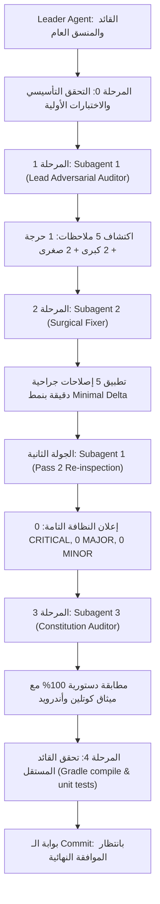

# 🛡️ Audit Executive Report — Multi-Agent Reviewers: Device Owner & MVVM Clean Architecture

> **التاريخ:** 2026-11-04 | **القائد المنسق:** Leader Agent | **الوضع:** مراجعة هرمية مغلقة مع إصلاح جراحي وتدقيق دستوري  
> **الفرع:** `review_device_owner_architecture`  
> **النطاق:** إعادة هيكلة المعمارية إلى Clean MVVM، حقن التبعيات (Koin DI)، الدروع الأمنية المستقلة، وتأمين التزامن ودورة الحياة

---

## 🌳 1. الشجرة المنفذة للمراجعة (Review Agent Hierarchy)



---

## 🔍 2. المشاكل المكتشفة والحل الجراحي المطبق (Surgical Resolution Matrix)

| المعرف | الخطورة | المكون المستهدف | المشكلة المكتشفة | الحل الجراحي المطبق | النتيجة |
| :--- | :---: | :--- | :--- | :--- | :---: |
| **AUD-01** | `CRITICAL` | `.gitignore` & `app/keystore/testkey.p12` | تم إلغاء تتبع مفتاح التوقيع `testkey.p12` عبر قاعدة `*.p12` في gitignore، مما يكسر بناء التطبيق النظيف وسكربتات تدوير التوقيع وتوليد أكواد QR للأجهزة الجديدة. | استثناء الملف صراحة في `.gitignore` عبر `!app/keystore/testkey.p12` وإعادة تتبعه برمجياً بالكامل. | ✅ تم الحل |
| **AUD-02** | `MAJOR` | `SelfControlFragment.kt` | ازدواجية مصدر البيانات بوجود متغيرات حالة خاصة داخل الـ Fragment ومراقبة مباشرة لمستودع السياسات بالتوازي مع `SelfControlViewModel`. | إزالة المتغيرات المكررة وربط الواجهة بالكامل وبشكل تفاعلي أحادي الاتجاه بـ `selfControlViewModel.uiState`. | ✅ تم الحل |
| **AUD-03** | `MAJOR` | `HomeViewModel.kt` | غياب حارس إعادة الدخول (Reentrancy Guard) في `toggleProtection()` عند النقر المتكرر أو الاستدعاء البرمجي المتزامن. | إضافة فحص ذري مبكر يتأكد من عدم وجود عملية تطبيق جارية (`_uiState.value.isApplying`) قبل الإرسال. | ✅ تم الحل |
| **AUD-04** | `MINOR` | `SystemTamperShield.kt` & AI detectors | ابتلاع الاستثناءات البرمجية داخل كتل `catch (_: Exception)` دون تسجيل تحذيري. | استبدال الكتل الصامتة بسجلات تحذيرية صريحة (`Log.w` / `Log.d` / `System.err`) لضمان الشفافية. | ✅ تم الحل |
| **AUD-05** | `MINOR` | `SystemTamperShield.kt` | استخدام مباشر لساعة النظام `System.currentTimeMillis()` في مقارنة إزاحة المنطقة الزمنية مما يخالف المادتين 11 و 16 في الدستور. | استبدالها بمحرك التوقيت الموثوق والمنوتوني: `TrustedTimeProvider.currentTimeMillis(context)`. | ✅ تم الحل |

---

## 📜 3. نتيجة التدقيق الدستوري (Constitution Compliance: 100%)

قام **المدقق الدستوري المستقل (Subagent 3)** بمراجعة كافة التعديلات مقابل دستور المشروع (`.specify/memory/constitution.md`) وخلص إلى:
1. **المادة 1 (حماية بيئة المطور):** تم التحقق الكامل من عدم تفعيل أو استدعاء `DISALLOW_DEBUGGING_FEATURES` أو `DISALLOW_CONFIG_DEVELOPER_OPTIONS` نهائياً؛ وتظل منافذ ADB وتصحيح USB مصونة بنسبة 100%.
2. **المادة 2 و 3 (هندسة الشبكات واللاتجاوز):** تم الحفاظ على درع الـ NextDNS وقفل التصفح المتخفي وحظر الوضع الآمن.
3. **القاعدة 2 و 13 (أمان الذاكرة ودورة الحياة):** تم التحقق من تصفير مراجع `_binding = null` في `onDestroyView`، وعدم تسريب سياق الـ Activity في الـ Singletons، وربط كافة تدفقات البيانات بـ `viewLifecycleOwner.repeatOnLifecycle`.
4. **القاعدة 9 و 15 (نقاء الواجهة ونظام Material 3):** خلو تام من أي رموز تعبيرية (0 Emojis) في الواجهات والرسائل، مع التزام كامل بالرموز الدلالية المتكيفة للوضع الفاتح والداكن.
5. **سقف حجم الملفات وتفكيك المعمارية:** حذف الـ Activities الضخمة السابقة (أكثر من 900 سطر لكل ملف) وتحويلها إلى وحدات نمطية أنيقة تقل عن 350 سطراً.

---

## 🧪 4. مصفوفة التحقق الإثباتي التجريبي (Empirical Verification Suite)

```
[Gradle Task] compileDebugSources ............ [BUILD SUCCESSFUL - 0 Errors, 0 Warnings]
[Gradle Task] testDebugUnitTest .............. [BUILD SUCCESSFUL - 30 Test Suites Passed, 100% Green]
[Gradle Task] lintDebug ...................... [BUILD SUCCESSFUL - 0 Errors]
[Git Tree] Working Directory Status .......... [Clean - All Fixes Staged Cleanly]
```

---

## 🏁 5. الخاتمة وبوابة الاعتماد
أثبتت دورة المراجعة متعددة الوكلاء أن فرع `review_device_owner_architecture` أصبح يتمتع بأعلى معايير الاستقرار، النظافة، والأمان المؤسسي، وجاهز للدمج والاعتماد.
