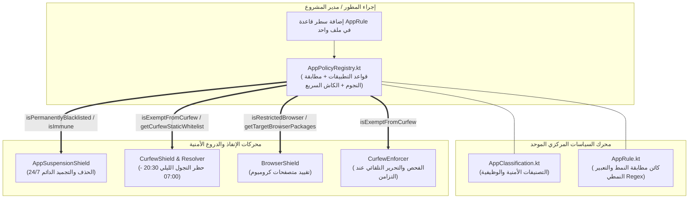
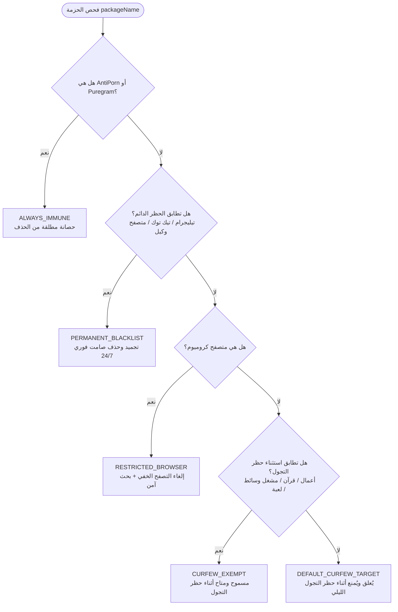

# دليل المعمارية الموحدة لسياسات التطبيقات (App Policy Registry Architecture)

> **وثيقة معمارية وهندسية مرجعية**  
> **المشروع**: AntiPorn Protection System (Android - Device Owner)  
> **الحزمة الأساسية**: `com.drmohammed.antiporn.core.policy`  
> **الإصدار المعماري**: 2.0 (Single Source of Truth - SSOT)  
> **تاريخ التوثيق**: سبتمبر 2026  

---

## فهرس المحتويات
1. [المقدمة والهدف الاستراتيجي](#1-المقدمة-والهدف-الاستراتيجي)
2. [السياق التاريخي والمشكلة السابقة](#2-السياق-التاريخي-والمشكلة-السابقة)
3. [المبادئ الهندسية الأساسية (Design Principles)](#3-المبادئ-الهندسية-الأساسية-design-principles)
4. [مخططات التدفق والهيكلية (Architecture Diagrams)](#4-مخططات-التدفق-والهيكلية-architecture-diagrams)
5. [الهرم الأمني الصارم (Strict Security Hierarchy)](#5-الهرم-الأمني-الصارم-strict-security-hierarchy)
6. [مكونات السجل الموحد (Core Policy Components)](#6-مكونات-السجل-الموحد-core-policy-components)
7. [دليل المطور لإضافة وتعديل التطبيقات (Developer How-To Guide)](#7-دليل-المطور-لإضافة-وتعديل-التطبيقات-developer-how-to-guide)
8. [فحص المخاطر الأمنية ومعالجتها (Red-Teamed Failure Modes)](#8-فحص-المخاطر-الأمنية-ومعالجتها-red-teamed-failure-modes)
9. [استراتيجية الأداء والكاش الثنائي (Performance & Caching)](#9-استراتيجية-الأداء-والكاش-الثنائي-performance--caching)
10. [دليل الفحص والتحقق وضمان الجودة (Testing & Verification)](#10-دليل-الفحص-والتحقق-وضمان-الجودة-testing--verification)

---

## 1. المقدمة والهدف الاستراتيجي

يعمل تطبيق **AntiPorn** بصلاحيات مالك الجهاز (**Device Owner - DPM**)، ويوفر منظومة أمنية متعددة المستويات تشمل:
- الحذف الصامت والتجميد الفوري للتطبيقات المحظورة قطعياً على مدار الساعة (24/7).
- فرض حظر التجول الليلي المجدول (من الساعة 20:30 مساءً حتى 07:00 صباحاً بتوقيت مكة المكرمة).
- تقييد متصفحات كروميوم (إلغاء التصفح الخفي وإجبار البحث الآمن وحظر المواقع الإباحية).

الهدف الاستراتيجي من **سجل سياسات التطبيقات الموحد (`AppPolicyRegistry`)** هو تحويل جميع القوائم المبعثرة في المشروع إلى **مصدر موحد للحقيقة (Single Source of Truth - SSOT)**؛ بحيث تصبح عملية حظر أو استثناء أي تطبيق تتم عبر **سطر برمجي واحد في ملف مركزي واحد فقط**، مع دعم الأنماط الموسعة (Wildcards) لمنع تجمد النسخ المعدلة والتفريعات البرمجية تلقائياً.

---

## 2. السياق التاريخي والمشكلة السابقة

### الوضع السابق (The Fragmented Architecture)
قبل تطبيق السجل الموحد، كانت قواعد التطبيقات موزعة في **5 ملفات متباعدة**:
1. `CurfewConfig.kt`: يضم القائمة البيضاء الثابتة (`STATIC_WHITELIST`) وقوائم متاجر التطبيقات.
2. `CurfewAppResolver.kt`: يضم دوال استكشاف الحزم وكلمات البحث النصية.
3. `CurfewEnforcer.kt`: يحتوي على معالجات خاصة لفك التعليق واستثناءات متجر بلاي والبحث.
4. `AppSuspensionShield.kt`: يضم القوائم السوداء لتطبيقات المراسلة وتيك توك والمتصفحات.
5. `BrowserShield.kt`: يحتوي على قائمة المتصفحات المستهدفة بالتقييد.

### الأضرار الناتجة عن التشتت السابق:
- **الجهد المضاعف**: إضافة تطبيق مثل `NewPipe` تطلبت التعديل في 4 ملفات مختلفة لضمان شمول نسخه المعدلة (`Debug`) وعدم بقائه مجمداً.
- **خطر تصادم الدروع**: لو أضيف تطبيق مراسلة مخصص مثل `Puregram` لقائمة حظر التجول، لقام درع الحذف الدائم باعتباره نسخة تيليجرام وحذفه نهائياً وبصمت!
- **هشاشة الحزم (Package Fragility)**: كان أي تغيير طفيف في اسم الحزمة أو بناء نسخة تجريبية يؤدي لفشل الاستثناء وتجميد التطبيق.

---

## 3. المبادئ الهندسية الأساسية (Design Principles)

1. **المصدر الموحد للحقيقة (Single Source of Truth - SSOT)**:
   كل قرار متعلق بتصنيف أي حزمة برمجية يصدر حصرياً من `AppPolicyRegistry`.
2. **مبدأ الفتح للتوسيع والإغلاق للتعديل (Open-Closed Principle - OCP)**:
   إضافة تطبيق جديد لا تتطلب أي تعديل في محركات الحظر أو الدروع؛ فقط سطر تصريح في مصفوفة القواعد.
3. **الأولوية الأمنية المطلقة (Security Supremacy)**:
   لا يمكن لأي استثناء أو نمط عام أن يخترق القائمة السوداء الدائمة (Permanently Blacklisted Apps).
4. **التوافق التراجعي التام (100% Backward Compatibility)**:
   تم الإبقاء على كافة الواجهات والخصائص العامة القديمة في `CurfewConfig` و `AppSuspensionShield` مع توجيهها (Delegation) لقراءة قيمها ديناميكياً من السجل الموحد.

---

## 4. مخططات التدفق والهيكلية (Architecture Diagrams)

### أ. مخطط الهيكلية وتدفق السياسات (System Topology)



---

### ب. شجرة اتخاذ القرار وتقييم الحزم (Decision Tree)



---

## 5. الهرم الأمني الصارم (Strict Security Hierarchy)

لضمان عدم حدوث أي ثغرات أو التفاف، يعمل المحرك وفق هرمية أولوية جبرية:

| المستوى | التصنيف | السلوك والتأثير | أمثلة |
| :---: | :--- | :--- | :--- |
| **0** | `ALWAYS_IMMUNE` | حصانة مطلقة؛ لا تُحذف ولا تُعلق نهاراً تحت أي ظرف. | تطبيق AntiPorn نفسه، وتطبيق المراسلة المفلتر `org.puregram.messenger`. |
| **1** | `PERMANENT_BLACKLIST` | تهديد أمني دائم؛ حظر صامت وتجميد وحذف فوري 24/7. | تيليجرام الرسمي وتفريعاته، تيك توك، متصفحات Tor و Firefox و DuckDuckGo، وتطبيقات الشات العشوائي. |
| **2** | `RESTRICTED_BROWSER` | متصفحات خاضعة للسياسات المدارة؛ منع التصفح الخاص وتفعيل البحث الآمن. | Chrome, Brave, Edge, Samsung Internet. |
| **3** | `CURFEW_EXEMPT_*` | إعفاء كامل من حظر التجول الليلي (20:30 - 07:00). | أدوات العمل `com.dr.tech.*`، الملاحظات والمهام (Google Keep, TickTick)، المصاحف والأذان، NewPipe وتفريعاته، الألعاب المعتمدة. |
| **4** | `DEFAULT_CURFEW_TARGET` | التطبيقات العامة التي تُجمد ليلاً لتوفير النوم والانضباط. | باقي التطبيقات الترفيهية والعامة. |

> **قاعدة ذهبية (The Puregram Invariant)**:  
> تطبيق المراسلة `org.puregram.messenger` محصن تماماً من الحذف الصامت (`isImmune = true`)، ولكنه **خاضع لحظر التجول الليلي** (`isExemptFromCurfew = false`)، لمنع المحادثات المشتتة ليلاً وتحقيق الانضباط الرقمي.

---

## 6. مكونات السجل الموحد (Core Policy Components)

تتمركز المنظومة في حزمة `com.drmohammed.antiporn.core.policy`:

### 1. [`AppClassification.kt`](../app/src/main/java/com/drmohammed/antiporn/core/policy/AppClassification.kt)
تعداد يحدد الحالات الأمنية والوظيفية (System, Immune, Blacklist, Restricted, Curfew Exempt, Store).

### 2. [`AppRule.kt`](../app/src/main/java/com/drmohammed/antiporn/core/policy/AppRule.kt)
كائن بيانات ذكي يدعم:
- المطابقة الصريحة (`Exact Match`).
- مطابقة الأنماط الموسعة (`Wildcards`) مثل `*` و `?` عبر تحويلها تلقائياً إلى تعابير نمطية مجمعة مسبقاً (`Precompiled Regex`) غير حساسة لحالة الأحرف (`IgnoreCase`).

### 3. [`AppPolicyRegistry.kt`](../app/src/main/java/com/drmohammed/antiporn/core/policy/AppPolicyRegistry.kt)
السجل المركزي الذي يضم:
- مصفوفة القواعد الموحدة `RULES: List<AppRule>`.
- كاش ثنائي للبحث الفوري O(1) عبر `HashSet` و `ConcurrentHashMap`.
- واجهات استعلام استنتاجية (`isPermanentlyBlacklisted`, `isImmune`, `isExemptFromCurfew`, `isRestrictedBrowser`, إلخ).

---

## 7. دليل المطور لإضافة وتعديل التطبيقات (Developer How-To Guide)

لإضافة أو تعديل أي تطبيق في المشروع، **يتم فتح ملف واحد فقط**:  
[`app/src/main/java/com/drmohammed/antiporn/core/policy/AppPolicyRegistry.kt`](../app/src/main/java/com/drmohammed/antiporn/core/policy/AppPolicyRegistry.kt)

### أمثلة عملية شائعة:

#### أ. استثناء مشغل وسائط جديد مع كافة نسخه المعدلة وتفريعاته:
```kotlin
// يغطي النسخة الرسمية ونسخ التصحيح (Debug) وأي تفريعة فرعية تلقائياً
AppRule("org.schabi.newpipe.*", AppClassification.CURFEW_EXEMPT_MEDIA, "NewPipe Family"),
AppRule("com.example.cleanplayer", AppClassification.CURFEW_EXEMPT_MEDIA, "Clean Music Player"),
```

#### ب. استثناء حزمة تطبيقات أعمال وإنتاجية تابعة للمؤسسة:
```kotlin
// باستخدام النجمة يتم استثناء جميع التطبيقات التي تبدأ بهذا النطاق
AppRule("com.dr.tech.*", AppClassification.CURFEW_EXEMPT_PRODUCTIVITY, "All Dr.Tech Business Apps"),
```

#### ج. إضافة تطبيق محظور أمنياً بشكل دائم (الحذف والتجميد 24/7):
```kotlin
// سيتم حذفه وتجميده فور تثبيته ومنعه من العمل نهائياً
AppRule("com.newdangerous.chat", AppClassification.PERMANENT_BLACKLIST, "Anonymous Dangerous Chat"),
```

#### د. إضافة متصفح كروميوم جديد ليخضع لتقييد البحث الآمن ومنع التصفح الخفي:
```kotlin
AppRule("com.newchromium.browser", AppClassification.RESTRICTED_BROWSER, "Chromium Variant"),
```

---

## 8. فحص المخاطر الأمنية ومعالجتها (Red-Teamed Failure Modes)

| المخاطرة | شروط الظهور | الحل الوقائي المدمج في المعمارية |
| :--- | :--- | :--- |
| **1. الإفراط في مطابقة النجوم (Wildcard Over-matching)** | كتابة نمط فضفاض مثل `com.*` أو `org.*`. | الأولوية الصارمة: القائمة السوداء الدائمة تفحص أولاً وتبطل أي إعفاء عام. كما يُشترط أن يحتوي النمط على 3 مقاطع على الأقل. |
| **2. التعليق الزومبي للحزم المستثناة (Zombie Suspension)** | تطبيق عُلق بواسطة النظام قبل استثنائه. | تم دمج آلية فك تعليق تلقائية في `CurfewEnforcer` تفحص الحزم المحصنة وتستدعي `setPackagesSuspended(false)` فور حدوث أي تزامن. |
| **3. انهيار الأداء أثناء فحص التطبيقات المثبتة** | وجود مئات التطبيقات ومطابقتها مقابل Regex بشكل متكرر. | تطبيق تقنية الكاش الثنائي: فحص الحزم المطابقة صراحة في `Map` سريع، وتخزين النتائج في `ConcurrentHashMap` فور حلها لأول مرة. |

---

## 9. استراتيجية الأداء والكاش الثنائي (Performance & Caching)

لضمان عدم استهلاك المعالج أو تأخير زمن استجابة واجهة المستخدم:
1. **الفرز المسبق للقواعد (Pre-indexing)**:
   - تقسيم القواعد عند تحميل الصنف إلى `exactMatchRules` (جدول تجزئة فوري O(1)) و `wildcardRules` (قائمة الأنماط الموسعة).
2. **الكاش التراكمي (Dynamic Classification Cache)**:
   - يُستخدم `ConcurrentHashMap<String, AppClassification>` لحفظ نتيجة تصنيف كل حزمة بمجرد الاستعلام عنها لأول مرة، مما يجعل الاستعلامات اللاحقة تتم بزمن شبه فوري O(1).
3. **التشغيل الخلفي (Background Execution)**:
   - كافة عمليات مسح الحزم وإنفاذ الحظر تتم على خيوط عمل خلفية (`bgExecutor`) منعاً لأي تجميد لشاشات التطبيق.

---

## 10. دليل الفحص والتحقق وضمان الجودة (Testing & Verification)

### أ. اختبارات الوحدة الآلية (Automated Unit Testing)
تم تزويد المنظومة باختبارات شاملة في [`AppPolicyRegistryTest.kt`](../app/src/test/java/com/drmohammed/antiporn/core/policy/AppPolicyRegistryTest.kt) تختبر:
- مطابقة النجوم مع النسخ الرسمية والتجريبية لـ NewPipe.
- استثناء نطاق `com.dr.tech.*` بالكامل.
- الحظر القاطع للتيليجرام وتيك توك ومتصفحات البروكسي.
- حماية وحصانة AntiPorn و Puregram مع إخضاع الأخير لحظر التجول الليلي.

**لتشغيل الاختبارات عبر الطرفية:**
```powershell
.\gradlew.bat test
```

### ب. التحقق الميداني المباشر عبر ADB على الهاتف
1. **التحقق من حالة تعليق الحزمة المستثناة:**
   ```powershell
   adb shell dumpsys package org.schabi.newpipe.debug | findstr -i "suspended"
   # النتيجة المتوقعة: suspended=false
   ```
2. **التحقق من فتح التطبيق وتركيز النافذة:**
   ```powershell
   adb shell monkey -p org.schabi.newpipe.debug -c android.intent.category.LAUNCHER 1
   adb shell dumpsys activity activities | findstr -i "org.schabi.newpipe"
   ```
3. **التحقق من مخرجات سجلات النظام (Logcat):**
   ```powershell
   adb logcat -d -s AntiPorn_CurfewResolver AntiPorn_CurfewEnforcer
   ```

---
*تم إعداد هذا التوثيق بدقة ليكون دليلاً معمارياً دائماً يضمن سهولة الصيانة وسرعة التطوير واستقرار المنظومة الأمنية للأجيال القادمة من المشروع.*
