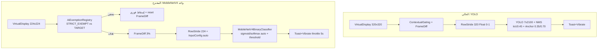

# Master Implementation Plan — Single-MobileNetV4 Experiment + Standard Exemption Architecture

> **الحالة: خطة فقط — ZERO CODE. بانتظار موافقتك الصريحة (ابدأ / نفذ / Approved) + مسار ملف MobileNetV4.**
> **الفلسفة:** لا سطر كود واحد قبل الاعتماد. التنفيذ لاحقاً عبر وكلاء فرعيين بمراجعة قائد.

## 1. Executive Summary & Business Value
- **الهدف:** استبدال كاشف YOLO11n متعدد الصناديق (10.6MB، CPU فقط، Toast فقط) بنموذج **واحد MobileNetV4 تصنيفي** (صورة كاملة → درجة فاضح/نظيف) يهز ويعرض Toast للتجربة فقط، مع **نظام استثناءات معماري قياسي** يعفي تطبيقات نظام Realme 6 Pro المؤكدة النظافة (لانشر/إعدادات/هاتف...) ويبقي الدرع قابلاً للتشغيل/الإيقاف اليدوي.
- **القيمة:** تجربة أخف وأسرع (224 مقابل 320، مصنف واحد مقابل NMS)، ضجيج أقل في التطبيقات الآمنة، وقابلية عكس كاملة إلى YOLO بسطر واحد عبر `IModestyDetector` — مثالي لمرحلة المعايرة الميدانية قبل أي إنفاذ.
- **النطاق المحظور في هذه المرحلة:** لا `setPackagesSuspended`، لا `lockNow`، لا بلور، لا تشغيل تلقائي بعد الإقلاع. فقط اهتزاز + Toast.

## 2. Ground Truth (نتائج الفحص الجراحي — Read-Only)
- **لا يوجد MobileNetV4 في المجلد الآخر:** `D:\b\antiporn_ai_dream\models` يحتوي فقط `custom_modesty_yolo11n_320.tflite (10,612,703B)` + `.onnx/.pt` — **بانتظار مسارك.**
- **العقد الحالي:** `IModestyDetector.detect(ByteBuffer): ModestyInferenceResult` — `TfLiteModestyDetector` يقرأ `inputShape/outputShape` runtime ويخصص `outputArray` مسبقاً، `RowStrideExtractor` يحول RGBA→Float32 NHWC/NCHW، `FrameDifferencer (8x4, 3%)` بوابة L0، `ContextualGatingWatcher (UsageStats, 1s)` بوابة سياق، `ScreenAiProjectionService (320x320 VirtualDisplay, HandlerThread, START_NOT_STICKY)` + `triggerAlertThrottled (5s, vibrate 150ms + Toast)`.
- **الاستثناءات اليوم مشتتة:** `AppPolicyRegistry.isExemptFromCurfew` (للحظر الليلي، ليس للـ AI) + `SOCIAL_FEED_PACKAGES` داخل `ContextualGatingWatcher` — لا يوجد `AiExemption` مستقل. القرار: بناء طبقة AI خاصة لا تكسر `AppPolicyRegistry` (SSOT للحظر).
- **الإجماع الخارجي (DuckDuckGo):** مصنفات MobileNet القياسية دخل `[1,224,224,3]`؛ مخرج sigmoid واحد أو softmax ثنائي؛ تطبيع `[0,1]` أو `[-1,1]` حسب التدريب — لذلك **الاكتشاف التلقائي runtime إلزامي** وليس افتراضاً.
- **Realme 6 Pro (RMX2061, SD720G):** حزم ColorOS/Oppo الآمنة موثقة (`com.coloros.*`, `com.oppo.*`, `com.realme.*`, `com.android.*`) — القرار المعتمد: **قائمة مغلقة صارمة** + المتجر/المتصفح هدف دائم.

## 3. Current vs Proposed (Mermaid)

## 4. 3 Red-Teamed Failure Modes & Mitigations
1. **Input mismatch (224 vs 320, [0,1] vs [-1,1]):** درجات عشوائية صامتة. **المنع:** `AiInputConfigResolver` يقرأ `inputTensor.shape()+type` عند `initialize`، يضبط `VirtualDisplay+Extractor` تلقائياً، ويفشل بصوت عالٍ (حالة حمراء في البطاقة) إذا الشكل غير `[1,H,W,3]`. سجل `inShape/outShape` في Logcat.
2. **Output misinterpretation (sigmoid vs softmax vs embedding):** إيجابيات 100% أو صمت 100%. **المنع:** `MobileNetOutputDecoder` يدعم `[1,1] sigmoid` و `[1,2] softmax` فقط ويرفض غيرهما، عتبة افتراضية `0.65` قابلة للضبط من `AiCalibration` (لاحقاً)، ووضع `DebugLogits` يعرض الدرجة الخام في Toast التجريبي لمعايرة سريعة على `data/test_samples/safe|suggestive`.
3. **Exemption over-broadening + UsageStats lag:** إعفاء تطبيق فيه WebView (بحث الإعدادات، متجر Realme) يخفي ثغرة؛ وفحص كل 1s يفوت تبديلاً سريعاً. **المنع:** طبقتان `ALWAYS_EXEMPT_SYSTEM (بلا WebView إطلاقاً: لانشر/ساعة/آلة حاسبة)` مقابل `DEFAULT_TARGET (المتصفح/المتجر/السوشيال دائماً هدف)`، شرط `isExempt = inExempt && !inTarget` (الهدف يغلب)، `reset()` للـ FrameDiff عند تغير الواجهة لمنع تلوث العينات، وتنبيه عند سحب إذن UsageStats (fail-closed مع رسالة، لا تجميد صامت).

## 5. Surgical File Diff Blueprint
- **[NEW] `ai/core/policy/AiExemptionRegistry.kt`:** `object` مستقل: `STRICT_SYSTEM_EXEMPT: Set<String>` (لانشر Realme `com.oppo.launcher`/`com.coloros.launcher`, إعدادات `com.android.settings`, واجهة `com.android.systemui`, هاتف `com.android.dialer/com.android.contacts`, رسائل `com.android.mms`, ساعة/آلة حاسبة/مسجل ColorOS, كاميرا/معرض النظام) + `ALWAYS_TARGET: Set<String>` (كل `RESTRICTED_BROWSER` من `AppPolicyRegistry` + `SOCIAL_FEED_PACKAGES` + `BLACKLIST` + `com.android.vending/com.heytap.market`) + `isExempt(pkg) = exempt && !target` + `clearCache()`. لا يعدل `AppPolicyRegistry`.
- **[NEW] `ai/core/inference/MobileNetV4ModestyDetector.kt`:** يطبق `IModestyDetector`: `initialize()` يقرأ الشكل/النوع ويبني `inputBuffer/outputArray` مسبقاً، `detect()` يشغل `Interpreter(numThreads=4, NNAPI)` ويمرر `MobileNetOutputDecoder` → `ModestyInferenceResult` (نعيد استخدام `EXPOSED_SKIN` كانتهاك واحد بثقة الدرجة، بلا صناديق). يحتفظ بتوقيع `detect(ByteBuffer)` لعزل الخدمة عن نوع الموديل.
- **[NEW] `ai/core/inference/MobileNetOutputDecoder.kt` + `AiInputConfig.kt`:** فك `[1,1]/[1,2]` + عتبة قابلة للحقن + رفض صريح للأشكال الغريبة.
- **[MODIFY] `ai/service/ScreenAiProjectionService.kt`:** حقن `detector: IModestyDetector` (افتراضي MobileNet، تبديل سطر إلى YOLO للرجوع)، تغيير `VirtualDisplay` إلى حجم الموديل المكتشف (224)، استدعاء `AiExemptionRegistry.isExempt` قبل `FrameDifferencer`، إظهار خطأ التهيئة في البطاقة بدل الصمت. **لا تغيير في `onDestroy` الترتيبي (listener→join→close).**
- **[MODIFY] `ai/core/pipeline/RowStrideExtractor.kt`:** تعميم `width/height` (224) + دعم تطبيع `[-1,1]` عبر flag من `AiInputConfig` — بلا كسر `isChannelsLast`.
- **[MODIFY] `ai/core/pipeline/ContextualGatingWatcher.kt`:** تفويض القرار إلى `AiExemptionRegistry` (حذف `SOCIAL_FEED_PACKAGES` المكررة)، الاحتفاظ بدورة `1s` للتجربة مع `onStateChanged → frameDifferencer.reset()`.
- **[MODIFY] `ai/ui/AiControlCardViewBinder.kt` + `res/values/strings.xml`:** سطر يعرض اسم الموديل النشط (`MobileNetV4-experiment`) + حالة `Model load failed` الحمراء + زر تشغيل/إيقاف كما هو (التجربة اليدوية).
- **[KEEP — لا حذف] `TfLiteModestyDetector.kt`, `ModestyPostProcessor.kt`, `custom_modesty_yolo11n_320.tflite`:** تبقى احتياطاً للرجوع الفوري. حذفها لاحقاً فقط بعد نجاح المعايرة.
- **[DELETE — لا شيء في هذه المرحلة].**

## 6. Subagent Task Breakdown (بعد الاعتماد فقط)
| Role | Domain | Gate |
|---|---|---|
| **model-ingest** | استلام مسارك، نسخ `.tflite` إلى `assets/`, قراءة `in/out shape` عبر سكربت فحص (read-only أولاً) وتثبيت `AiInputConfig` | يعرض الأشكال والعتبة المقترحة قبل أي كود |
| **logic-specialist** | `MobileNetV4Detector + Decoder + AiExemptionRegistry` + حقن `IModestyDetector` | مراجعة `synchronized`، لا GC pauses، فشل صاخب |
| **service-specialist** | `ScreenAiProjectionService + RowStrideExtractor(224) + Watcher delegation` | مراجعة خيط واحد، `image.close()`، `START_NOT_STICKY` محفوظ |
| **ui-verify** | بطاقة AI + strings + اختبار يدوي على Realme 6 Pro (تبديل safe/suggestive + تطبيقات معفاة) | `assembleDebug` + Toast/Vibrate موثقة بالفيديو |
| **auditor (coderabbit-guard)** | تدقيق Kotlin: NPE، تسرب `Interpreter`، أذونات `USAGE_STATS/FOREGROUND_SERVICE_MEDIA_PROJECTION` | `0 errors` قبل التسليم |

## 7. Verification & Testing Plan
- **ستاتيكي:** `assembleDebug`, فحص `inShape=[1,224,224,3]? outShape=[1,1]/[1,2]?`, لا تحذيرات `NNAPI deprecated` تُخفي فشلاً.
- **ميداني (Realme 6 Pro):** (1) افتح إعدادات/لانشر → لا FPS ولا Toast (معفي). (2) افتح Chrome/YouTube صورة `suggestive_01` → اهتزاز+Toast خلال ~2s. (3) صورة `safe_05` → صمت. (4) أوقف من البطاقة → يتوقف فوراً؛ أعد التشغيل → يطلب إذن التقاط. (5) اسحب إذن UsageStats → رسالة تحذير لا تجميد صامت.
- **معايرة:** جرّب عتبات `0.5/0.65/0.8` على `antiporn_ai_dream/data/test_samples` وسجل FP/FN في `reports/` قبل تثبيت العتبة.
- **رجوع:** تبديل سطر `MobileNetV4ModestyDetector` → `TfLiteModestyDetector` يعيد YOLO دون حذف.

## 8. ما أحتاجه منك الآن (بوابة الاعتماد)
1. **أرسل المسار الكامل لملف MobileNetV4 (`.tflite`)** — سأقرأ أبعاده أولاً وأؤكد العقد قبل أي تنفيذ.
2. **رد بكلمة واحدة:** `ابدأ` / `Approved` للتنفيذ بالوكلاء، أو عدّل القائمة المغلقة/العتبة أعلاه.
3. **تأكيد:** هل أبقي `VirtualDisplay` على `224` تلقائياً من شكل الموديل (موصى به) أم تفضل `320` مع resize؟

> **لن يُكتب أو يُعدل أي كود مصدري حتى ترد بالاعتماد + المسار.**
