# الخطة المعمارية الشاملة: إضافة أزرار ومداخل معالج التفعيل الذاتي لصلاحية Device Owner 🛡️⚡

> **البروتوكول المعماري النشط:** `/stop-think-search-and-plan` — **ZERO CODE LOCK**.  
> **حالة الخطة:** **بانتظار مراجعة وموافقة مدير المشروع الصريحة (`ابدأ` / `نفذ` / `Approved`)**.  
> **الهدف:** توفير مداخل واضحة وبارزة وسهلة الاستخدام تُمكّن أي مستخدم (تقني أو غير تقني) من الوصول الفوري لمعالج التفعيل الذاتي (`ProvisioningWizardActivity`) بلمسة واحدة دون الحاجة للبحث أو استخدام جهاز كمبيوتر.

---

## 1. الملخص التنفيذي وقيمة التطوير (Executive Summary & Value)

* **المشكلة الحالية ونقطة الألم:**  
  على الرغم من اكتمال وترقية محرك التفعيل الذاتي اللاسلكي (`ProvisioningWizardActivity`) بنجاح لدعم تخطي حذف الحسابات، إلا أن واجهة التطبيق الحالية تفتقر تماماً إلى أي زر أو رابط يفتح هذا المعالج!
  - في الصفحة الرئيسية (`HomeFragment`): تظهر بطاقة نصية جامدة (`cardAdbHelp`) تعرض أمراً مخصصاً للمطورين عبر سطر أوامر الكمبيوتر بدون أي إمكانية للنقر.
  - زر "تفعيل الحماية الآن" الحالي يحاول تطبيق الحماية دون امتلاك الصلاحية، فيفشل ويُظهر رسالة خطأ فقط.
  - في شاشة الإعدادات (`SettingsFragment`): بند "صلاحية مسؤل الجهاز" لا يستجيب للنقر العادي (مخصص لضغطة مطولة فقط).

* **الحل المعتمد (وفق اختياراتك في جلسة الأسئلة):**
  1. **الصفحة الرئيسية (Home Screen):**  
     - تحويل زر البطاقة التنبيهية عندما تكون الصلاحية غير مفعلة ليصبح زراً بارزاً وواضحاً: **"بدء التفعيل الذاتي الفوري 🛡️"** يفتح المعالج فوراً.
     - إعادة تصميم بطاقة ADB لتصبح بطاقة تفاعلية أنيقة: "تفعيل الصلاحية العالية بدون كمبيوتر" مع زر فتح المعالج، مع الاحتفاظ بالأمر النصي كخيار ثانوي لمن يفضل استخدام الكمبيوتر.
  2. **شاشة الإعدادات (Settings Screen):**  
     - جعل بند "صلاحية مسؤل الجهاز" قابلاً للنقر العادي لفتح معالج التفعيل الذاتي مباشرة (مع الحفاظ على الضغطة المطولة لفتح سجلات التشخيص).
     - تحديث النصوص لتعكس إمكانية التفعيل الذاتي بدلاً من العبارات القديمة *"مطلوب أمر ADB"*.
  3. **الحماية التلقائية (Safety Guard):**  
     - إضافة قفل زمني لمنع النقر المزدوج السريع (`Debounce`) وتعيين `launchMode="singleTop"` لتفادي تكرار فتح الشاشات.

---

## 2. مقارنة التدفق: الوضع الحالي vs الحل الجديد (Mermaid Architecture)

```mermaid
flowchart TD
    subgraph CURRENT_STATE [الوضع الحالي: طريق مسدود]
        C_User([مستخدم غير مفعل للصلاحية]) --> C_Home["الصفحة الرئيسية HomeFragment"]
        C_Home --> C_CardNotice["بطاقة تنبيه: الحماية غير مفعلة"]
        C_CardNotice --> C_BtnEnforce["زر: تفعيل الحماية الآن"]
        C_BtnEnforce -->|نقر| C_FailToast["رسالة خطأ Toast: الصلاحية غير ممنوحة!"]
        C_Home --> C_CardAdb["بطاقة جامدة: أمر كمبيوتر ADB"]
        C_CardAdb -.->|غير قابلة للنقر| C_Stall([حيرة المستخدم وعدم إيجاد الزر])
        
        C_User --> C_Settings["شاشة الإعدادات SettingsFragment"]
        C_Settings --> C_DO_Pref["بند: صلاحية Device Owner غير مفعلة"]
        C_DO_Pref -.->|نقر عادي لا يستجيب| C_Stall
    end

    subgraph PROPOSED_STATE [الحل الجديد: مسار انسيابي فوري]
        P_User([مستخدم غير مفعل للصلاحية]) --> P_Home["الصفحة الرئيسية HomeFragment"]
        
        %% المسار 1 في الرئيسية
        P_Home --> P_CardNotice["بطاقة رئيسية مميزة"]
        P_CardNotice --> P_BtnWizard["زر بارز: بدء التفعيل الذاتي الفوري 🛡️"]
        P_BtnWizard -->|نقر بلمسة واحدة| P_Wizard(["فتح معالج التفعيل الذاتي ProvisioningWizardActivity"])
        
        %% المسار 2 في الرئيسية
        P_Home --> P_CardHelp["بطاقة تفاعلية: تفعيل ذاتي بدون كمبيوتر"]
        P_CardHelp -->|نقر على البطاقة| P_Wizard
        
        %% المسار 3 في الإعدادات
        P_User --> P_Settings["شاشة الإعدادات SettingsFragment"]
        P_Settings --> P_DO_Pref["بند: صلاحية مسؤل الجهاز (اضغط للتفعيل الذاتي)"]
        P_DO_Pref -->|نقر عادي| P_Wizard
        P_DO_Pref -->|ضغط مطول| P_Diag(["فتح نافذة سجلات التشخيص"])
        
        P_Wizard --> P_Done([اكتمال التفعيل بنجاح والعودة لحصن كامل 🛡️])
    end
```



---

## 3. التدقيق المعماري وأوضاع الفشل الثلاثة (The 3 Failure Modes & Mitigations)

### وضع الفشل 1: النقر المزدوج السريع (Double-Tap Activity Race Condition)
- **طبيعة المشكلة:** إذا قام المستخدم بالنقر السريع مرتين متتاليتين على زر التفعيل في الصفحة الرئيسية أو الإعدادات.
- **سيناريو الخطر:** فتح نسختين متزامنتين من `ProvisioningWizardActivity`، مما يؤدي إلى تضارب خدمتي رادار mDNS (`AdbPairingNotificationService`) ورمي استثناء في النظام لتعارض المنافذ.
- **خط الدفاع البرمجي المزدوج:**
  1. إضافة مانع النقر المتكرر (`Debounce Threshold: 800ms`) باستخدام `SystemClock.elapsedRealtime()`.
  2. ضبط `android:launchMode="singleTop"` لنشاط `ProvisioningWizardActivity` في `AndroidManifest.xml` لضمان وجود نسخة واحدة نشطة في الذاكرة دائماً.

### وضع الفشل 2: النقر على البند بعد اكتمال التفعيل (Post-Activation Click Handling)
- **طبيعة المشكلة:** إذا دخل المستخدم إلى شاشة الإعدادات بعد أن أصبح التطبيق بالفعل مالكاً للجهاز (`Device Owner Active`) ونقر على البند.
- **سيناريو الخطر:** فتح معالج التفعيل دون داعٍ، والذي سينتهي برسالة خطأ تفيد بأن الجهاز مفعل مسبقاً.
- **خط الدفاع البرمجي:**
  - فحص حالة `ProtectionEngine.isDeviceOwner(context)` قبل فتح المعالج؛ فإذا كان الجهاز مفعلاً بالفعل، يتم إظهار رسالة تطمين لطيفة (Toast / SnackBar): *"صلاحية المالك نشطة ودرع حِصْن يعمل بأقصى كفاءة 🛡️"*.

### وضع الفشل 3: تحديث الواجهة التلقائي عند العودة (Stale UI State on Return)
- **طبيعة المشكلة:** عندما يكمل المستخدم خطوات المعالج في شاشة التفعيل أو يخرج منها بالرجوع دون إكمالها.
- **سيناريو الخطر:** بقاء الصفحة الرئيسية تعرض البطاقة القديمة أو الأزرار غير المحدثة نتيجة كاش الحالة.
- **خط الدفاع البرمجي:**
  - الاستفادة من دورة حياة `onResume()` الموجودة في `HomeFragment` و `SettingsFragment` لإعادة استعلام محرك الحماية وتحديث حالة الزر ديناميكياً فور عودة التطبيق للمقدمة.

---

## 4. مخطط التعديلات الجراحية في الملفات (Surgical File Blueprint)

| المسار البرمجي | طبيعة العملية | التغيير المستهدف بالتفصيل |
| :--- | :---: | :--- |
| `app/src/main/res/layout/fragment_home.xml` | **MODIFY** | تحديث `cardAdbHelp` لتصبح بطاقة عصرية تفاعلية تدعم النقر وتحتوي على زر فرعي "فتح معالج التفعيل الذاتي"، وإضافة أيقونة سهمية تفاعلية. |
| `app/src/main/java/com/drmohammed/antiporn/ui/home/HomeFragment.kt` | **MODIFY** | 1. ربط حدث النقر على `cardAdbHelp` لفتح `ProvisioningWizardActivity` مع Debounce.<br/>2. تخصيص زر `btnEnforceNow` عندما تكون الصلاحية غير مفعلة ليتحول إلى **"بدء التفعيل الذاتي الفوري 🛡️"** ويفتح المعالج مباشرة بدلاً من إظهار خطأ. |
| `app/src/main/java/com/drmohammed/antiporn/ui/settings/SettingsFragment.kt` | **MODIFY** | ربط `layoutDeviceOwnerPreference.setOnClickListener` للتحقق من حالة الصلاحية؛ فإذا كانت غير مفعلة يفتح `ProvisioningWizardActivity`، وإذا كانت مفعلة يُظهر رسالة تطمين، مع الحفاظ على `onLongClick` لسجلات التشخيص. |
| `app/src/main/res/values/strings.xml` & `strings-en.xml` | **MODIFY** | تحديث النصوص العربية والإنجليزية لإزالة مصطلحات "مطلوب أمر ADB" واستبدالها بنصوص التفعيل الذاتي المشجعة. |
| `app/src/main/AndroidManifest.xml` | **MODIFY** | إضافة `android:launchMode="singleTop"` لنشاط `ProvisioningWizardActivity` لمنع تعدد النوافذ. |

---

## 5. هيكلية الوكلاء المنفذين تحت الإشراف (Subagent Decomposition Schema)

```
[Leader Agent: Chief Systems Architect]
       │
       ├──> [Subagent 1: UI & Layout Specialist]
       │     - تحديث fragment_home.xml بالتصميم الجديد لكرت التفعيل
       │     - إضافة النصوص الجديدة في strings.xml و values-en/strings.xml
       │     - تحديث AndroidManifest.xml بـ singleTop
       │
       ├──> [Subagent 2: Fragment Logic Specialist]
       │     - ربط النقر في HomeFragment.kt مع التوجيه الذكي وزر التفعيل الفوري
       │     - ربط النقر في SettingsFragment.kt مع فحص الحالة والحفاظ على السجلات
       │
       └──> [Subagent 3: Clean Code & Verification Guard]
             - التدقيق ضد عيوب التزامن وتسريب المستمعين
             - تشغيل فحص التجميع والتحقق من عدم وجود أي خطأ برمجي
```

---

## 6. خطة التحقق والاختبار للمستخدم (PM Verification Steps)

1. **التحقق من الصفحة الرئيسية:**
   - فتح التطبيق (عندما تكون الصلاحية غير مفعّلة).
   - التأكد من ظهور زر بارز في البطاقة الرئيسية: **"بدء التفعيل الذاتي الفوري 🛡️"**.
   - الضغط على الزر، والتأكد من انتقال التطبيق فوراً وبسلاسة إلى معالج التفعيل اللاسلكي الجديد بخطوتيه.
2. **التحقق من شاشة الإعدادات:**
   - التوجه لتبويب "الإعدادات".
   - النقر بنقرة واحدة عادية على بند "صلاحية مسؤل الجهاز".
   - التأكد من فتح المعالج مباشرة.
   - النقر بضغطة مطولة على نفس البند، والتأكد من فتح نافذة سجلات التشخيص (`Diagnostic Logs`) كالسابق دون أي تأثر.
3. **التحقق من فحص التجميع والأمان:**
   - التأكد من بناء المشروع بنجاح 100% دون أي تحذيرات أو أخطاء استيراد.
