# الخطة المعمارية الشاملة: ترقية محرك التفعيل الذاتي لتفعيل Device Owner دون حذف الحسابات 🛡️⚡

> **الوضع:** خطة تنفيذية وفق بروتوكول `/stop-think-search-and-plan` — **ZERO CODE**.  
> **حالة التنفيذ:** **مقفل تماماً بانتظار موافقتك الصريحة (`ابدأ` / `نفذ` / `Approved`)**.  
> **الهدف الأسمى:** تمكين أي مسلم أو شاب من تفعيل الحماية السيادية القصوى في هاتف أندرويد الخاص به خلال دقيقة واحدة من داخل التطبيق نفسه دون الحاجة لحذف حساب Google أو WhatsApp أو Telegram إطلاقاً.

---

## 1. الملخص التنفيذي وقيمة الحل (Executive Summary & Business Value)

* **الوضع الحالي ونقاط الألم:**  
  يحتوي تطبيق حِصْن حالياً على معالج تفعيل ذاتي مدمج (`ProvisioningWizardActivity.kt` و `DeviceOwnerPromoter.kt`) يعمل عبر بروتوكول الإقران اللاسلكي المحلي (`Wireless ADB Pairing`). لكن المعالج الحالي يفرض شرطاً قاسياً في الخطوة 1 (`AccountAuditor.kt`): إجبار المستخدم على الدخول لإعدادات الهاتف وحذف كافة حساباته المسجلة (حساب Google، واتساب، تيليجرام...) قبل السماح له بالبدء، وهو ما يُشكل حاجزاً نفسياً وتقنياً كبيراً يُحبط 90% من المستخدمين غير التقنيين ويمنعهم من الاستفادة من التطبيق.
* **الحل المعماري الجديد (المعتمد باختيارك في جلسة النقاش):**
  1. **الاعتماد الكلي على النظام المدمج داخل التطبيق:** دون أي تبعيات خارجية أو تطبيقات طرف ثالث (لا حاجة لـ Shizuku).
  2. **تحويل المعالج إلى خطوتين سريعتين فقط:**  
     - **الخطوة 1:** تفعيل خيارات المطور والتصحيح اللاسلكي.  
     - **الخطوة 2:** إدخال رمز الإقران والتفعيل الفوري بنقرة زر واحدة.  
     *(إلغاء خطوة حذف الحسابات تماماً، ووضع شريط تطمين علوي بارز: "درع حِصْن يدعم التفعيل الذاتي الفوري وحساباتك في أمان تام دون أي حذف")*.
  3. **محرك التجاوز الذكي في `DeviceOwnerPromoter` بحسب إصدار أندرويد:**  
     - **لأندرويد 12 فما فوق (API 31 إلى 36):** تصفير مؤقت لإشارة الإعداد `user_setup_complete=0` وتحديث كاش الذاكرة الحية لـ `DevicePolicyManagerService` عبر وسيط خفيف (Helper Dex)، ثم تعيين التطبيق مالكاً للجهاز والخروج فوراً وإعادة إشارة الإعداد `1`؛ فيقبل النظام التعيين فوراً متجاهلاً وجود الحسابات.  
     - **لأندرويد 11 (API 30):** تجميد برمجي مؤقت وسريع للحزم التي تحمل حسابات (`pm disable-user`) لثانية واحدة، وتعيين المالك، ثم فك التجميد فوراً داخل كتلة حتمية (`finally`).  
     - **لهواتف أندرويد 7 إلى 10 (التي لا تدعم التصحيح اللاسلكي أصلاً في النظام):** بطاقة توجيه ذكية وأنيقة توفر زراً لفتح موقع **PureSite** للتفعيل عبر كابل USB بنقرة واحدة بدون حذف حسابات.

---

## 2. مقارنة التدفق: الوضع الحالي vs الحل الجديد (Mermaid Architecture)

```mermaid
flowchart TD
    subgraph OLD_FLOW [التدفق القديم المعقد]
        O_Start([فتح معالج التفعيل]) --> O_Step1["الخطوة 1: فحص الحسابات"]
        O_Step1 --> O_Block{"هل توجد حسابات مسجلة؟"}
        O_Block -- "نعم (Google/WhatsApp)" --> O_ForceDel["إجبار المستخدم على فتح الإعدادات وحذف كافة حساباته!"]
        O_ForceDel -.->|إحباط وترك التطبيق| O_Abandon([فشل التثبيت])
        O_ForceDel --> O_Retry["الرجوع للتطبيق بعد حذف الحسابات"]
        O_Retry --> O_Step2["الخطوة 2: خيارات المطور"]
        O_Step2 --> O_Step3["الخطوة 3: إدخال الكود وأمر dpm العادي"]
        O_Step3 --> O_Done([نجاح التفعيل])
    end

    subgraph NEW_FLOW [التدفق الجديد الانسيابي بدون حذف حسابات]
        N_Start([فتح معالج التفعيل]) --> N_CheckOS{"إصدار أندرويد؟"}
        
        %% المسار لأندرويد 11 فما فوق
        N_CheckOS -- "أندرويد 11 فما فوق (API 31+)" --> N_Step1["الخطوة 1: تشغيل التصحيح اللاسلكي"]
        N_Step1 --> N_Step2["الخطوة 2: كتابة رمز الإقران والضغط على 'تفعيل درع حِصْن'"]
        N_Step2 --> N_Engine{"فحص الإصدار الدقيق"}
        
        N_Engine -- "أندرويد 12+" --> N_Bypass12["1. تصفير user_setup_complete=0 مؤقتاً<br/>2. تحديث كاش النظام عبر Helper<br/>3. تعيين Device Owner بنجاح وتخطي الحسابات<br/>4. استعادة user_setup_complete=1 فوراً"]
        N_Engine -- "أندرويد 11" --> N_Bypass11["1. تجميد مؤقت للحزم pm disable-user<br/>2. تعيين Device Owner<br/>3. فك تجميد الحزم فوراً"]
        
        %% المسار لأندرويد القديم 7 إلى 10
        N_CheckOS -- "أندرويد 7 إلى 10" --> N_Legacy["بطاقة توجيه ذكية:<br/>توصيل الهاتف بالكمبيوتر وموقع PureSite<br/>للتفعيل بنقرة واحدة بدون حذف حسابات"]
        
        N_Bypass12 --> N_Success([تم تفعيل الحماية السيادية بنجاح تام! 🛡️])
        N_Bypass11 --> N_Success
        N_Legacy --> N_Success
    end
```



---

## 3. المخاطر المعمارية واستراتيجيات الحماية (The 3 Failure Modes & Mitigations)

### وضع الفشل 1: جدار هواتف شاومي (Xiaomi / MIUI / HyperOS Security Gate)
- **طبيعة المشكلة:** نظام شاومي يمنع شيل ADB من تعديل `user_setup_complete` إلا إذا كانت خاصية **"تصحيح أخطاء USB (إعدادات الأمان)"** مفعلة في خيارات المطور.
- **سيناريو الخطر:** إذا ضغط المستخدم على زر التفعيل دون تفعيل هذا الخيار في شاومي، تفشل عملية التصفير ويرمي النظام خطأ `SecurityException`.
- **خط الدفاع البرمجي:**
  1. يقوم `DeviceOwnerPromoter` باكتشاف واجهة الهاتف؛ فإذا كان الجهاز شاومي (`MIUI/HyperOS`)، يختبر إمكانية الكتابة في الإعدادات بأمر تجريبي آمن.
  2. إذا وجد القيد مفعلاً، يُظهر المعالج فوراً نافذة إرشادية مخصصة لهواتف شاومي باللغة العربية مع صورة توضيحية لتفعيل الخيار في ثوانٍ.

### وضع الفشل 2: المجلد الآمن والتطبيقات المزدوجة في سامسونج (Dual Messenger / Secure Folder)
- **طبيعة المشكلة:** في هواتف سامسونج، إذا كان "المجلد الآمن" نشطاً يُنشئ مستخدماً برقم `User 150`، وإذا كانت ميزة "Dual Messenger" مفعلة للواتساب يُنشئ مستخدماً برقم `User 95`. وجود هؤلاء المستخدمين الفرعيين قد يجعل النظام يرفض التعيين بخطأ `already several users`.
- **خط الدفاع البرمجي:**
  1. فحص فوري عبر الشيل لقائمة المستخدمين (`pm list users`).
  2. إذا وُجد مستخدم فرعي، يتم تقديم إرشاد مباشر باللغة العربية: "يرجى قفل المجلد الآمن مؤقتاً أو تعطيل ميزة المراسلة المزدوجة لمدة دقيقة واحدة لإتمام التفعيل".

### وضع الفشل 3: حالة الإعداد العالقة في حال انقطاع المعالج (Zombie Setup State Prevention)
- **طبيعة المشكلة:** إذا تعطل تطبيق حِصْن أو أُغلق قسرياً في الجزء من الثانية الذي تكون فيه قيمة `user_setup_complete = 0`.
- **سيناريو الخطر:** قد يختفي شريط التنقل السفلي في بعض الهواتف لأن النظام يظن أن معالج الإعداد الأولي قيد التشغيل.
- **خط الدفاع البرمجي المزدوج الحتمي:**
  1. **على مستوى دالة الترويج:** تنفيذ عملية استعادة `user_setup_complete = 1` وتحديث الكاش داخل كتلة `finally` البرمجية غير القابلة للتجاوز، بحيث تنفذ حتمياً حتى لو حدث انهيار غير متوقع أو انقطع الاتصال اللاسلكي.
  2. **على مستوى إقلاع التطبيق بالكامل (`AntiPornApplication.kt`):** إضافة فحص حراسة ذاتية عند كل إقلاع؛ فإذا وجد التطبيق أن `user_setup_complete == 0` بينما الهاتف مهيأ أصلاً (`device_provisioned == 1`)، يتم إرسال تنبيه أو تصحيح الحالة فوراً كصمام أمان استباقي.

---

## 4. مخطط التعديلات الجراحية في الملفات (Surgical File Blueprint)

| المسار البرمجي | طبيعة العملية | التغيير المستهدف بالتفصيل |
| :--- | :---: | :--- |
| `app/src/main/java/com/drmohammed/antiporn/provisioning/engine/DeviceOwnerPromoter.kt` | **MODIFY** | إضافة منطق التجاوز الذاتي المزدوج (`executeZeroAccountPromotion`) عبر حقن وتمرير كود مساعد الكاش `SetupStateHelper` لأندرويد 12+، والتجميد السريع للحزم لأندرويد 11، مع كتلة `finally` الحتمية. |
| `app/src/main/java/com/drmohammed/antiporn/provisioning/engine/AccountAuditor.kt` | **MODIFY** | إلغاء دالة الحجب `isReadyForProvisioning`؛ وتعديلها لتصبح دالة استعلامية تشخيصية فقط لا تمنع المستخدم من بدء التفعيل. |
| `app/src/main/java/com/drmohammed/antiporn/provisioning/ui/ProvisioningWizardActivity.kt` | **MODIFY** | إعادة هيكلة المعالج ليصبح بخطوتين فقط بدلاً من ثلاثة، حذف كرت إجبار حذف الحسابات، إضافة بطاقة توجيه ذكية لأجهزة أندرويد 7-10، وربط زر التفعيل بالمنطق الجديد بدون حسابات. |
| `app/src/main/res/layout/activity_provisioning_wizard.xml` | **MODIFY** | تحديث شريط الخطوات (Stepper) ليعرض خطوتين فقط (تفعيل التصحيح اللاسلكي -> إدخال الرمز والتفعيل)، إضافة شريط التطمين العلوي البارز، وتنسيق بطاقة أجهزة أندرويد القديمة. |
| `app/src/main/res/values/strings.xml` & `strings-ar.xml` | **MODIFY** | إضافة وحذف النصوص الإرشادية لتعكس التفعيل الفوري بدون حذف الحسابات وتطمين المستخدم. |
| `app/src/main/java/com/drmohammed/antiporn/AntiPornApplication.kt` | **MODIFY** | إضافة صمام الأمان والتعافي الذاتي (Watchdog Recovery) لحالة الإعداد في `onCreate`. |

---

## 5. هيكلية الوكلاء المنفذين تحت الإشراف (Subagent Decomposition Schema)

```
[Leader Agent: Chief Systems Architect]
       │
       ├──> [Subagent 1: Provisioning Engine Specialist]
       │     - تحديث DeviceOwnerPromoter.kt بمنطق التجاوز الذاتي
       │     - دمج كود SetupStateHelper والتعافي الحتمي في finally
       │     - تحديث AccountAuditor.kt
       │
       ├──> [Subagent 2: UI & UX Specialist]
       │     - تعديل activity_provisioning_wizard.xml إلى خطوتين
       │     - تحديث ProvisioningWizardActivity.kt وإلغاء حظر الحسابات
       │     - إضافة بطاقة توجيه مستخدمي أندرويد 7-10 لموقع PureSite
       │
       └──> [Subagent 3: Code Auditor & Verification Guard]
             - فحص جودة ونظافة الكود (Clean Code Guard)
             - التحقق من تجميع المشروع وخلوه من أخطاء التصريف
             - فحص مسارات التعافي والاستثناءات
```

---

## 6. خطة التحقق والاختبار الصارم (Verification & Quality Gates)

1. **التحقق من صحة الكود والتصريف (Compilation & Lint Check):**  
   تشغيل فحص الأخطاء البرمجية عبر Gradle والتأكد من نجاح بناء التطبيق بنسبة 100% دون أي تحذيرات أو أخطاء استيراد.
2. **اختبار محاكاة التجاوز البرمجي:**  
   التأكد من أن تسلسل الأوامر المنفذة عبر `AdbClient` يمرر الأوامر بالترتيب الدقيق:
   - في أندرويد 12+: `user_setup_complete 0` -> تحديث الكاش -> `dpm set-device-owner` -> `user_setup_complete 1` -> تحديث الكاش.
   - في أندرويد 11: `pm disable-user` للحزم -> `dpm set-device-owner` -> `pm enable` للحزم.
3. **خطوات فحص المستخدم (PM Verification Steps):**  
   - فتح شاشة التفعيل في الهاتف دون حذف حساب Google أو WhatsApp.
   - التأكد من أن المعالج يعرض خطوتين فقط وشريط التطمين الأخضر.
   - إدخال رمز التصحيح اللاسلكي والضغط على "تفعيل درع حِصْن".
   - التحقق من نجاح التفعيل الفوري واكتساب صلاحية Device Owner دون فقدان أو مساس بأي حساب.
