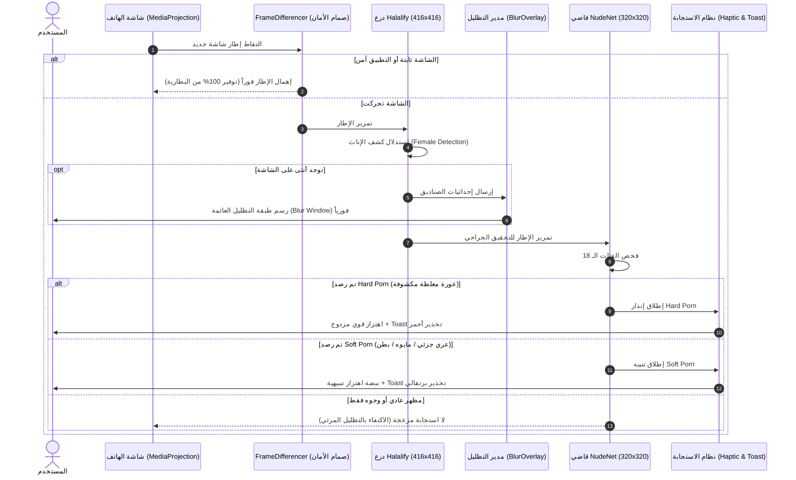

# الخطة المعمارية الشاملة: تتابع درع Halalify مع قاضي العورات NudeNet والاستجابة التفاعلية

> **الوضع:** تحليل معماري عميق وتخطيط مسبق وفق بروتوكول `/deep-analysis` و `/stop-think-search-and-plan` — **ZERO CODE**.  
> **بانتظار مراجعتك وموافقتك الصريحة (ابدأ / Approved) قبل إجراء أي تعديل برمجى.**  

---

## 1. الملخص التنفيذي وتوزيع الأدوار (Executive Summary & Model Roles)

لحسم المعادلة بدقة، سيتم توزيع الوظائف بصرامة بين النموذجين بحيث يكمل كل منهما الآخر دون تضارب أو إهدار لطاقة الهاتف:

### 1. دور نموذج Halalify v2 (`halalify_v2.tflite` - 416x416):
* **الوظيفة الحصرية:** **درع غض البصر البصري التلقائي (Pure Visual Blur Shield)**.
* **طريقة العمل:**
  * يعمل مباشرة على كل إطار لرصد وجوه وأجساد الفتيات بدقة.
  * يرسل الإحداثيات فورياً إلى مدير التظليل [ScreenBlurOverlayManager.kt](file:///d:/b/antiporn/app/src/main/java/com/drmohammed/antiporn/ai/overlay/ScreenBlurOverlayManager.kt) لرسم مستطيلات تعتيم أنيقة داكنة فوق أجساد ووجوه الفتيات.
  * **الضمانة:** لا يوقف التطبيقات، ولا يغلق الشاشة، ولا يصدر اهتزازات مزعجة، بل يحفظ بصر المستخدم بسلاسة تامة مع بقاء الهاتف قابلاً للاستخدام الطبيعي.

### 2. دور نموذج NudeNet v3 (`320n.onnx` - 320x320):
* **الوظيفة الحصرية:** **قاضي ومفتش مستويات المحتوى الفاضح (Content Violation Inspector)**.
* **طريقة العمل:**
  * يحلل تفاصيل المشهد عبر 18 فئة تشريحية دقيقة لتصنيف درجة الخطورة وتفعيل استجابة الهاتف:
    * **المستوى الأول: Hard Porn (إباحية صريحة مغلظة):**
      * الفئات: `FEMALE_GENITALIA_EXPOSED`، `MALE_GENITALIA_EXPOSED`، `FEMALE_BREAST_EXPOSED`، `ANUS_EXPOSED`.
      * **استجابة الهاتف:** **اهتزاز قوي مزدوج (Double Heavy Haptic Pulse)** + **إشعار Toast أحمر:**  
        `"🚨 تحذير عاجل: تم رصد محتوى إباحي صريح!"`
    * **المستوى الثاني: Soft Porn (عري جزئي صريح ولباس فاضح):**
      * الفئات: `FEMALE_GENITALIA_COVERED` (ملابس سباحة/داخلية)، `BUTTOCKS_EXPOSED`، `BELLY_EXPOSED`.
      * **استجابة الهاتف:** **نبضة اهتزاز تنبيهية (Single Haptic Pulse)** + **إشعار Toast برتقالي:**  
        `"⚠️ تنبيه: تم رصد محتوى فاضح / عري جزئي"`
    * **فئات اللباس العادي (`FEMALE_BREAST_COVERED` و `FACE_FEMALE`):**
      * **لا تطلق أي اهتزاز ولا أي Toast**، بل تُدمج تلقائياً مع نوافذ تظليل Halalify لغض البصر فقط دون مضايقة المستخدم.

---

## 2. مخطط تدفق المعالجة الزمني (End-to-End Sequence Diagram)

---

## 3. صمامات الأمان الثلاثة (The 3 Red-Teamed Failure Modes & Mitigations)

### 🔴 الفشل الأول: عاصفة الاهتزازات والإشعارات المتتالية أثناء الفيديوهات (Alert Storm)
* **المشكلة:** إذا كان المستخدم يشاهد مقطع فيديو يحتوي على لقطة فاضحة مدتها 5 ثوانٍ (بمعدل 10 إلى 20 إطاراً)، فإن استدعاء الاهتزاز و Toast في كل إطار سيجعل الهاتف يهتز بشكل هستيري ويملأ الشاشة بعشرات رسائل Toast المعلقة.
* **الحل الوقائي الحاسم:** تطبيق **صمام خافق التكرار الذكي (Alert Debounce)**؛ بحيث لا تتكرر استجابة الـ Toast والاهتزاز للمستوى نفسه إلا بعد مرور **5 ثوانٍ على الأقل (`ALERT_DEBOUNCE_MS = 5000L`)** من آخر إنذار.

### 🔴 الفشل الثاني: تكرار فك وإنشاء الـ Bitmaps واستنزاف الذاكرة (Bitmap GC Churn)
* **المشكلة:** إنشاء `Bitmap` جديد لنموذج Halalify، ثم إنشاء `Bitmap` آخر لنموذج NudeNet في كل إطار سيؤدي إلى استهلاك هائل للذاكرة وتدخل دوري لمجمع النفايات (Garbage Collection)، مما يسبب تقطيعاً (Stutter) في شاشة الهاتف.
* **الحل الوقائي الحاسم:** إنشاء كائن `Bitmap` واحد فقط ومشاركته بدقة بين النموذجين، مع إعادة تدويره فوراً (`rawBitmap.recycle()`) داخل كتلة `finally` لضمان صفر تسرب للذاكرة.

### 🔴 الفشل الثالث: فخ إطلاق الإنذارات على المحجبات والمعلمات (Modesty False Alarm)
* **المشكلة:** وسم `FEMALE_BREAST_COVERED` يرصده NudeNet لأي امرأة ترتدي ملابس عادية أو حجاباً؛ فلو أطلق اهتزازاً أو Toast، سيهتز هاتف المستخدم عند تصفح أي محتوى طبيعي.
* **الحل الوقائي الحاسم:** حصر استجابة الهاتف (الاهتزاز + Toast) **فقط وحصرياً** في فئات العري الصريح (`GENITALIA`, `EXPOSED_BREAST`, `BELLY_EXPOSED`, `FEMALE_GENITALIA_COVERED`)، ومنع أي استجابة تحذيرية لفئة `FEMALE_BREAST_COVERED` أو `FACE_FEMALE`.

---

## 4. خطة التعديل الجراحي للملفات (Surgical Implementation Blueprint)

| المسار | نوع التعديل | التغيير المستهدف |
| :--- | :---: | :--- |
| `app/build.gradle.kts` | `[MODIFY]` | إضافة مكتبة ONNX Runtime Mobile الرسمية: `implementation("com.microsoft.onnxruntime:onnxruntime-android:1.20.0")` |
| `app/src/main/assets/nudenet_320.onnx` | `[NEW]` | نقل ملف النموذج المعتمد والمختبر ميدانياً من `devolopment/320n.onnx` إلى مجلد assets. |
| `app/.../ai/core/model/NudeNetDetection.kt` | `[NEW]` | صياغة كائنات البيانات والأنواع الممثلة للفئات الـ 18 وتصنيف درجاتها (`HARD_PORN`, `SOFT_PORN`, `VISUAL_BLUR`). |
| `app/.../ai/core/inference/NudeNetDetector.kt` | `[NEW]` | محرك الاستدلال الآمن والمحصن لـ NudeNet v3 (فك مصفوفات 320x320 + NMS + معالجة Letterbox). |
| `app/.../ai/service/ScreenAiProjectionService.kt` | `[MODIFY]` | ربط `nudeNetDetector` داخل دورة معالجة الإطارات الحية بالتتابع المعتمد، وتحديث `triggerAlertThrottled` ليدعم اهتزازات ورسائل مختلفة لـ Hard Porn و Soft Porn. |
| `app/src/main/res/values/strings.xml` | `[MODIFY]` | إضافة نصوص التنبيه الاحترافية لـ Toast باللغتين العربية والإنجليزية. |

---

## 5. خطوات التحقق العملي بعد الدمج (PM Verification Steps)

1. **التحقق من غض البصر (Halalify):** عند فتح أي صورة لفتاة، تظهر فوراً نافذة التظليل الداكنة الدائرية فوق جسدها ووجهها دون إغلاق الهاتف.
2. **التحقق من استجابة الـ Soft Porn:** عند ظهور عري جزئي (ملابس سباحة/بطن مكشوف)، يهتز الهاتف نبضة واحدة وتظهر رسالة Toast برتقالية: *"⚠️ تنبيه: تم رصد محتوى فاضح / عري جزئي"*.
3. **التحقق من استجابة الـ Hard Porn:** عند رصد عورة مغلظة، يهتز الهاتف بنبضتين قويتين وتظهر رسالة Toast تحذيرية حمراء: *"🚨 تحذير: تم رصد محتوى إباحي صريح!"*.
4. **التحقق من ثبات الأداء:** بقاء الـ FPS سلساً والذاكرة مستقرة دون أي ارتفاع في حرارة الهاتف.

---

> [!IMPORTANT]
> **بوابة إذن البدء (Approval Gate):**  
> يرجى مراجعة الخطة أعلاه. فور كتابتك **"ابدأ"** أو **"Approved"**، سنبدأ مباشرة بتنفيذ التعديلات الجراحية واختبار التطبيق.
