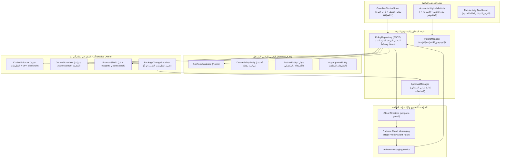

# Master Implementation Plan — Accountability Partner Cloud Infrastructure & Standard Dynamic Architecture
## خطة التحول المعماري الشامل: نظام التحكم السحابي التبادلي وشريك المساءلة (AntiPorn)

> **الحالة: خطة معمارية فقط — ZERO CODE. بانتظار موافقتك الصريحة (ابدأ / نفذ / Approved) لبدء إطلاق الوكلاء.**
> **الفلسفة:** لا سطر كود واحد في ملفات المصدر قبل الاعتماد. التنفيذ يتم لاحقاً عبر وكلاء فرعيين متخصصين تحت إشراف ومراجعة القائد.

---

## 1. الملخص التنفيذي وقيمة الأعمال (Executive Summary & Business Value)
- **الهدف الاستراتيجي:** تحويل تطبيق **AntiPorn** من تطبيق حماية محلي ذي إعدادات ثابتة في الكود إلى **منصة شبكية قياسية قائمة على شريك المساءلة (Accountability Partner & Guardian Model)**.
- **القيمة الوظيفية للمستخدم:**
  1. **التحكم بيد الصديق أو الولي، لا بيد المستخدم نفسه:** إزالة مفتاح الإلغاء الذاتي؛ حماية كل هاتف تدار حصرياً من هاتف الصديق المختار.
  2. **تحكم متعدد وشامل (1:N و N:M):** إمكانية تحكم الأب في عدة أبناء، وإمكانية تبادل التحكم بين صديقين (أ يتحكم في ب، وب يتحكم في أ في آن واحد).
  3. **تحكم دقيق وفوري في الصلاحيات:**
     - مواقيت الحظر الليلي (البدء والانتهاء).
     - قوة المنع (قطع الإنترنت بالكامل عبر VPN Blackhole أم تجميد تطبيقات محددة فقط).
     - قائمة التطبيقات المحظورة كلياً 24/7.
     - فرض غلق التصفح الخفي ومحركات البحث الآمنة في متصفحات كروم.
     - **قفل أي تطبيق جديد يُثبّت فوراً (Freeze at 0ms)** حتى يضغط الصديق على زر الموافقة في هاتفه.
  4. **بنية قياسية سهلة التوسع مستقبلاً:** نموذج بيانات مرن يسمح بإضافة أي صلاحية جديدة مستقبلاً بسطر واحد دون المساس بجهاز التوأمة أو شبكة المزامنة.

---

## 2. نتائج الفحص الجراحي وقرارات المستخدم (Ground Truth & Alignment)
1. **تم إنجاز الجانب السحابي وتجهيزه ذاتياً بالكامل:**
   - تم إنشاء مشروع Firebase: `antiporn-guard` تحت الخطة المجانية الدائمة (`freeTier: true`).
   - تم تسجيل تطبيق أندرويد `com.drmohammed.antiporn` وتوليد وتثبيت ملف `app/google-services.json`.
   - تم تفعيل خدمة `Cloud Firestore` وإنشاء قاعدة البيانات في منطقة `europe-west3` (فرانكفورت).
2. **قرارات المقابلة المعمارية المعتمدة مع المستخدم (`/grill-me`):**
   - **المصادقة:** دخول مجهول وصامت كلياً (`Firebase Anonymous Auth`) مع توليد رمز اقتران فريد لكل مستخدم (مثل `ALH-7421`) دون الحاجة لإدخال بريد إلكتروني أو كلمة سر (خصوصية تامة وسهولة تشغيل).
   - **الواجهة:** شاشة كاملة مستقلة **"مركز المساءلة" (Accountability Hub)** تتضمن: رمزي الخاص للمشاركة، قائمة بمن أحميهم (Wards)، وقائمة بمن يحمونني (Guardians).
   - **سياسة التطبيقات الجديدة:** تطبيق مبدأ **الحظر الصارم 100% (Strict Zero-Trust)**؛ أي تطبيق جديد يُجمّد فور تثبيته عبر `Device Owner` ولا يُفتح حتى يوافق الصديق من هاتفه.

---

## 3. المعمارية المستهدفة ودورة تدفق البيانات (Architecture & Flow)

---

## 4. سيناريوهات الفشل الثلاثة الحرجة وسبل الوقاية (3 Failure Modes & Mitigations)

1. **الفشل الأول: حلقة العزل التام وانقطاع النت (The Offline Blackhole Trap):**
   * *السيناريو:* الصديق فعّل "قطع النت بالكامل" عبر VPN Blackhole، أو نفدت باقة الإنترنت، وأراد الصديق فك القفل أو الموافقة على تطبيق، فتعذر وصول الإشعار السحابي للهاتف.
   * *الحل المعماري الوقائي:*
     1. استثناء نطاقات FCM وخوادم Google Play Services في الـ VPN Blackhole لضمان استقبال أوامر التحكم دائماً.
     2. إضافة خوارزمية **رمز الطوارئ بدون إنترنت (Offline TOTP Emergency Code)**؛ يفتح الصديق شاشته ويظهر رمزاً مؤقتاً مدته دقيقتان يُدخله المستخدم في هاتفه لفك القفل محلياً.

2. **الفشل الثاني: مأزق الشلل التبادلي (Mutual Lockout Deadlock):**
   * *السيناريو:* المستخدم (أ) يتحكم في (ب)، و(ب) يتحكم في (أ). قيام أحدهما بحظر تطبيقات الآخر بما فيها وسائل الاتصال والتطبيق نفسه.
   * *الحل المعماري الوقائي:*
     1. الحصانة الصلبة غير القابلة للإلغاء لحزمة `com.drmohammed.antiporn` (`ALWAYS_IMMUNE`)؛ لا يمكن لأي مستخدم أو سياسة تجميد تطبيق الحماية.
     2. الفصل المعماري التام: شاشة التحكم في الصديق منفصلة تماماً عن السياسة المطبقة على هاتفي.

3. **الفشل الثالث: اغتيال أنظمة توفير الطاقة لعمليات المزامنة (OEM Battery Murder):**
   * *السيناريو:* واجهات شاومي وريلمي وأوبو تقتل قنوات الاتصال بالخلفية فور إطفاء الشاشة.
   * *الحل المعماري الوقائي:*
     1. عدم الاعتماد إطلاقاً على اتصالات مفتوحة (WebSockets/Polling).
     2. استخدام رسائل `FCM High-Priority Data Messages` ذات إذن الاستيقاظ الاستثنائي لصلاحية `Device Owner`.
     3. **الاستقلالية المحلية:** مواعيد الحظر تجدول محلياً في `AlarmManager` وتعمل بدقة الثانية حتى لو كان الهاتف مفصولاً كلياً عن الشبكة.

---

## 5. المخطط الجراحي لتعديل وإنشاء الملفات (Surgical File Diff Blueprint)

### أ. ملفات التبعات والبناء (Gradle & Dependencies):
- **`[MODIFY]` `gradle/libs.versions.toml`:**
  - إضافة `firebase-bom = "33.10.0"`.
  - إضافة `firebase-firestore`, `firebase-messaging`, `firebase-auth`.
  - إضافة `room = "2.7.0-alpha12"` أو أحدث إصدار متوافق، مع `ksp`.
  - إضافة `google-services = "4.4.2"`.
- **`[MODIFY]` `build.gradle.kts`:**
  - تسجيل إضافة `com.google.gms.google-services` apply false.
- **`[MODIFY]` `app/build.gradle.kts`:**
  - تطبيق إضافة `plugins { id("com.google.gms.google-services") }`.
  - ربط مكتبات Firebase عبر BoM، ومكتبات Room، والـ Coroutines.

### ب. طبقة البيانات والنماذج المحلية (Data & Models):
- **`[NEW]` `core/model/DevicePolicyBundle.kt`:** كائن البيانات الموحد لجميع إعدادات الحماية:
  - `curfewStartHour`, `curfewStartMinute`, `curfewEndHour`, `curfewEndMinute`.
  - `isVpnBlackholeEnabled: Boolean`.
  - `isIncognitoBlocked: Boolean`.
  - `lockNewInstallsUntilApproved: Boolean`.
  - `customBlacklistPackages: Set<String>`.
  - `customCurfewWhitelistPackages: Set<String>`.
  - `version: Long`, `updatedAt: Long`.
- **`[NEW]` `data/local/db/AntiPornDatabase.kt`:** قاعدة بيانات Room المحلية.
- **`[NEW]` `data/local/db/entity/DevicePolicyEntity.kt`:** كيان تخزين السياسة المحلية.
- **`[NEW]` `data/local/db/entity/PartnerEntity.kt`:** كيان تخزين الأصدقاء والمكفولين.
- **`[NEW]` `data/local/db/entity/PendingApprovalEntity.kt`:** كيان طابور التطبيقات المعلقة.

### ج. طبقة المستودع والمزامنة السحابية (Repository & Cloud Sync):
- **`[NEW]` `data/repository/PolicyRepository.kt`:** المستودع الموحد (SSOT) الذي يدمج القراءة من Room مع مزامنة Firestore.
- **`[NEW]` `data/repository/AccountabilityRepository.kt`:** إدارة علاقات التوأمة برموز الاقتران.
- **`[NEW]` `cloud/fcm/AntiPornFirebaseMessagingService.kt`:** استقبال الإشعارات الصامتة عالية الأولوية وتطبيق التغييرات فوراً في الخلفية.

### د. تحرير وتحديث محركات الإنفاذ (Engine Dynamicization):
- **`[MODIFY]` `curfew/CurfewConfig.kt`:** تحويل الثوابت الجامدة لميثودات تقرأ ديناميكياً من `PolicyRepository`.
- **`[MODIFY]` `curfew/CurfewScheduler.kt`:** جدولة المنبهات بالاعتماد على الأوقات المستلمة من الصديق.
- **`[MODIFY]` `curfew/CurfewEnforcer.kt`:** التحقق من خيار `isVpnBlackholeEnabled`؛ تشغيل VPN فقط إذا كان الخيار معتمداً من الصديق.
- **`[MODIFY]` `shields/BrowserShield.kt`:** تطبيق وضع منع التصفح الخفي ديناميكياً حسب رغبة الصديق.
- **`[MODIFY]` `PackageChangeReceiver.kt`:** عند تثبيت أي تطبيق جديد أثناء تفعيل خيار الصديق `lockNewInstallsUntilApproved`، يتم تجميده فورياً عبر `DevicePolicyManager` ورفع طلب استئذان للسحابة.

### هـ. طبقة الواجهة وتجربة المستخدم (UI & Accountability Hub):
- **`[NEW]` `ui/accountability/AccountabilityHubActivity.kt`:** الشاشة المخصصة لشركاء المساءلة.
- **`[NEW]` `ui/accountability/GuardianControlActivity.kt`:** لوحة تحكم الصديق في مكفوله (تعديل الأوقات، التبديل بين قوة المنع، الموافقة على التطبيقات).
- **`[NEW]` `res/layout/activity_accountability_hub.xml`:** واجهة أنيقة بالـ Material 3.
- **`[MODIFY]` `ui/binder/MainViewBinder.kt` & `activity_main.xml`:** إضافة زر رئيسي جذاب لفتح "مركز المساءلة".

---

## 6. خطة توزيع المهام على الوكلاء الفرعيين (Subagents Decomposition)

| الوكيل المتخصص | نطاق العمل والمسؤولية | بوابة المراجعة الصارمة (Supervision Gate) |
| :--- | :--- | :--- |
| **الوكيل 1: مهندس البيانات والمزامنة السحابية** `(subagent-data-cloud)` | • ربط تبعات Firebase و Room في Gradle. • إنشاء كيانات قاعدة البيانات وجداول السياسات. • بناء `PolicyRepository` و `FirestoreSyncEngine`. | التحقق من صحة بناء المشروع وعدم وجود أخطاء في الـ Schema. |
| **الوكيل 2: مهندس تحرير محركات النظام** `(subagent-engine-dynamic)` | • فك الارتباط الثابت في `CurfewConfig` و `CurfewScheduler`. • تعديل `CurfewEnforcer` لدعم أنماط المنع المختلفة. • ربط `BrowserShield` و `PackageChangeReceiver` بالسياسة الديناميكية. | فحص مسارات التنفيذ وتوافقها 100% مع صلاحيات `Device Owner`. |
| **الوكيل 3: مهندس الإشعارات الفورية والتجميد الصارم** `(subagent-fcm-approval)` | • كتابة `AntiPornFirebaseMessagingService`. • معالجة الإشعارات الصامتة وإيقاظ النظام. • تفعيل دورة استئذان التطبيقات الجديدة وتجميدها الفوري. | التأكد من استيقاظ التطبيق وسرعة التجميد في 0ms دون تجميد واجهة النظام. |
| **الوكيل 4: مهندس الواجهات وتجربة المستخدم** `(subagent-ui-hub)` | • بناء شاشة `AccountabilityHubActivity` و `GuardianControlActivity`. • تصميم حوار مشاركة وإدخال رمز الاقتران (6 أرقام). • ربط التفاعل مع الشاشة الرئيسية `MainActivity`. | مراجعة التصميم، دعم اللغة العربية والإنجليزية وتناسق الخطوط والمظهر الليلي. |
| **الوكيل 5: المدقق الحيادي الصارم** `(subagent-auditor-verifier)` | • تدقيق شامل للكود ومسارات الأمان ومقاومة العبث. • تشغيل `./gradlew assembleDebug` و `./gradlew test`. • التأكد من تصفير كافة التحذيرات والأخطاء. | تحقيق نسبة نجاح 100% في الاختبارات وبناء APK قابل للتشغيل الفوري. |

---

## 7. خطة التحقق والاختبار (Verification & Acceptance Testing)

1. **اختبار البناء البرمجي (Compilation & Build Gate):**
   - تنفيذ `./gradlew assembleDebug` والتحقق من اكتمال الدمج وخلوه من أي تعارضات في المكتبات.
2. **اختبار التوأمة السحابية (Pairing Verification):**
   - توليد رمز اقتران للمستخدم الأول، وإدخاله في محاكاة المستخدم الثاني، والتحقق من إنشاء وثيقة الاقتران في Firestore لحظياً.
3. **اختبار تغيير مواقيت الحظر عن بعد (Remote Curfew Sync):**
   - تعديل موعد الحظر من لوحة تحكم الصديق، والتحقق من استقبال الإشعار الصامت وتحديث منبهات `AlarmManager` على الهاتف المكفول في أقل من 3 ثوانٍ.
4. **اختبار قفل التطبيق الجديد الصارم (Instant Freeze Test):**
   - تثبيت حزمة جديدة، والتحقق من تجميدها الفوري عبر `dpm.setPackagesSuspended` وظهور طلب الاستئذان على هاتف الصديق.
5. **اختبار الأمان والحصانة:**
   - التأكد من استحالة تجميد تطبيق AntiPorn نفسه، واستمرار عمل الحماية حتى في حال إعادة تشغيل الجهاز.

---

> [!IMPORTANT]
> **بوابة الاعتماد الصريح (Approval Gate):**
> لقد تم وضع الخطة التفصيلية الكاملة أعلاه طبقاً لمواصفاتك وأجوبتك الدقيقة.
> **لن يتم تعديل أي ملف في كود المشروع، ولن يتم إطلاق الوكلاء الفرعيين، حتى تعطي إشارتك بالموافقة الصريحة (مثل: "ابدأ"، "نفذ"، "Approved").**
