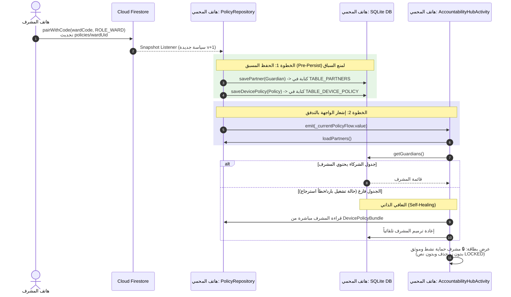

# خطة التنفيذ الشاملة: حل عوائق ظهور المشرف وتوحيد مصدر الحقيقة
## Master Implementation Plan: Reliable Guardian Visibility & Single Source of Truth

---

### 1. ملخص تنفيذي وقيمة المشروع (Executive Summary & Value)
تهدف هذه الخطة إلى حل مشكلة عدم ظهور المشرف في صفحة "مركز شريك المسائلة" لدى هاتف الشخص المحمي. بعد دراسة معمقة وتوافق مع متطلبات إدارة المشروع (PM Lead)، تقرر اعتماد نموذج الحماية القياسي الأحادي: **المشرف هو من يُدخل رمز المحمي لربطه**، بينما يعرض هاتف المحمي بطاقة موثقة وأنيقة للمشرف دون زر حذف زائف ودون نصوص مشوهة.

يحل هذا التعديل 4 عوائق برمجية جذرية:
1. **القضاء على سباق التزامن (Race Condition):** حفظ المشرف محلياً في قاعدة البيانات أولاً قبل إشعار الواجهة بالتحديث.
2. **التعافي الذاتي وتوحيد الحقيقة (Self-Healing Fallback):** استدعاء بيانات المشرف مباشرة من وثيقة السياسة الفعالة إذا وُجد جدول الشركاء فارغاً.
3. **تنقية تجربة المستخدم (UX Polish):** تحويل نافذة إضافة الشريك لتكون مخصصة حصراً لإضافة المشمولين بالرعاية (Wards)، وتحويل بطاقة المشرف لبطاقة أمان موثقة `🔒 مشرف حماية نشط وموثق`.

---

### 2. البنية المعمارية ومخطط التدفق (Architecture & Flow)

---

### 3. تدقيق أنماط الإخفاق وحلولها الوقائية (3 Red-Teamed Failure Modes)

| الرقم | سيناريو الإخفاق | السبب الجذري | الحل الوقائي المنفذ في الخطة |
| :--- | :--- | :--- | :--- |
| **1** | **تحديث اسم المشرف لا ينعكس على المحمي** | تجاهل التحديثات اللاحقة بسبب شرط `!wasSupervised && isNowSupervised` | إلغاء الشرط، وتحديث سجل المشرف دائماً كلما وردت سياسة مقيدة تحتوي `guardianUid` و `guardianName`. |
| **2** | **فتح التطبيق بدون إنترنت (Cold Boot Offline)** | قراءة جدول شركاء فارغ قبل وصول نبضة السحابة | تطبيق آلية التعافي الذاتي `Self-Healing`: عند استدعاء `getGuardians()`، إذا كان فارغاً والسياسة مقيدة، يتم توليد المشرف وحفظه فوراً في SQLite. |
| **3** | **ارتباك المستخدم ومحاولة إضافة المشرف من هاتف المحمي** | بقاء خيار "إضافة كمشرف" المرفوض أمنياً من السحابة | تنقية نافذة "إضافة شريك" لتكون مخصصة حصراً لـ "إضافة شخص مشمول برعايتك"، مع توجيه المحمي لمشاركة رمزه الظاهر على الشاشة مع المشرف. |

---

### 4. التغييرات البرمجية الجراحية (Surgical File Blueprint)

#### 1. [`PolicyRepository.kt`](file:///d:/b/antiporn/app/src/main/java/com/drmohammed/antiporn/data/repository/PolicyRepository.kt) — [MODIFY]
* **الموقع:** دالة `attachPolicyListener` و `loadInitialPolicy`
* **التعديل:**
  1. تقديم كتابة المشرف `database.savePartner(partner)` لتكون **قبل** `updateLocalPolicyAndEnforce(cloudPolicy)`.
  2. إزالة القيد القديم `!wasSupervised && isNowSupervised`، وتحديث المشرف كلما كان `cloudPolicy.isSupervised && !cloudPolicy.guardianUid.isNullOrBlank()`.
  3. في `loadInitialPolicy()`: فحص السياسة المحلية، فإذا كانت مقيدة وجدول الشركاء لا يحوي المشرف، يتم إدراجه فوراً.

#### 2. [`AccountabilityRepository.kt`](file:///d:/b/antiporn/app/src/main/java/com/drmohammed/antiporn/data/repository/AccountabilityRepository.kt) — [MODIFY]
* **الموقع:** دالة `getGuardians()`
* **التعديل:**
  * إضافة فحص تعافي ذاتي: إذا كانت النتيجة من `TABLE_PARTNERS` فارغة، يتم الاستعلام من `database.getDevicePolicy()`. فإذا كان مقيداً، يُنشأ كائن `PartnerEntity` للمشرف ويُحفظ تلقائياً في SQLite ويُعاد للقائمة.

#### 3. [`AccountabilityHubActivity.kt`](file:///d:/b/antiporn/app/src/main/java/com/drmohammed/antiporn/ui/accountability/AccountabilityHubActivity.kt) — [MODIFY]
* **الموقع:** `showAddPartnerDialog` و `createPartnerCard`
* **التعديل:**
  1. **تنقية بطاقة المشرف:** 
     * عند `isWard == false`: إخفاء حقل "رمز الاقتران: LOCKED" واستبداله بنص شارة موثقة: `🔒 مشرف حماية نشط وموثق`.
     * إخفاء زر "حذف الشريك" لبطاقة المشرف نهائياً (`if (isWard)` فقط).
  2. **تنقية نافذة إضافة الشريك:**
     * تخصيص النافذة لإضافة Wards فقط ("إضافة شخص تحت حمايتك").
     * توضيح نصي أن الإشراف على هذا الهاتف يتم من خلال مشاركة الرمز الظاهر على الشاشة مع المشرف.

#### 4. [`strings.xml`](file:///d:/b/antiporn/app/src/main/res/values/strings.xml) — [MODIFY]
* **التعديل:** إضافة نصوص واضحة باللغة العربية والإنجليزية لحالة المشرف النشط وتوجيهات الاقتران.

---

### 5. خطة توزيع العمل على الوكلاء الفرعيين (Subagents Breakdown)

| الوكيل | التخصص والاسم | المهام المسندة | معيار القبول والتحقق |
| :--- | :--- | :--- | :--- |
| **وكيل 1: البيانات والمزامنة** | `self` / `repo-sync-specialist` | تعديل `PolicyRepository.kt` و `AccountabilityRepository.kt` لتثبيت الحفظ المسبق والتعافي الذاتي | ضمان عدم قراءة قائمة فارغة أبداً عند وجود سياسة مقيدة |
| **وكيل 2: واجهة المستخدم** | `self` / `ui-specialist` | تعديل `AccountabilityHubActivity.kt` و `strings.xml` | إخفاء زر الحذف عن المشرف، وتحديث نصوص الشارة والنافذة |
| **وكيل 3: التدقيق والتجميع** | `self` / `qa-auditor` | تشغيل `./gradlew testDebugUnitTest` والتحقق من سلامة البناء وخلوه من التعارضات | اجتياز 100% من الاختبارات بنجاح |

---

### 6. خطة التحقق والاختبار (Verification Plan)

1. **فحص سلامة التجميع الآلي:** تشغيل `./gradlew compileDebugKotlin` للتأكد من عدم وجود أخطاء في الرموز والأنواع.
2. **اختبارات الوحدة الآلية:** تشغيل `./gradlew testDebugUnitTest` للتأكد من سلامة منطق السياسات وقواعد البيانات.
3. **خطوات التحقق الميداني لمدير المشروع (PM Verification Walkthrough):**
   * **خطوة 1:** افتح مركز شريك المسائلة في هاتف غير مقيد -> لاحظ ظهور رمز الاقتران ووضوح الرسالة.
   * **خطوة 2:** اضغط "إضافة شريك" -> لاحظ أن النافذة واضحة ومخصصة لإضافة الأشخاص المشمولين برعايتك فقط دون ارتباك خيار "كمشرف".
   * **خطوة 3:** اربط الهاتف بمشرف من الهاتف الآخر -> راقب شاشة المحمي لحظياً: ستتحول بطاقة الرمز إلى شارة القفل فوراً، ويظهر كارت المشرف بالأسفل: **اسم المشرف + "🔒 مشرف حماية نشط وموثق"** دون أي نصوص LOCKED وبدون زر حذف مشوه!
   * **خطوة 4:** أغلق التطبيق بالكامل وافتحه من جديد -> تحقق من بقاء بطاقة المشرف ظاهرة وثابتة دون اختفاء!

---

> [!IMPORTANT]
> **بوابة إذن المستخدم (User Approval Gate):**  
> الخطة الآن مكتملة وجاهزة وفق بروتوكول `stop-think-search-and-plan`.  
> لم يتم إجراء أي تعديل على كود المشروع بعد.  
> يرجى مراجعة الخطة وإعطاء إشارة البدء (مثل: **"اعتمد ونفذ"** أو **"Proceed"**) لنباشر التنفيذ ومراقبة الوكلاء الفرعيين فوراً.
