# الخطة المعمارية الشاملة: التثبيت الذكي لبلور الذكاء الاصطناعي ومنع الوميض والتقطيع (Motion-Gated Blur Stability Engine) 🛡️👁️

> **الوضع:** خطة معمارية شاملة وفق بروتوكول `/stop-think-search-and-plan` — **ZERO CODE**.  
> **حالة التنفيذ:** **مقفل تماماً بانتظار موافقتك الصريحة (`ابدأ` / `نفذ` / `Approved`)**.  
> **الهدف الجوهري:** تحويل تعتيم الذكاء الاصطناعي (Halalify & NudeNet) من وميض متقطع (2.5 Hz) إلى درع بصري ثابت 100% كالصخرة على الصور الثابتة، مع إزالة فورية ذكية (<50ms) عند التمرير السريع لمنع تعليق المربع الأسود.

---

## 1. الملخص التنفيذي وقيمة الحل (Executive Summary & Business Value)

* **المشكلة الحالية:**  
  عند اكتشاف الذكاء الاصطناعي لامرأة في صورة ثابتة، يقوم برسم صندوق بلور داكن فوقها. لكن لأن خدمة تسجيل الشاشة تلتقط الصندوق نفسه (Self-Occlusion)، يعتقد الذكاء الاصطناعي في الإطار التالي أن المرأة اختفت، فينتهي مؤقت الثبات (400ms) ويسقط البلور، فتظهر المرأة مجدداً، ليعيد الذكاء الاصطناعي رسم البلور... وهكذا دواليك كالفلاش المتقطع، مما يزعج عين المستخدم ويسرب لقطات عابرة.
* **الحل المعماري المقترح (المعتمد باختيارك):**
  1. **التثبيت الذكي المقترن بالحركة (Motion-Gated Static Latch):**  
     طالما أن شاشة الهاتف ساكنة (حركة البكسلات < 2% ولم يقم المستخدم بالتمرير أو تغيير التطبيق)، **يتم قفل البلور وتثبيته للأبد** دون مسحه، ودون استهلاك طاقة المعالج في إعادة فحص الصورة الثابتة.
  2. **الإزالة الفورية عند مغادرة الصورة (Fast Motion Dismissal < 50ms):**  
     عندما يكتشف كاشف الحركة قيام المستخدم بتمرير سريع (Scroll Delta > 5%) نحو محتوى سليم، يتم مسح البلور فوراً (أقل من 50 ملي ثانية) لمنع بقاء مربع أسود معلق فوق النصوص البريئة (Ghost Box).
  3. **استئناف الفحص السلس مع الحركة:**  
     بمجرد تحرك الشاشة، يستأنف الذكاء الاصطناعي فحص الإطارات وتحديث إحداثيات الصندوق بتنعيم حركي انسيابي (EMA Smoothing).

---

## 2. مقارنة التدفق: الوضع الحالي vs المحرك المقترح (Mermaid Flow)

```mermaid
flowchart TD
    subgraph Current [الوضع الحالي: حلقة الوميض والتقطيع]
        C1[رصد امرأة في صورة ثابتة] --> C2[رسم الصندوق الأسود فوقها]
        C2 --> C3[جدولة مسح بعد 400ms]
        C3 --> C4[الإطار التالي: الصندوق حجب المرأة]
        C4 --> C5[الذكاء الاصطناعي: لم أعد أرى امرأة!]
        C5 --> C6[انتهاء 400ms -> حذف الصندوق وكشف المرأة!]
        C6 --> C1
    end

    subgraph Proposed [المحرك الجديد: درع ثابت ومقترن بالحركة 100%]
        P1[رصد امرأة على الشاشة] --> P2[رسم البلور وقفل الحالة Latch Active]
        P2 --> P3[فحص حركة الإطار التالي عبر FrameDifferencer]
        P3 --> P4{هل تحركت الشاشة؟}
        
        P4 -- "لا (حركة < 2%)" --> P5[الشاشة ساكنة: تثبيت البلور 100% وإيقاف الفحص لتوفير البطارية]
        P5 --> P3
        
        P4 -- "نعم (تمرير سريع)" --> P6[فحص الذكاء الاصطناعي للإطار المتحرك]
        P6 --> P7{هل ما زالت المخالفة موجودة؟}
        P7 -- نعم --> P8[تحديث إحداثيات البلور بسلاسة مع التمرير]
        P7 -- لا --> P9[إزالة فورية خلال أقل من 50ms لمنع تعليق المربع]
        
        P8 --> P3
        P9 --> P10[عودة الشاشة للوضع الطبيعي]
    end
```



---

## 3. بوابات الإخفاق الثلاث وخطة تحصينها (The 3 Failure Modes & Mitigations)

| الرقم | وضع الفشل (Failure Mode) | السيناريو الحرج | آلية التحصين الهندسية في الخطة |
| :--- | :--- | :--- | :--- |
| **1** | **تذبذب الحجب الذاتي (Self-Occlusion Loop)** | البلور يحجب المرأة فيعتقد الموديل اختفاءها بعد 400ms. | **تحويل دورة الحياة**: البلور لا يسقط بمؤقت زمني أعمى، بل يسقط فقط إذا أثبتت حركة الشاشة الفعلية مغادرة المنطقة المخالفة. |
| **2** | **تعليق المربع الأسود (Ghost Box on Harmless Text)** | بقاء الصندوق معلقاً 400ms بعد التمرير السريع فوق نصوص عادية. | **بوابة التفريغ السريع (Fast Dismissal)**: إذا كانت حركة التمرير > 5% وتأكد خلو الإطار الجديد، يُمسح الصندوق فوراً في <50ms بدلاً من 400ms. |
| **3** | **تغير التطبيق المفاجئ (App Switch Leak)** | المستخدم يضغط زر Home أو يبدل التطبيق لـ WhatsApp أثناء وجود البلور. | **ربط فوري بـ `ContextualGatingWatcher`**: عند تغير التطبيق الأمامي يتم استدعاء `clearImmediate()` فوراً بدون أي تأخير. |

---

## 4. المخطط الجراحي للملفات (Surgical File Blueprint)

### 1. `FrameDifferencer.kt` [MODIFY]
* **المسار:** `app/src/main/java/com/drmohammed/antiporn/ai/core/pipeline/FrameDifferencer.kt`
* **التعديلات الجراحية:**
  - حفظ آخر نسبة تغير: `var lastChangeRatio: Float = 0f` (قراءة آمنة).
  - إضافة دالة `isSceneStatic(threshold: Float = 0.02f): Boolean` لتحديد ما إذا كانت الشاشة ساكنة (تغير أقل من 2%).
  - إضافة دالة `isSignificantMotion(threshold: Float = 0.05f): Boolean` لاكتشاف التمرير السريع (تغير أكبر من 5%).

### 2. `ScreenBlurOverlayManager.kt` [MODIFY]
* **المسار:** `app/src/main/java/com/drmohammed/antiporn/ai/overlay/ScreenBlurOverlayManager.kt`
* **التعديلات الجراحية:**
  - إضافة حالة القفل الثابت: `@Volatile var isStaticLatch: Boolean = false`.
  - إضافة دالة `retainActiveRegions()`: تقوم بإلغاء `clearRunnable` وتثبيت الصناديق الحالية طالما أن الشاشة ساكنة.
  - إضافة دالة `dismissFast()`: مسح فوري وسلس في أقل من 50ms عند اكتشاف التمرير بعيداً عن المحتوى.
  - تعديل دالة `updateRegionsInternal`:
    - عند استلام مناطق جديدة: تفعيل `isStaticLatch = true` وتحديث الإحداثيات وتثبيت الصندوق.
    - عدم السماح بحذف الصناديق إلا عبر إشارة حركة مؤكدة من `ScreenAiProjectionService`.

### 3. `ScreenAiProjectionService.kt` [MODIFY]
* **المسار:** `app/src/main/java/com/drmohammed/antiporn/ai/service/ScreenAiProjectionService.kt`
* **التعديلات الجراحية:**
  - في معالج الإطارات `reader.setOnImageAvailableListener`:
    ```kotlin
    if (!frameDifferencer.hasScreenChanged(...)) {
        // الشاشة ساكنة تماماً!
        if (blurOverlayManager.hasActiveRegions) {
            blurOverlayManager.retainActiveRegions() // تثبيت البلور دون أي وميض
        }
        return@setOnImageAvailableListener // توفير طاقة المعالج
    }
    ```
  - عند اكتشاف حركة (`hasScreenChanged == true`):
    - فحص الذكاء الاصطناعي `halalifyDetector.detect(rawBitmap)`.
    - إذا وُجدت إناث: `blurOverlayManager.updateRegionsMapped(...)`.
    - إذا لم توجد إناث وكانت الحركة كبيرة (`isSignificantMotion`): استدعاء `blurOverlayManager.dismissFast()` لمنع تعليق المربع الأسود.

### 4. `ScreenBlurOverlayManagerTest.kt` [MODIFY]
* **المسار:** `app/src/test/java/com/drmohammed/antiporn/ai/overlay/ScreenBlurOverlayManagerTest.kt`
* **التعديلات الجراحية:**
  - كتابة اختبارات وحدة جديدة تؤكد:
    1. ثبات الصناديق عند استدعاء `retainActiveRegions()` دون سقوطها بعد 400ms.
    2. تفريغ الصناديق الفوري عبر `dismissFast()`.
    3. عمل التنعيم الحركي EMA بالتوازي مع وضع القفل الثابت.

---

## 5. خطة توزيع المهام والوكلاء (Subagent Task Breakdown)

| الوكيل المتخصص | نطاق العمل (Domain) | المخرجات المتوقعة | بوابة المراجعة (Gate) |
| :--- | :--- | :--- | :--- |
| **Subagent 1: Pipeline Specialist** | `FrameDifferencer.kt` | إضافة مقاييس السكون ونسب التغير `isSceneStatic` و `isSignificantMotion` | مراجعة الكود، اختبار عدم وجود تخصيص ذاكرة زائد |
| **Subagent 2: Overlay Specialist** | `ScreenBlurOverlayManager.kt` | تنفيذ `retainActiveRegions` و `dismissFast` وقفل الثبات | مراجعة التزامن (Thread-Safety) ومؤقتات Handler |
| **Subagent 3: Service Coordinator** | `ScreenAiProjectionService.kt` | ربط الكاشف بالخدمة ومنع إسقاط البلور أثناء السكون | مراجعة دورة التقاط الإطارات واستهلاك البطارية |
| **Subagent 4: Quality Auditor** | `Unit Tests & Build` | كتابة الاختبارات وتشغيل `./gradlew test` | التحقق من نجاح كافة الاختبارات بنسبة 100% |

---

## 6. خطة التحقق والاختبار (Empirical Verification Plan)

1. **الاختبارات الآلية (Automated Tests):**
   - تشغيل اختبارات الوحدة عبر Gradle:
     ```powershell
     ./gradlew testDebugUnitTest --tests "com.drmohammed.antiporn.ai.overlay.ScreenBlurOverlayManagerTest"
     ```
   - التأكد من اجتياز 100% من الاختبارات دون أي فشل.
2. **التحقق البصري والتجريبي على الهاتف (PM Manual Verification Steps):**
   - **الخطوة 1:** افتح صورة ثابتة تحتوي على مخالفة، ولا تحرك إصبعك على الشاشة لمدة 10 ثوانٍ.
     - *النتيجة المتوقعة:* يظهر البلور ويبقى ثابتاً 100% دون أي وميض أو ومضة سريعة أو تقطيع كالفلاش.
   - **الخطوة 2:** مرر إصبعك للأسفل بسرعة لمغادرة الصورة نحو مقال نصي.
     - *النتيجة المتوقعة:* يختفي البلور فوراً وبسلاسة دون أن يظل معلقاً فوق النصوص البريئة.
   - **الخطوة 3:** راقب الـ Logcat عبر الأمر:
     ```powershell
     adb logcat -v time -s ScreenAiProjectionSvc ScreenBlurOverlay
     ```
     - *النتيجة المتوقعة:* في وضع السكون، سترى رسائل تثبيت وثبات الدرع دون أي رسائل تبديل متكررة كل 400ms.
