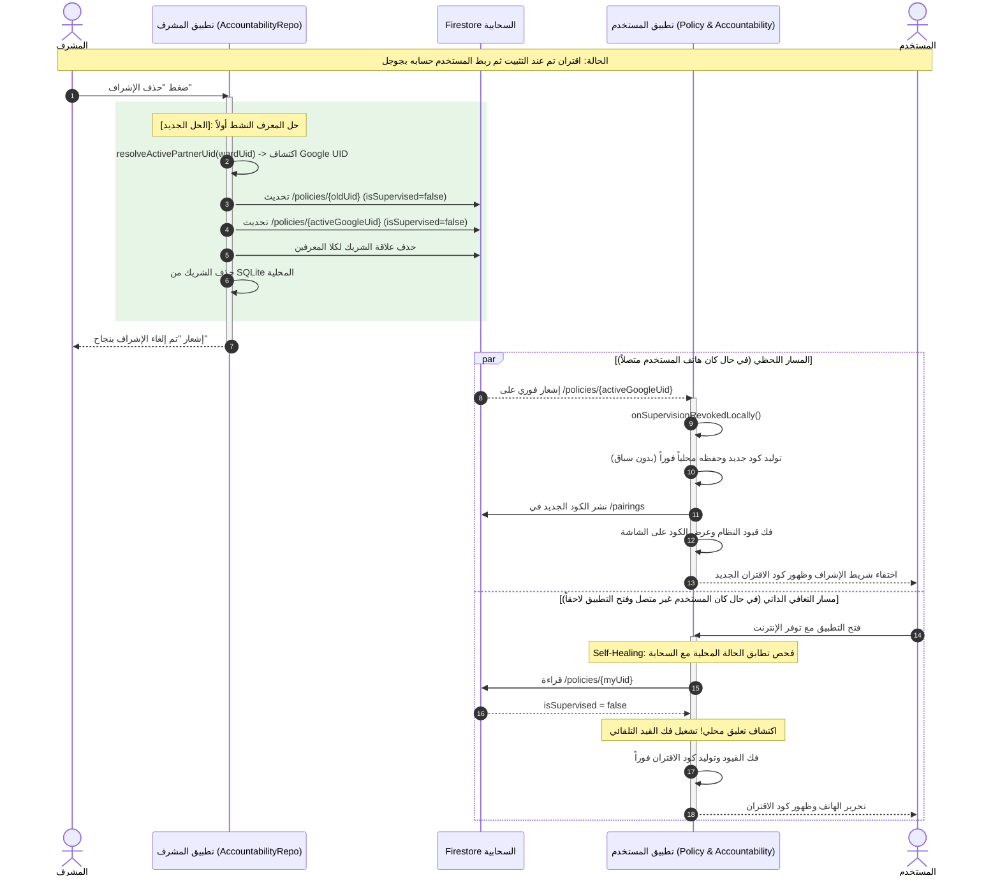

# الخطة المعمارية الشاملة: إصلاح ثغرة انفصال المعرف والتعافي الذاتي عند إلغاء الإشراف 🛡️🔄

> **الوضع:** خطة تنفيذية وفق بروتوكول `/stop-think-search-and-plan` — **ZERO CODE**.  
> **حالة التنفيذ:** **مقفل تماماً بانتظار موافقتك الصريحة (`ابدأ` / `نفذ` / `Approved`)**.  
> **الهدف الجوهري:** ضمان تحرر هاتف المستخدم فوراً ودون أي استثناء عند قيام المشرف بحذف الإشراف، ومعالجة انفصال المعرف (UID Drift)، وسد ثغرة انقطاع الاتصال عبر فحص التعافي الذاتي التلقائي (Self-Healing).

---

## 1. الملخص التنفيذي وقيمة الحل (Executive Summary & Business Value)

* **المشكلة التي نعالجها:**  
  عندما يقترن المشرف بهاتف مستخدم عند أول تشغيل للتطبيق، يتم حفظ المعرف الأولي (Anonymous UID أو Hardware Fallback). وإذا قام المستخدم لاحقاً بربط حسابه بجوجل (تأمين الحساب)، ينتقل هاتفه للمعرف الجديد. عند قيام المشرف بإلغاء الإشراف لاحقاً، كان التطبيق يرسل الإلغاء للمعرف القديم فقط، فيظل هاتف المستخدم مقيداً ومقفولاً للأبد (Stuck in Limbo) بينما المشرف يظن أنه قد حرره. بالإضافة إلى تعليق المستخدم إذا كان غير متصل بالإنترنت لحظة الحذف.
* **الحل المعماري المقترح (المعتمد باختيارك):**
  1. **الإلغاء الثنائي الشامل في السحابة (Multi-UID Cloud Revocation):**  
     تعديل دالة `revokeSupervision` لتقوم بحل المعرف النشط (`resolveActivePartnerUid`). إذا كان للمستخدم معرف قديم وآخر جديد (Google)، يتم تحديث الوثيقتين معاً في السحابة وضبطهما على `isSupervised=false` وحذف العلاقة من كلا المعرفين.
  2. **نظام التعافي الذاتي التلقائي (Self-Healing Check on Resume/Boot):**  
     عند فتح التطبيق أو عودة الاتصال بالإنترنت على هاتف المستخدم، يقوم النظام بفحص سريع: إذا كانت قاعدة البيانات المحلية تظن أن الجهاز خاضع للإشراف، لكن وثيقة السحابة تقول أنه غير خاضع للإشراف؛ يقوم الهاتف بفك القيود فوراً، وحذف المشرف محلياً، وتوليد كود اقتران جديد وإظهاره على الشاشة تلقائياً.
  3. **القضاء على سباق توليد الأكواد (Race-Free Pairing Code Regeneration):**  
     حفظ الكود الجديد محلياً فوراً قبل انتظار استجابة حذف الكود القديم من السحابة، لمنع ظهور كودين متضاربين في نفس الثانية.

---

## 2. مقارنة التدفق: الوضع الحالي vs الحل الجديد (Mermaid Architecture)

---

## 3. حالات الفشل الثلاث وكيف نمنعها (The 3 Failure Modes & Mitigations)

| # | حالة الخلل (Failure Mode) | السيناريو والمخاطر | خطة الوقاية والمعالجة البرمجية الصارمة |
|---|---|---|---|
| **1** | **انفصال المعرف (UID Drift)** | المشرف يرسل الإلغاء للمعرف القديم فقط، بينما المستخدم يستمع لمعرفه الجديد (جوجل)، فيتعلق المستخدم للأبد. | استدعاء `resolveActivePartnerUid` وتحديث المعرف القديم والمعرف النشط في نفس العملية. |
| **2** | **انقطاع الإنترنت وقت الحذف (Offline Limbo)** | المستخدم بدون إنترنت وقت الحذف، فلا يصله الإشعار اللحظي ويظل هاتفه مقفلاً. | إضافة فحص التعافي الذاتي (`checkAndSelfHealSupervisionStatus`) يعمل تلقائياً عند فتح التطبيق لفك القيد بمجرد ملامسة الإنترنت. |
| **3** | **سباق توليد كود الاقتران (Race Condition)** | الواجهة تطلب الكود الجديد بينما الكود القديم لا يزال قيد الحذف من السحابة، مما يولد كودين متضاربين. | توليد الكود الجديد وتخزينه في `prefs` فوراً في السطر الأول، ونقل حذف الكود القديم ليعمل في الخلفية غير المعطلة (`repositoryScope.launch`). |

---

## 4. المخطط الجراحي للتعديلات البرمجية (Surgical File Diff Blueprint)

### أ. [`app/src/main/java/com/drmohammed/antiporn/data/repository/AccountabilityRepository.kt`](file:///d:/b/antiporn/app/src/main/java/com/drmohammed/antiporn/data/repository/AccountabilityRepository.kt)
1. **تحديث دالة `revokeSupervision` (السطور 338-370):**
   - حل المعرف النشط عبر `resolveActivePartnerUid(wardUid)`.
   - تجميع المعرفات المستهدفة `setOf(wardUid, activeWardUid)`.
   - تصفير السياسة السحابية لكلا المعرفين مع رفع رقم الإصدار `version + 1` وضبط `isSupervised = false` و `guardianUid = null`.
   - حذف علاقة الشريك من كلا المعرفين في السحابة وقاعدة البيانات المحلية.
2. **تحسين دالة `onSupervisionRevokedLocally` (السطور 378-422):**
   - توليد الكود الجديد وحفظه في `SharedPreferences` فوراً لمنع أي فراغ أو سباق بيانات.
   - حذف الكود القديم في الخلفية دون تعطيل واجهة المستخدم.
3. **إضافة دالة التعافي الذاتي `checkAndSelfHealSupervisionStatus()`:**
   - فحص السياسة السحابية مقابل المحلية؛ إذا كانت السحابة محررة والمحلي مقيداً، يتم استدعاء مسار التحرير فوراً.

### ب. [`app/src/main/java/com/drmohammed/antiporn/data/repository/PolicyRepository.kt`](file:///d:/b/antiporn/app/src/main/java/com/drmohammed/antiporn/data/repository/PolicyRepository.kt)
- استدعاء `checkAndSelfHealSupervisionStatus()` عند ربط المستمع السحابي `startFirestoreSync()` لضمان فك القيد تلقائياً عند أي إعادة تشغيل أو عودة للاتصال.

### ج. [`app/src/main/java/com/drmohammed/antiporn/ui/accountability/AccountabilityFragment.kt`](file:///d:/b/antiporn/app/src/main/java/com/drmohammed/antiporn/ui/accountability/AccountabilityFragment.kt)
- في دالة `onResume()` ودالة `observePolicyChanges()`: التأكد من تشغيل فحص المزامنة للتأكد من عدم وجود أي تضارب بين حالة الشاشة وحالة السحابة.

---

## 5. هيكلية تنفيذ الوكلاء الفرعيين (Subagent Task Breakdown)

وفق متطلبات البروتوكول، سيتم تجزئة العمل إلى وكلاء متخصصين تحت إشراف كامل ومراجعة واختبار بعد كل خطوة:

1. **الوكيل الفرعي 1: Logic Specialist**
   - تعديل `revokeSupervision` لدعم المعرفات المتعددة (Old + Active Google UID).
   - تحسين `onSupervisionRevokedLocally` لمنع سباق توليد الأكواد.
   - إضافة دالة `checkAndSelfHealSupervisionStatus`.
2. **الوكيل الفرعي 2: Policy & UI Specialist**
   - ربط فحص التعافي الذاتي في `PolicyRepository` و `AccountabilityFragment`.
   - ضمان انسيابية ظهور كود الاقتران في الواجهة فور التحرير.
3. **الوكيل الفرعي 3: Auditor & Quality Guard**
   - فحص خلو الكود من أي أخطاء لغوية أو استيرادات ناقصة.
   - التحقق من معايير Clean Code والامتثال الكامل لـ Android Architecture.

---

## 6. خطة التحقق والاختبار (Verification & Testing Plan)

1. **فحص سلامة البناء (Build & Static Analysis):**
   - تشغيل فحص التجميع عبر Gradle لضمان عدم وجود أي Syntax Errors أو Type Mismatches.
2. **سيناريو اختبار انفصال المعرف (UID Drift Test):**
   - محاكاة جهاز تم إقرانه بمعرف أولي ثم ترقيته لمعرف جوجل.
   - ضغط المشرف على "حذف الشريك": التحقق من وصول التحديث للمعرف الجديد وتحرر الهاتف فوراً.
3. **سيناريو اختبار عدم الاتصال (Offline & Self-Healing Test):**
   - فصل هاتف المستخدم عن الإنترنت.
   - قيام المشرف بالحذف من هاتفه.
   - إعادة توصيل هاتف المستخدم بالإنترنت وفتح التطبيق: التحقق من تحرره التلقائي وظهور كود الاقتران دون أي ضغط من المستخدم.
