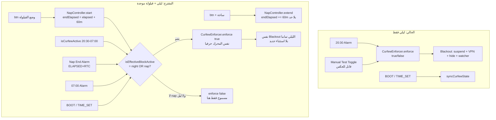

# Master Implementation Plan — وضع القيلولة Nap Mode (حظر تام 60د غير قابل للفك)

> **الحالة: خطة فقط — ZERO CODE. لن يُكتب أي كود مصدري حتى ترد بالاعتماد الصريح (`ابدأ` / `نفذ` / `Approved`).**
> **الفلسفة:** نفس قوة الحظر المسائي تماماً، ساعة غير قابلة للتقليل من داخل التطبيق، تمديد اختياري +60د، وقفل موحد بلا فجوات مع الحظر الليلي.

## 1. Executive Summary & Business Value (الملخص التنفيذي)

- **المشكلة:** التطبيق رائع في "الحفظ التام مساءً" (20:30→07:00)، لكن ثغرة عظيمة صباحاً: قيلولة والهاتف معك = انكشاف كامل. نظام الـ AI وحده غير كافٍ للاعتماد عليه.
- **الحل:** زر `وضع القيلولة` يفرض **نفس الحظر المسائي تماماً** (تعليق التطبيقات + Blackhole VPN + إخفاء المتاجر + مراقب الواجهة ForegroundWatcher) لمدة **60 دقيقة ثابتة**، **بلا زر إلغاء/تقليل داخل التطبيق نهائياً**، مع زر ثانٍ `+ ساعة` يمدد من نهاية المؤقت (غير محدود حسب إجابتك)، والتطبيقات المهمة المعفاة ليلاً تبقى تعمل بدون نت كما هي.
- **حالة التداخل الحرجة (سؤالك):** تفعيل القيلولة قبل الليلي بنصف ساعة (مثال 20:00→21:00 والليلي 20:30→07:00) → **قفل موحد متصل 20:00→07:00 بلا أي فجوة** عبر قاعدة `effectiveLock = max(napEnd, nightEnd)`. منبه انتهاء القيلولة 21:00 يُتجاهل لأن الليلي نشط.
- **القيمة:** إغلاق الثغرة الصباحية بأقل كود جديد (إعادة استخدام `CurfewEnforcer.enforce(true)`)، صفر Regression على الليلي، ومقاومة تحايل (تغيير الساعة، قتل التطبيق، إعادة التشغيل).

## 2. Ground Truth (نتائج الفحص الجراحي — Read-Only)

- **نافذة الليل:** `CurfewConfig` — `START 20:30 / END 07:00` بتوقيت `Asia/Riyadh`، و`CurfewEnforcer.isCurfewActive()` wall-clock يعبر منتصف الليل (`min >= 1230 || min < 420`).
- **الحالة الفعالة اليوم:** `isEffectiveCurfewActive = enabled && !emergencyExtension && (manualTest || isCurfewActive)` — و`enforce(activate)` هو محرك الحظر الكامل (تعليق `CurfewAppResolver.getCurfewTargetPackages` + إخفاء `OEM_APP_STORES + CURFEW_SEARCH_APPS` + `Always-On Blackhole VPN lockdown` + `CurfewForegroundWatcher.start` + حفظ `KEY_CURFEW_SUSPENDED_PACKAGES`). الفك `enforce(false)` يحرر VPN/المتاجر ويعيد التعليق ما عدا `AppSuspensionShield.isBlacklisted` (القاعدة الحديدية).
- **الحارس الأمني الحالي:** `enforce()` يرفض الفك ليلاً (`if (!activate && isCurfewActive && !emergency) return true`) — سنمدد نفس الحارس ليشمل القيلولة.
- **الجدولة:** `CurfewScheduler.scheduleNextAlarms` (exact + `AllowWhileIdle`, مسار S خاص بـ `canScheduleExactAlarms`) + `CurfewAlarmReceiver` يستقبل `START/END/BOOT_COMPLETED/MY_PACKAGE_REPLACED/TIME_SET/TIMEZONE_CHANGED` ويعيد `syncCurfewState + scheduleNextAlarms` دائماً (مضاد لانتحال البث).
- **الواجهة:** `MainViewBinder` يقفل زر التجربة ليلاً (`btn night_locked` معطل) ويفتحه نهاراً؛ `MainActivity` يمنع الفك الليلي من الزر + `onResume` يعيد `schedule + syncAsync`. زر `manualTest` **قابل للعكس** — لا يصلح للقيلولة.
- **الاختبارات:** `CurfewTest` يغطي النافذة عبر منتصف الليل، invariant رفض الفك ليلاً، وVPN/المتاجر — سنضيف `NapTest` بنفس الأسلوب دون كسر أي اختبار قائم.
- **الخارج (DuckDuckGo):** إجماع على `SystemClock.elapsedRealtime()` (monotonic, يشمل Deep Sleep) كأساس لقياس المدد ضد العبث بالساعة، مع `AlarmManager.ELAPSED_REALTIME_WAKEUP` + `RTC_WAKEUP` المزدوج، و`ForegroundService + BOOT receiver` للبقاء بعد القتل/الإقلاع.

## 3. Current vs Proposed (Mermaid)

**مثال التداخل:** قيلولة 20:00→21:00 + ليلي 20:30→07:00 → عند 21:00 `nap=false` لكن `night=true` → `U=نعم` → يبقى `enforce(true)` → قفل متصل حتى 07:00. لا كود خاص، فقط `OR`.

## 4. 3 Red-Teamed Failure Modes & Mitigations (الفشل المدروس)

1. **العبث بالساعة (تقديم/تأخير الوقت للهروب):** wall-clock وحدها تُكسر بتأخير الساعة. **المنع:** مصدر الحقيقة المزدوج — `endElapsed = SystemClock.elapsedRealtime() + 60m` (monotonic لا يتأثر بتغيير الساعة) + `endWallMs` احتياطي للـ reboot (حيث يتصفر elapsed). قاعدة fail-closed: القفل نشط إذا **أي** منهما يقول نشط (`elapsed < endElapsed || wall < endWall`). `TIME_SET/TIMEZONE_CHANGED` يعيد `sync + applyAll` فوراً كما يفعل الليلي اليوم.
2. **قتل التطبيق / إعادة التشغيل أثناء القيلولة (فك بالهروب):** `elapsedRealtime` يتصفر بعد reboot فيفقد المؤقت. **المنع:** تخزين دائم `SharedPreferences (antiporn_nap_prefs)`: `KEY_NAP_END_ELAPSED + KEY_NAP_END_WALL + KEY_NAP_ACTIVE`. `CurfewAlarmReceiver` يستقبل `BOOT_COMPLETED/MY_PACKAGE_REPLACED` → يستعيد الحالة من `endWallMs` ويعيد `enforce(true)` + يعيد جدولة منبه `ACTION_NAP_END` المزدوج. `handlePackageAdded` أثناء القفل يجمد المثبت الجديد فوراً (موجود ليلاً، يُورث مجاناً).
3. **فجوة السباق بين انتهاء القيلولة وبدء الليلي (ثوانٍ ينفتح فيها الهاتف):** مؤقتان منفصلان قد يتركان فجوة. **المنع:** لا قرار بالإطفاء من مؤقت واحد أبداً — كل مسار إطفاء (منبه القيلولة، زر، `sync`) يحسب `isEffectiveBlockActive()` الموحد أولاً، ولا ينادي `enforce(false)` إلا إذا `!nap && !night`. زائد هامش أمان: منبه القيلولة `ELAPSED_REALTIME_WAKEUP` **و** `RTC_WAKEUP` معاً + `CurfewForegroundWatcher` يبقى يعمل حتى يثبت `sync` أن الفك آمن. الاختبار `testNapOverlapWithNight_noGap` يثبتها.

## 5. Surgical File Diff Blueprint (مخطط التعديل الجراحي)

- **[NEW] `curfew/NapConfig.kt`:** ثوابت فقط — `PREFS_NAME="antiporn_nap_prefs"`, `KEY_NAP_END_ELAPSED`, `KEY_NAP_END_WALL_MS`, `KEY_NAP_ACTIVE`, `NAP_DURATION_MS=60*60*1000`, `EXTEND_STEP_MS=60*60*1000`, `ACTION_NAP_END="com.drmohammed.antiporn.ACTION_NAP_END"`. بلا منطق.
- **[NEW] `curfew/NapController.kt`:** (`object`, دوال pure قابلة للاختبار): `startNap(ctx)` → يرفض إذا ليلي نشط؟ لا — يسجل end حتى لو ليلي (للاتساق) وينادي `syncBlockState`؛ `extendNap(ctx)` → `end += 60m` (غير محدود)؛ `isNapActive(ctx)` → `elapsed<endElapsed || wall<endWall`؛ `clearIfExpired(ctx)`؛ `remainingMs(ctx)` للعد التنازلي. **لا زر cancel ولا `clearNap` عام** — الدالة الداخلية `private` فقط لمنبه الانتهاء بعد تحقق `!night`.
- **[MODIFY] `curfew/CurfewEnforcer.kt`:** إضافة `isEffectiveBlockActive(ctx) = isEffectiveCurfewActive(ctx) || NapController.isNapActive(ctx)` + `syncBlockState(ctx)` الجديد (يستدعي `enforce(shouldBeActive)`)؛ **تمديد الحارس الحديدي:** `if (!activate && (isCurfewActive(cal) || NapController.isNapActive(ctx)) && !emergency) return true`. `isEffectiveCurfewActive` الأصلية **تبقى كما هي** (لا كسر للاختبارات) — المسارات الجديدة تنادي الموحدة. `handlePackageAdded` يستخدم الموحدة.
- **[MODIFY] `curfew/CurfewScheduler.kt`:** إضافة `scheduleNapEndAlarm(ctx, endElapsed, endWall)` لمنبه مزدوج (`ELAPSED_REALTIME_WAKEUP` + `RTC_WAKEUP` بنفس `PendingIntent`/`REQUEST_CODE_NAP_END=3003`) + `cancelNapEndAlarm(ctx)`. `scheduleNextAlarms` تبقى لليلية فقط.
- **[MODIFY] `curfew/CurfewAlarmReceiver.kt`:** استقبال `ACTION_NAP_END` + `BOOT_COMPLETED/MY_PACKAGE_REPLACED` يعيد جدولة منبه القيلولة من `prefs` ثم `syncBlockState` (بدل `syncCurfewState` وحده) — مع إبقاء مسار الليلي كما هو.
- **[MODIFY] `ui/binder/MainViewBinder.kt` + `res/layout/activity_main.xml` + `res/values/strings.xml`:** بطاقة القيلولة: `btnNapStart (وضع القيلولة — ساعة)`, `btnNapExtend (+ ساعة)`, `tvNapCountdown (متبقٍ 42:10)`. القواعد: ليلي نشط → `btnNapStart` معطل (`نوم ليلي مفعّل`)؛ قيلولة نشطة → `btnNapStart` معطل، `btnNapExtend` ظاهر، **لا زر إلغاء إطلاقاً**؛ نهار بلا قيلولة → `btnNapStart` مفعّل و`btnNapExtend` مخفي. العد التنازلي يتحدث عبر `uiTicker` القائم (1s).
- **[MODIFY] `MainActivity.kt`:** مستمعا الزرين + تأكيد قبل البدء (`هل أنت متأكد؟ ساعة كاملة بلا فك`) + `SystemClock.elapsedRealtime()` لمنع النقر المزدوج (نفس نمط `lastAiToggleMs`)؛ زر البدء يستدعي `NapController.startNap + scheduleNapEndAlarm + syncBlockStateAsync`؛ زر التمديد يستدعي `extendNap + reschedule`.
- **[MODIFY] `AndroidManifest.xml`:** إضافة `ACTION_NAP_END` إلى `intent-filter` الخاص بـ `CurfewAlarmReceiver` (سطر واحد، لا receiver جديد).
- **[NEW] `app/src/test/.../curfew/NapTest.kt`:** اختبارات pure بلا DPM: `start_sets60m`, `extend_adds60m_unlimited`, `cannotShorten_noApiExists` (يثبت عدم وجود API تقليل عبر reflection)، `overlap_nap20to21_night2030_staysLocked`، `reboot_wallFallback_restores`، `daytime_expiry_releases`.
- **[KEEP — لا حذف/لا تغيير]:** `CurfewConfig` (النافذة 20:30-07:00)، `CurfewAppResolver` (نفس الأهداف والبيضاء)، `CurfewBlackholeVpnService`، `CurfewForegroundWatcher`، `AppSuspensionShield` blacklist، `EMERGENCY_WORK_EXTENSION` سلوكها كما هو.

## 6. Subagent Task Breakdown (بعد الاعتماد فقط — متوازية حيث أمكن)

| Role | Domain / Responsibilities | Supervision Gate |
|---|---|---|
| **nap-logic-specialist** | `NapConfig + NapController` (elapsed+wall مزدوج، start/extend/isActive/remaining، بلا cancel API) + `NapTest` | مراجعة: لا `System.currentTimeMillis` وحده، لا دالة تقليل/مسح عامة، fail-closed بـ OR |
| **enforce-integrator** | `CurfewEnforcer.isEffectiveBlockActive + syncBlockState + تمديد الحارس` + `CurfewScheduler.scheduleNapEndAlarm` + `CurfewAlarmReceiver (NAP_END/BOOT)` + `Manifest` سطر واحد | مراجعة: `isEffectiveCurfewActive` الأصلية لم تتغير، `enforce(false)` مستحيل أثناء nap/night، `REQUEST_CODE_NAP_END` فريد |
| **ui-specialist** | بطاقة القيلولة (زرّان + عدّاد) + strings عربية + `MainActivity` listeners + تأكيد البدء + ticker العد التنازلي | مراجعة: `GoogleFonts.cairo()`/الثيم القائم، `if (!mounted/isFinishing)`، لا زر إلغاء في أي layout، حالة ليل-نشط تعطّل زر القيلولة |
| **auditor (coderabbit-guard)** | تدقيق أمني + `assembleDebug` + `testDebugUnitTest --tests NapTest,CurfewTest` + سيناريوهات يدوية | بوابة: 0 errors، كل اختبارات `CurfewTest` القديمة خضراء، لا regression ليلي |

## 7. Verification & Testing Plan (خطة التحقق)

- **ستاتيكي:** `assembleDebug` + `./gradlew testDebugUnitTest --tests "com.drmohammed.antiporn.curfew.*"` — يجب: `NapTest` أخضر + `CurfewTest` كامل أخضر (لا كسر).
- **يدوي (جهاز حقيقي DeviceOwner):**
  1. نهاراً: اضغط `وضع القيلولة` → أكّد → حظر كامل فوري (تطبيقات معلقة + لا نت + المتاجر مخفية) + عدّاد `59:xx`.
  2. أثناء القيلولة: تحقق **لا يوجد** أي زر فك/تقليل؛ اضغط `+ ساعة` → العدّاد يقفز +60د؛ كرر مرتين → +120د.
  3. غيّر ساعة النظام +30د للأمام ثم -60د للخلف → القفل **يبقى** (elapsed هو الحكم).
  4. اقتل التطبيق من الأخيرة + أعد التشغيل → القفل **يبقى** ويُستعاد.
  5. التداخل: فعّل قيلولة 20:00 (أو اضبط ساعة الاختبار) وانتظر 20:30 → عند انتهاء القيلولة **لا ينفتح** الهاتف بل يستمر حتى 07:00.
  6. بعد انتهاء القيلولة نهاراً (اختبار بمدة قصيرة debug فقط؟ لا — الإنتاج 60د ثابتة): ينفك تلقائياً ويعود النت والتطبيقات ما عدا blacklist الدائم.
- **رجوع:** حذف `NapController` استدعاءاته يعيد الليلي وحده (الكود الليلي الأصلي لم يُمس بنيوياً).

## 8. ما أحتاجه منك الآن (بوابة الاعتماد 🚦)

1. **رد بكلمة واحدة:** `ابدأ` / `نفذ` / `Approved` للتنفيذ بالوكلاء الأربعة أعلاه، أو اطلب تعديل أي بند.
2. **تأكيدان أخيران (افتراضيهما = كما أجبت):** (أ) لا زر طوارئ/فك نهائياً — حتى `adb` لن يفك إلا بإعادة ضبط DeviceOwner (مقصود)؛ (ب) نص زر البدء يتضمن تحذير `ساعة كاملة بلا فك — متأكد؟`.
3. **ملاحظة:** مدة الساعة ثابتة بالإنتاج؛ أي مدة أقصر ستكون فقط في فرع debug محلي للاختبار ولن تشحن.

> **لن يُكتب أو يُعدل أي كود مصدري حتى ترد بالاعتماد.**
